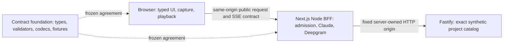

# Contract-first Parallel Implementation Plan Amendment for Epic #2

> **For agentic workers:** REQUIRED SUB-SKILL: Use superpowers:subagent-driven-development or superpowers:executing-plans to implement this amendment task-by-task. Steps use checkbox syntax. This additive amendment changes decomposition and scheduling only after sealed acceptance and root-owned canonical hydration; it grants no native parallel wave or lifecycle approval.

**Goal:** Deliver independent browser and BFF work against one executable public API agreement while retaining the separate Fastify service and every final system/live requirement.

**Architecture:** Preserve the accepted two-process Next.js Node BFF plus Fastify retrieval application. Extract one complete public-contract foundation from Tasks 2/3/4 and one complete capture-module package from Task 7. Browser components use explicit test-only controlled transports; BFF tests use real retrieval HTTP. Later system tests join the independently delivered components.

**Tech stack:** Node >=26; exact reproduction 26.8.1 / npm 12.0.2 / @types/node 26.6.5, all other accepted direct pins unchanged. Global ai-peer-review 0.4.1 runtime/MCP remains untouched.

**Spec:** [Accepted design](../specs/2026-10-12-voice-bff-reference-design.md). **Authority:** Historical specification bc6e15ecb2f48c9f3b0cc030609fd99a8f17adac, SHA-256 8512daa8c456af00628a16471d4b13526c7585172c223c8bfa0f2323bee4fff6; base plan docs/superpowers/plans/2026-10-12-2-voice-bff-reference.md, at accepted revision cb82f730f63ba0e0bd4480f7bc76ca09d286af83, SHA-256 5dc37eb3c25f59d056756b45582a584ea321ac3a881041992b073b5a3656523e; accepted Node26 amendment 3574e5d35ebaafbf427a68aeac7c66e409b1e4e0, SHA-256 0d478dc1a1a114b63c7ebd2bf151fa7e0e5b17ed33f4410c81a06ddc098cd939. Exact Task 1 / 2 / 3 / 4 / 5 / 7 sections and current native rank-wave policy/bindings/runtime were inspected.

## Preserved global requirements

Keep exactly two local processes; same-origin browser→BFF only; server-owned credentials/model/tools/retrieval origin; no Edge/extra gateway/general framework. Typed input 2,000 UTF-16 code units (JavaScript string length), measured turn body 2 MiB, WAV mono PCM16 / 16 kHz / 30 seconds. Completed history four whole pairs/eight messages/16,000 JS-string characters, never partial-turn history. Turn/retrieval/speech deadlines 60 / 5 / 20 seconds, two upstream-held slots per request kind, no paid replay or automatic 429 retry. Model 3 rounds / 4 custom attempts / 1,024 output tokens; hosted search 2 uses shared across continuations, exact web_search_20250305. Speech mono PCM16 little-endian at 24 kHz, segment min(120,floor(6*CPS)), CPS 14 gives 84 characters, backlog 2,400 characters, audio high/low 10 / 2 seconds and stalled playback 3 seconds. Preserve safe Markdown/HTTP(S), exact VAD timing/cleanup patch, all 15 spec cases and actual final live evidence. No API credentials or live model selection is needed for these offline contract/component deliveries.

## Review Focus

1. Producer and consumer disagree about the first sequence or terminal text: CONTRACT pins valid/invalid traces; #5 producer and #6 consumer prove conformance.
2. A client test double accidentally becomes a production fallback: #6 tests intercept only test harness transport; #11 joins actual HTTP processes without turn interception.
3. Shared validation imports a secret-bearing config or provider SDK: CONTRACT checks transitive public-module imports and browser build; server config stays server-only.
4. Capture initialization or inference settles after Stop: CAPTURE-MODULE exercises the actual patched public destroy path; #9 proves real browser resource cleanup.
5. A rank member reports a module checkpoint as complete before shared wiring: controller enforces whole-story entry/completion graph, especially #7; independent checks never waive Test/Review/Close.

## Exact runtime and dependency pins

Node floor >=26; .nvmrc 26.8.1; npm 12.0.2; packageManager npm@12.0.2; @types/node 26.6.5. Keep engine-strict=true and save-exact=true. Preserve TypeScript 5.9.3, tsx 4.20.6, Vitest 4.0.18, ESLint 9.39.1, eslint-config-next 16.4.0, Prettier 3.9.10, jsdom 26.1.0, @testing-library/react 16.3.3, Playwright 1.64.0, @types/react 19.3.0 and @types/react-dom 19.3.0. Web: Next 16.4.0, React/React DOM 19.3.0, react-markdown 10.1.0, @anthropic-ai/sdk 0.133.0, @deepgram/sdk 5.15.0, @ricky0123/vad-web 0.0.31 and onnxruntime-web 1.30.0. Retrieval: Fastify 5.12.5 and Ajv 8.17.1. CAPTURE-MODULE alone adds patch-package 8.0.1 with postinstall patch-package --error-on-fail. Preserve the existing local AITM tarball and global local APR 0.4.1 installation/Node26 runtime/MCP. No package installation is authorized by authoring this amendment.

Clean reproduction explicitly selects Node26.8.1, installs npm@12.0.2 if absent, checks versions with delivered scripts/verify-toolchain.mjs, then npm ci. Node26.8.1 is the selected Current release, not an inherited Node24 LTS claim. CI and README retain the accepted Node26 amendment ordering. A later major meets the floor but is tested only if actually exercised.

## Verified current status

Fastify/workspace #3 is implemented. Current issue read shows OPEN, last-known Test, rank 2; remaining review/approval/integration/Close gates are not complete. It is neither an ongoing implementation track nor strict Done. Do not invent retrieval work to claim three concurrent tracks.

Current live field ranks: #4=3; #5=4; #6=5; #7=4; #8=7; #9=7; #10=9; #11=10. The clean authoring-time checkout was c5c94f4 and had no application interface source; exact APIs below come from accepted plan, not invented existing code. Implementers must use the actual reviewed #3 integrated source base.

The amendment author is genuinely bound as issue #2 orchestrator in native session 01a135ad-c1bc-7492-9e5f-be69bf8257f4, branch codex/2-draft. This is planning collateral only. The actual canonical child state can change during review; root revalidates it before scheduling. No new source implementation is claimed here.

## Runtime tracks and ownership



Browser and BFF are independent implementation tracks after agreeing the public API. Fastify is the already implemented third runtime boundary and is reused. Native provider/tool/config state stays server-owned. Final joined tests connect all three runtime boundaries.

## Smallest complete graph

Create exactly TWO new governed child stories, symbolically CONTRACT and CAPTURE-MODULE until canonical creation assigns real numeric IDs. CONTRACT is a complete executable public agreement delivery. CAPTURE-MODULE is a complete independently reviewable library/patch/assets delivery. Narrow existing scopes explicitly; do not close a partial phase of an unchanged original story.

| Delivery | Proposed rank | Required reviewed/integrated/strict-Done entry | Full completion |
|---|---:|---|---|
| #3 Fastify/workspace | 2 unchanged | None | Existing complete delivery/gates |
| CONTRACT new issue, ID not assigned | 3 | #3 | Public types/validators/history/SSE/docs/fixtures/conformance |
| #4 BFF admission | 4, was 3 | CONTRACT | Server config/body/admission/leases/deadlines/build/capabilities |
| #6 typed browser client | 4, was 5 | CONTRACT | Generation/history/rendering/transport and honest client-contract browser acceptance |
| CAPTURE-MODULE new issue, ID not assigned | 4 | CONTRACT | WAV/VAD/capture/patch/assets module checks |
| #5 Claude/tools | 4 unchanged | #4 | Complete typed model/tool/retrieval HTTP/SSE producer integration |
| #7 Deepgram | 4 unchanged | #4 independent adapter/endpoint; #5 before shared wiring/full completion | Same owner completes all #7 integration, no partial-story Done |
| #8 PCM/playback/queue | 5, was 7 | Full #6 and #7 | Full speech client plus Conversation/controller wiring |
| #9 capture browser wiring | 6, was 7 | CAPTURE-MODULE and #8 | Full automatic Start/Stop/mutes/browser/assets acceptance |
| #10 interruption | 7, was 9 | #8 and #9 | Original full race/interruption/browser behavior |
| #11 system/live/tutorial | 8, was 10 | #3, CONTRACT, CAPTURE-MODULE and #4–#10 | Original final evidence plus joined typed-system browser tests |

After CONTRACT, three genuinely ready disjoint tracks are #4 server admission, #6 browser typed UI and CAPTURE-MODULE browser internals. After #4, #5 and #7 server modules can overlap browser work, while #7 waits #5 before shared-file wiring. Fastify is the delivered boundary reused by them.

Rank 4 requires ONE explicit rank-level grant whose exact membership is #4 / #5 / #6 / #7 / the real CAPTURE-MODULE number. Internal native DAG edges remain. Root bounds active workers by available slots while preparing genuine native identities/occupancy for all members; no manufactured sessions or duplicate bindings. Assigning #4/#5/#6 successive ranks would serialize their overlap under current strict lower-rank rule. Later ranks 5 → 6 → 7 → 8 deliberately serialize shared Conversation wiring.

Native epic-rank-wave-policy.mjs requires EVERY lower-rank child: board Done, issue closed, closeReason completed, no childEvidenceError, recoveryPhase null/complete. Ungranted operation is sequential. Granted operation requires frozen graph including ranks/dependencies/refinement digests, exact membership of ALL children of that rank, genuine bindings and each target’s current refinement and dependencyReadiness ready. Any other-rank active child refuses. Occupancy must match provider/session/worktree/generation; physical branch/common-directory and native transcript identity are independently verified. A paused Ready-for-Planning peer may retain genuine occupancy for preparation; the target still needs active exact bind. Verified supervisor discharge handles Test/Review handoffs; closed identities are retained historical evidence, never fabricated occupancy.

New stories/scopes/ranks/digests are not yet authoritative and the root has not recorded a grant. Root must review/pin the amendment, create real issues through canonical create-issue, update authorities/refinement/dependencies through sanctioned actions and record/revalidate a native grant. Refusal means hold source; do not bypass or send technical/rank choices to the user.

## Executable API agreement

CONTRACT owns apps/web/shared/contracts.ts, validation.ts, history.ts and sse.ts, scripts/contract-digest.mjs, scripts/contract-digest.d.mts and tests/contracts/contract-digest.test.ts. It also owns apps/web/client/contract-probe.tsx plus the temporary starter app/page.tsx import for actual browser bundle compilation; #6 replaces that starter page after foundation delivery. New proposed artifacts: docs/contracts/voice-bff-v1.md, tests/helpers/wire-contract-fixtures.ts, tests/contracts/wire-contracts.test.ts, public-validation.test.ts, public-history.test.ts; tests/contracts/sse.test.ts moves from #5. Agreement records schemaVersion 1, exact limits/errors/headers/framing/sequence/terminal semantics and trace fixtures. Production modules/types and executable conformance—not prose alone—are consumer authority.

Exact accepted types:
```ts
type ProjectRecord = { id:string;name:string;status:'active'|'paused'|'complete';ownerTeam:string;openItems:number;summary:string };
type ProjectCatalog = { schemaVersion:1;source:'synthetic-project-catalog';records:ProjectRecord[] };
type HistoryMessage = { role:'user'|'assistant';content:string };
type TurnInput = {turnId:string;history:HistoryMessage[]} &
 ({kind:'text';text:string}|{kind:'audio';wav:Uint8Array});
type SpeechInput = {turnId:string;segmentId:string;text:string};
type Source = {title:string;url:string;citedText?:string};
type Usage = {inputTokens?:number;outputTokens?:number;searchUses?:number};
type AppErrorFields = {code:string;message:string;turnId:string|null;retryable:boolean};
type TurnStatus = 'complete'|'interrupted'|'failed'|'truncated'|'no-speech';
type EventPayloads = {
 'turn.accepted':{mode:'live'|'mock'};
 'transcript.final':{text:string};
 stage:{stage:'transcribing'|'researching'|'retrieving'|'answering'};
 'tool.started':{name:'lookup_projects';summary:string};
 'tool.completed':{result:ProjectCatalog};
 'answer.delta':{text:string};
 sources:{sources:Source[]};
 'turn.completed':{text:string;status:'complete'|'truncated'|'no-speech';usage?:Usage};
 'turn.failed':AppErrorFields;
};
type TurnEvent = {[K in keyof EventPayloads]:{
 schemaVersion:1;turnId:string;seq:number;type:K;data:EventPayloads[K]
}}[keyof EventPayloads];
type Capabilities = {
 schemaVersion:1;mode:'live'|'mock';model:string|null;sttModel:string|null;ttsModel:string|null;
 build:{mode:'production'|'development';buildId:string|null};
 turnsAvailable:boolean;speechAvailable:boolean;
 search:{state:'disabled'|'unavailable'|'configured'|'verified';reason:string|null;accountValidation:'pending'|'verified'|'unavailable'};
 speech:{segmentChars:number;backlogChars:2400;highWaterSeconds:10;lowWaterSeconds:2};
};
```

Accepted exports: parseTurn(bytes:Uint8Array,contentType:string):Promise<TurnInput>; validateSpeech(value:unknown,cap:number):SpeechInput; validateHistory(value:unknown):HistoryMessage[]; encodeSse(event:TurnEvent):Uint8Array; decodeSse(bytes:AsyncIterable<Uint8Array>):AsyncIterable<TurnEvent>. Parse bounded bytes only; reject duplicate/extra fields, invalid UUID, both/neither input, >2000chars, invalid RIFF length/chunk/padding/PCM 1 / channel 1 / 16,000 Hz / 16 bits / blockAlign 2 / byteRate 32,000 / more than 480,000 samples. Valid empty PCM maps later to no-speech without model. History validation rejects unpaired/nonstring/>8 messages / >16,000 characters input; never silently trims inbound.

Public interface allocations and explicit additions:
- Export AppError from shared/contracts.ts with constructor(httpStatus:number,code:string,message:string,turnId:string|null,retryable:boolean), matching the accepted common class so shared validation avoids server imports. #4 http/errors.ts normalizes/re-exports it; no competing class.
- Export retainPairs(input:ReadonlyArray<readonly [HistoryMessage,HistoryMessage]>):{pairs:Array<[HistoryMessage,HistoryMessage]>;omitted:boolean}, preserves accepted Task 4 behavior for valid store input and strengthens arbitrary public input: clone, omit oversized newest pair, then always drop whole oldest pairs until four pairs / 16,000 characters. #6 keeps current-generation atomic completion in HistoryStore.
- Initial seq convention was unpinned in historical text. This amendment explicitly defines seq 0 for turn.accepted and strict +1 thereafter. The reviewed agreement, producer and consumer conformance tests pin this additive choice; it is not represented as an already implemented convention.

Shared code cannot import server provider/runtime/credential-bearing config. ServerConfig remains #4 server/config.ts, with exact accepted mode/allowlists/keys/models/retrieval/search/CPS/segment/deadline fields. BFF parse/admission/deadline/lease APIs remain accepted assertAdmission(headers,config,requireOrigin):void, readBoundedBody(req,cap,signal):Promise<Uint8Array>, acquireLease(kind):{release():void}, runWithDeadline(ms,caller,work):{result,settled,signal}, deadlineRemainingMs(signal):number, getRuntime():process singleton. Timeout-facing result is never lease-settlement evidence.

Codec incrementally validates discriminated event/data/turn/sequence across UTF8/CRLF/multiline/terminators/trailing frame. Proposed protocol requires one accepted event and at most one terminal/no post-terminal append. #6 consumer additionally checks completed.text equals accumulated literal deltas. #5’s accepted joining invariant remains: one accumulator appends each delta once, no separator within round, later first nonempty text inserts standalone two-newline iff prior text exists without trailing whitespace, final native text never appended again. Truncation is visibly terminal but cannot establish history.

Endpoints:
- POST /api/turn: configured Origin+matching allowed Host before body; measured 2 MiB multipart fields turnId, history and exactly text or audio; fetch-readable text/event-stream, Cache-Control:no-cache,no-transform. No EventSource.
- POST /api/speech: same admission; measured 8 KiB JSON SpeechInput; segmentId nonempty<=80, text nonempty <= effective cap<=120; application/octet-stream plus X-Audio-Encoding:pcm_s16le, X-Audio-Sample-Rate:24000, X-Audio-Channels:1; no-store.
- GET /api/capabilities: allowed Host only, JSON/no-store, no secrets.
- Existing retrieval GET /health→{status:'ok'}, GET /v1/projects[?name]→validated ProjectCatalog; optional name nonempty <=200 / case-insensitive exact, malformed / repeated / unknown query returns 400, unmatched valid name returns empty. No browser direct call or BFF fixture fallback.

Common pre-stream JSON {error:{code,message,turnId,retryable}}; accepted 400 / 403 / 413 / 429 / 502 / 504; pre-body turnId null; accepted-SSE errors one turn.failed then close. Preserve all accepted stable server/client codes and sanitized fields, not provider raw events/headers/thinking.

## Client/module evidence versus system evidence

wire-contract-fixtures.ts contains immutable normative simulated traces, exact Atlas record/summary from Task 1 (“Synthetic active project owned by North with three open items.”), mode mock capabilities with search unavailable/accountValidation unavailable and malformed variants. Preamble/separator/answer trace is labeled Mock/Contract Simulation, never a provider/live observation.

#6 tests consume this fixture instead of not-yet-delivered #5 helper. Controlled fetch yields split SSE chunks and deferred terminal; production startTurn still calls /api/turn. Real Next page/components run with explicit test-harness interception; no fake production route/fallback/provider claim. This proves client parsing, rendering, generations, history and errors against agreement.

#5 keeps tests/helpers/scripted-providers.ts for complete native Anthropic messages/rounds and real createRetrievalClient HTTP deps. Emit real runTurn/producer events, decode foundation codec, assert full normalized type/data trace equals normative fixture (and separately verify the delta trace). Preserve multiRoundDeltaFixture export as actual observed sequence or compatible re-export plus equality assertion. #6/#8 no longer depend on that unavailable helper. #5 alone claims full typed server path after actual Fastify HTTP integration.

#11 adds tests/browser/typed-system.spec.ts: actual Next BFF plus actual Fastify and explicit deterministic providers, no turn interception. Recheck incremental text/HTTP project provenance/exact text/history/search-unavailable ordinary use/visible retrieval failure/no fallback/Busy deliberate recovery. Original #6 full system browser acceptance is explicitly transferred here, not falsely passed by controlled components. Full mock-system evidence remains distinct from original real live-provider/browser acceptance.

## Exclusive files and source changes

| Owner | Exclusive files/changes |
|---|---|
| CONTRACT | shared contracts/validation/history/SSE, agreement/fixture/public tests, client/contract-probe.tsx and starter app/page.tsx compile import; no server config/runtime/providers |
| #4 | server config/build-info/http admission/body/errors/leases/deadline/capabilities/runtime/capabilities route/.env.example; admission/config/build/lease/slow deadline tests; new body.test.ts separates measured-body tests |
| #6 | client turn-controller/turn-stream/history; Conversation/Answer/ProjectCard/Details/Capabilities/globals/page/layout; UI/history/controller/links/typed.spec.ts/playwrightconfig |
| CAPTURE-MODULE | voice wav/vad-adapter/capture-session; copy-vad-assets script/exact VAD patch; root package/lock, patch-package 8.0.1 postinstall / web predev-prebuild; wav/capture-module/vad-lifecycle/assets tests; no Conversation/controller/browser harness |
| #5 | server providers ModelAdapter/Claude/mock/tools/run-turn/SSEresponse/turnroute, runtime/capabilities after #4; scripted helper/typed integration/search/disconnect; consumes shared SSE |
| #7 | deepgram.ts SpeechAdapter/speechroute/distinct provider and endpoint tests; same-owner mock/runtime/run-turn/capability/audio integration wiring only after #5 |
| #8 | PCM/playback/speech-text/queue and Conversation/controller only after full #6 / #7 |
| #9 | capture Conversation/controller/browser harness/capture.spec.ts after #8; imports module instead of reowning patch/package/library |
| #10/#11 | Existing scopes; #11 additionally owns joined typed-system test and final contract provenance |

Required accepted authority edits before launch:
1. #2 plan mapping, new task intents, graph/ranks, AC/test ownership and epic trail gain both real new issues, preserving all original behaviors.
2. #4 removes public / pure contracts/validation/history to CONTRACT, consumes it; retains complete admission/body/deadline/lease/config/metadata. Combined input.test split into foundation public tests and #4 body.test; residual full criteria must pass.
3. #5 moves shared SSE implementation/test to CONTRACT; keeps producer/model/tool/search/retrieval/text/disconnect invariants and complete typed integration; imports/exercises fixture/codec. Still enters after full #4.
4. #6 blocker changes #5→CONTRACT, fixture dependency changes to foundation; Scope/AC explicitly separate client-contract acceptance from full system browser test moved #11. All client safeguards retained.
5. #7 retains #4 entry and #5 final serialized-wiring gate/same owner / no partial Done.
6. #9 extracts complete library/patch/assets to CAPTURE-MODULE; retains all full automatic gesture/start/stop/mute/browser acceptance after #8. Actual pinned VAD/ORT HTTP 200 / MIME / load browser smoke stays #9.
7. #8 consumes canonical fixture/waits full #6 / #7; #10 semantic dependencies remain; #11 adds two new children/full system test. Refresh scopes/source bindings / refinement / forecasts / ranks / dependency edges through registered procedures. Prior approvals/refinement receipts become stale, never reused.

Root/package-lock ownership moves from #9 early phase to CAPTURE-MODULE; no concurrent manifest edits by other tracks. Missing dependency requests go root for serialization. Distinct tests prevent source collisions. Foundation modules/fixture remain frozen consumer inputs; incompatible change needs reviewed amendment and coordinated revalidation.


### Collision-sensitive exact path index

These exact repository paths override abbreviated ownership prose. All other tests/files retain their detailed task owner; new source sharing requires serialized root coordination.

| Delivery | Collision-sensitive exclusive paths |
|---|---|
| CONTRACT | apps/web/shared/contracts.ts; apps/web/shared/validation.ts; apps/web/shared/history.ts; apps/web/shared/sse.ts; apps/web/client/contract-probe.tsx; apps/web/app/page.tsx starter only; scripts/contract-digest.mjs; scripts/contract-digest.d.mts; tests/helpers/wire-contract-fixtures.ts; tests/contracts/sse.test.ts; tests/contracts/contract-digest.test.ts |
| #4 | apps/web/server/config.ts; apps/web/server/build-info.ts; apps/web/server/http/admission.ts; apps/web/server/http/body.ts; apps/web/server/http/errors.ts; apps/web/server/turns/leases.ts; apps/web/server/turns/deadline.ts; apps/web/server/runtime.ts; apps/web/server/capabilities.ts; apps/web/app/api/capabilities/route.ts; apps/web/.env.example |
| #5 after #4 | apps/web/server/providers/contracts.ts; apps/web/server/providers/claude.ts; apps/web/server/providers/mock.ts; apps/web/server/turns/run-turn.ts; apps/web/server/runtime.ts; apps/web/server/capabilities.ts; apps/web/server/http/sse-response.ts; apps/web/app/api/turn/route.ts; apps/web/server/tools/lookup-projects.ts; apps/web/server/tools/retrieval-client.ts; tests/helpers/scripted-providers.ts |
| #7 independent then same-owner after #5 | apps/web/server/providers/deepgram.ts; apps/web/app/api/speech/route.ts independently; apps/web/server/providers/mock.ts; apps/web/server/runtime.ts; apps/web/server/capabilities.ts; apps/web/server/turns/run-turn.ts only after #5 |
| #6 after CONTRACT | apps/web/client/turn-controller.ts; apps/web/client/turn-stream.ts; apps/web/client/history.ts; apps/web/components/Conversation.tsx; apps/web/app/page.tsx; apps/web/app/layout.tsx; playwright.config.ts; tests/browser/typed.spec.ts; removal of apps/web/client/contract-probe.tsx |
| CAPTURE-MODULE | apps/web/client/voice/wav.ts; apps/web/client/voice/vad-adapter.ts; apps/web/client/voice/capture-session.ts; scripts/copy-vad-assets.mjs; patches/@ricky0123+vad-web+0.0.31.patch; package.json; package-lock.json; apps/web/package.json; tests/voice/wav.test.ts; tests/voice/capture-module.test.ts; tests/voice/vad-lifecycle.test.ts; tests/contracts/assets.test.ts |
| #8 → #9 → #10 serialized | apps/web/components/Conversation.tsx; apps/web/client/turn-controller.ts; new test harness tests/browser/voice-harness.ts (created by #6) are transferred only after each full predecessor integrates. #10 may change capture-session.ts only through serialized compatibility review with module tests rerun; #9 imports it unchanged. |
| #11 | tests/browser/typed-system.spec.ts plus final original docs/evidence/verifier/CI scope; no ownership of shared contract source during independent rank4 work |


## Capture module as a complete new story

Preserve accepted encodeWav(samples:Float32Array):Blob; CaptureToken={epoch,utteranceId,intentVersion}; exact VadCallbacks rawStart/confirmedStart/misfire/end/frame; createVad(context,acquireStream,stopStream,callbacks)→start/pause/destroy promises; CaptureSession start/mute/unmute/stop/invalidateIntent owns epoch/streams/callercontext/pending initialization. Inject valid-end WAV callback; module knows no Conversation / playback / BFF / provider and creates no second turn controller.

Module criteria: exact WAV clipping / header / 16 kHz / little-endian / 30-second limits checked against foundation parseTurn; no submission on misfire/obsolete/overlong; fresh usable stream resume; stop pending permission / model / worklet / start and admitted frame; real patched MicVAD public destroy / session / tensor release exactly once, no activation after cancel, visible cleanup failures; marker PLUS patch/package digests; pinned local VAD/ORT asset manifest / clean install / build regeneration. Controlled browser-node/ORT boundaries label simulation. Actual browser gesture dual context and HTTP asset / load / microphone / automatic turn acceptance remains #9 / #10 / #11. This extracted issue completes all its reviewed module criteria; original #9 does not close early.

## Executable verification strategy

Every code step follows failing behavioral test → observe expected missing behavior → minimal code → observe green. Import/setup failures are not intended red. No absent/future suite is empty-pass evidence.

CONTRACT:
```sh
npx vitest run tests/contracts/wire-contracts.test.ts tests/contracts/public-validation.test.ts tests/contracts/public-history.test.ts tests/contracts/sse.test.ts tests/contracts/contract-digest.test.ts
node scripts/contract-digest.mjs
npm run typecheck
npm run build
npm run lint
npm run format:check
```
Exact limits / fields / WAV / history / schema, every UTF-8 byte / CRLF / multiline / trailing frame split, invalid turn / seq / data, literal trace and transitive browser-import boundaries. Type / docs / fixture alignment is separately reviewed.

#4:
```sh
npx vitest run tests/contracts/admission.test.ts tests/contracts/body.test.ts tests/contracts/leases.test.ts tests/contracts/config.test.ts tests/contracts/build-info.test.ts
npm run test:slow
npm run typecheck
```
Zero body/upstream reads on rejected origins; counted chunked body / cancel, third-slot rejection / settled deferred retention, provider ignoring cancellation, stalled body deadline, sanitized capabilities.

#6 keeps npm test, dedicated history/controller/links, browser --grep typed and typecheck. Actual UI with controlled transport proves first delta before deferred terminal, stale generation / duplicate seq / final mismatch excluded, partial/no-speech never enters history, safe links, Busy deliberate retry/no replay. No real retrieval / provider assertion in component acceptance.

CAPTURE-MODULE:
```sh
npm run assets:vad
npx vitest run tests/voice/wav.test.ts tests/voice/capture-module.test.ts tests/voice/vad-lifecycle.test.ts tests/contracts/assets.test.ts
npm run typecheck
npm run build
```
Actual patched library lifecycle / ORT release boundaries rather than fake destroy; WAV conformance; package patch / asset generation / module types. Browser asset/device acceptance retained later.

#5 retains all actual Fastify HTTP typed/search/disconnect/typecheck/fullsuite/lint/format checks plus consumed SSE regression; #7 full provider / endpoints / audio integration; #8/#9/#10 own complete checks. Parent reruns full owning and impacted combined delivered suites after each integration. #11 runs every original root VC / epic trail with both new children / typed-system / browser / live record validation.

All 15 spec cases remain assigned:1/11/13 #5 native orchestration/search;2 #3 exact retrieval;3 CONTRACT SSE plus #8 PCM;4/14/15 #6 client guards joined by#10/#11;5/8 CAPTURE-MODULE lifecycle joined by #9 browser;6/10 #8 early speech / backpressure joined in final system;7 #5/#7 distinct failures with #11 UI;9 #4/#7admission;12 #10 misfire / interruption with real latency;15 #4/#5/#7/#10 actual settlement and final browser concurrency. Mock evidence never substitutes for live account / omitted-tool / microphone / audio / echo / latency acceptance.

## Handoff and limitations

Two extra complete stories are sufficient: CONTRACT removes browser → Claude source dependency; CAPTURE-MODULE removes browser library → playback dependency while preserving whole-story gates. More adapter/wiring splits are unnecessary; unchanged #7 legitimately remains incomplete until same-owner wiring. No reduced product baseline is proposed.

Root pins the accepted tracked amendment and owns canonical hydration, refinement, native grant and the accepted integrated source base before execution. Draft bytes have no scheduling authority. Existing #5 implementation ownership remains unchanged until canonical reconciliation. Reestimate extracted/residual tasks from exact accepted scopes; do not add extracted hours atop original tasks or promise parallelism saves total effort. Existing 41 hours / range 29–61 hours is the old planning baseline; coordination / system test transfer / renewed review may change forecast. Current #5 L / 5.5 hours remains until sanctioned refinement.

The controller manages technical/rank scheduling and reports concrete machine refusals. Source fanout remains unlaunched until its current native scope is authorized; generic parallel intent is not a machine grant.


### New-story intent drafts

CONTRACT: Beneficiary: developer implementing the browser or BFF. Capability: implement both sides against shared validated requests, normalized events and executable traces. Need: independently developed endpoints and consumers can drift in fields, framing, text and terminal semantics. Value: compatible components compose without hiding malformed inputs, stale results or false completion.

CAPTURE-MODULE: Beneficiary: person using hands-free capture. Capability: produce bounded valid utterances and stop capture resources reliably through the pinned VAD package. Need: pending permission, model initialization and inference can outlive Stop, while malformed WAV or unbounded capture prevents safe automatic submission. Value: downstream browser wiring receives attributable utterances and cancellation cannot leave microphone/model resources active.

If installed native dependencies cannot represent #7 independent entry separately from its final #5 wiring gate, hold the whole #7 until #5 strict Done. Browser #6 and CAPTURE-MODULE remain genuinely independent, so that limitation does not justify removing a blocker or partial completion.


## Complete normative event agreement and decoder signals

The following definitions are part of CONTRACT's frozen public agreement, not future ad hoc producer choices.

### Full Atlas fixture and producer ordering

The deterministic typed Atlas fixture contains no transcript.final and no sources event (there are no public citations). Its complete event sequence and data are:

```ts
const atlasCatalog:ProjectCatalog={schemaVersion:1,source:'synthetic-project-catalog',records:[
  {id:'atlas',name:'Atlas',status:'active',ownerTeam:'North',openItems:3,
   summary:'Synthetic active project owned by North with three open items.'}
]};
const wireTurnId='11111111-1111-4111-8111-111111111111';
const payloads:Array<{type:keyof EventPayloads;data:EventPayloads[keyof EventPayloads]}>=[
  {type:'turn.accepted',data:{mode:'mock'}},
  {type:'stage',data:{stage:'researching'}},
  {type:'answer.delta',data:{text:'Let me check Atlas.'}},
  {type:'tool.started',data:{name:'lookup_projects',summary:'Lookup Atlas'}},
  {type:'stage',data:{stage:'retrieving'}},
  {type:'tool.completed',data:{result:atlasCatalog}},
  {type:'stage',data:{stage:'answering'}},
  {type:'answer.delta',data:{text:'\n\n'}},
  {type:'answer.delta',data:{text:'Atlas is active, owned by North, with 3 open items.'}},
  {type:'turn.completed',data:{
    text:'Let me check Atlas.\n\nAtlas is active, owned by North, with 3 open items.',
    status:'complete',usage:{inputTokens:20,outputTokens:30,searchUses:0}
  }}
];
// Construct the union through validateTurnEvent, not an unsafe union cast:
const wireEvents:readonly TurnEvent[]=payloads.map((payload,seq)=>
  validateTurnEvent({schemaVersion:1,turnId:wireTurnId,seq,...payload}));
```

ScriptedModel round1 and round2 each have fixed native usage10 input/15 output tokens and zero search uses, yielding complete usage20/30/0. This is deterministic simulated usage, never paid usage evidence. #5 normalizes only its generated UUID to wireTurnId and requires full (type,data) equality, not just deltas. The producer emits the exact 'Lookup Atlas' summary and stage order above in that conformance case. Producer round-native tool_use identity still independently equals tool-atlas-1 in next matching result.

General ordering grammar, recorded in docs/contracts/voice-bff-v1.md and tested in sse.test.ts:
- Exactly one accepted at seq0; final successful stream has exactly one completed or failed; no event after terminal; seq+1 and one UUID throughout.
- Optional stage:transcribing occurs only for audio before optional transcript.final. A nonempty successful audio transcription emits exactly one transcript.final before model answer/tool work. No-speech ends completed{status:'no-speech',text:''} without model/tool/delta/source work.
- Stage:researching/answering may repeat or be omitted between nonterminal answer/tool/source events; stages are status hints, never required before rendering text. Stage:retrieving, when emitted, occurs after corresponding tool.started and before its tool.completed or failed terminal.
- A public tool.started means a validated lookup is now being dispatched, never merely a model-requested attempt. Invalid/unknown/additional-property arguments count toward the four-attempt cap and return a matching native is_error:true tool_result to the model, with zero retrieval calls and no public tool.started/tool.completed/retrieving event. The model may continue answering or request another valid lookup. A dispatched valid lookup emits tool.started then optional stage:retrieving then tool.completed with validated ProjectCatalog. Operations are serialized, one lookup at a time; no new tool or answer/source event while that dispatch is pending. Unavailable retrieval or malformed response after dispatch ends the turn with exactly one turn.failed whose code is RETRIEVAL_UNAVAILABLE (httpStatus502 before stream, retryable:false); it may leave the dispatched lookup pending, never fabricates tool.completed, sends a continuing native error or falls back to a local fixture. Preexisting partial text remains visible/incomplete and excluded from history. Sources are optional validated source snapshots and may interleave with answer.delta while answering; source rendering must not depend on a final-only placement.
- Answer deltas append literally; completed text must equal their concatenation except no-speech's empty string. Truncated text also equals accumulated deltas and is not history-ready. Usage is optional in general, present exactly as above in this fixture; missing usage is never invented.
- Clients accept all grammar-permitted stage/source placements and zero-tool ordinary answers. #6 exercises at least a second permitted trace with repeated researching/answering hints and sources interleaved between deltas, plus a no-tool answer and no-speech trace. These variants live only in #6-owned tests/ui/conversation.test.tsx and tests/contracts/turn-controller.test.ts; assertTurnSequence validates each. #6 never edits the frozen hashed tests/helpers/wire-contract-fixtures.ts after delivery. The normative Atlas equality test does not imply every valid turn has that shape.

CONTRACT exports assertTurnSequence(events:ReadonlyArray<TurnEvent>):void from sse.ts for complete collected-stream conformance. It throws the same INVALID_STREAM error for grammar violations; decodeSse enforces the grammar incrementally. Producer and consumer tests each call it; neither may validate only their own hand-built shape.

### Stable decoder errors

Export from shared/sse.ts:

```ts
export type SseDecodeCode='STREAM_DISCONNECTED'|'INVALID_STREAM';
export class SseDecodeError extends Error {
  constructor(readonly code:SseDecodeCode,message:string,options?:ErrorOptions) {
    super(message,options); this.name='SseDecodeError';
  }
}
```

The code is the public machine contract; message text/cause is diagnostic and clients do not pattern-match it. STREAM_DISCONNECTED and INVALID_STREAM are stable client-only reasons added to the common list. They never become an automatic reconnect or paid replay.
- EOF before terminal, empty stream, transport read rejection or EOF mid-JSON in an unterminated final frame throws STREAM_DISCONNECTED.
- A complete, syntactically valid unterminated terminal frame is validated and accepted; complete nonterminal at EOF is yielded then STREAM_DISCONNECTED; syntactically valid JSON with invalid envelope/schema/sequence/grammar at EOF throws INVALID_STREAM.
- A blank-line-terminated frame with invalid JSON, schema/data, seq gap/duplicate, mixed ID, event before accepted, duplicate accepted, invalid tool/stage ordering or post-terminal data throws INVALID_STREAM. Unparseable JSON without a final frame delimiter is classified as interrupted transport (STREAM_DISCONNECTED), including a partial turn.failed; it is never invented as a terminal event.
- Consumer-requested abort preserves AbortError from its caller rather than showing an obsolete current error; current-generation checks still suppress callbacks. Unexpected upstream iterator failure before terminal is wrapped as STREAM_DISCONNECTED with cause.

CONTRACT tests additionally pin two valid tool-attempt traces: (1) argument-rejected native continuation has accepted/stage:researching/answer.delta/turn.completed, with no public tool or retrieving event and zero retrieval calls in #5; (2) dispatched lookup failure has accepted/tool.started/stage:retrieving/turn.failed{code:'RETRIEVAL_UNAVAILABLE',message:'Project retrieval is unavailable.',turnId:wireTurnId,retryable:false} and no fabricated catalog or completion. Invalid counterparts with rejected-attempt tool.started followed by continued answer, failed dispatch followed by tool.completed, or continued answer after retrieval failure throw INVALID_STREAM. #5 typed-turn tests call assertTurnSequence on actual emitted events for both cases and check zero service work on invalid arguments plus actual failed HTTP retrieval/no fallback. CONTRACT tests pin thrown class/name/code for terminated malformed JSON, partial final JSON, partial failed terminal, empty/no-terminal EOF, complete unterminated terminal, complete unterminated nonterminal, malformed schema, all ordering/seq cases and read rejection. #6 tests distinct visible messages, preserved incomplete text, excluded history and deliberate recovery for each code. Complete raw-frame expected bytes remain independent of encodeSse. Canonical envelope ordering schemaVersion/turnId/seq/type/data makes raw framing deterministic even if producer object insertion order differs.

### Deterministic contract digest

CONTRACT creates scripts/contract-digest.mjs and tests/contracts/contract-digest.test.ts; these files have exclusive foundation ownership. The accompanying scripts/contract-digest.d.mts declares export function computeContractDigest(read:(path:string)=>Uint8Array):string for TypeScript test imports. One aggregate SHA-256 digest covers exactly these five repository-relative files, in ascending ASCII path order:
1. apps/web/shared/contracts.ts
2. apps/web/shared/history.ts
3. apps/web/shared/sse.ts
4. apps/web/shared/validation.ts
5. tests/helpers/wire-contract-fixtures.ts

For each entry update SHA-256 with UTF-8 path, a NUL byte, ASCII decimal raw file byteLength, a NUL byte, the raw file bytes, then one NUL byte. No newline/BOM normalization. Output exactly sha256: followed by 64 lowercase hex digits and stdout newline. The doc, digest script/tests, browser probe/starter page, generated assets and review collateral are excluded from hashed membership. Doc/type/fixture agreement and script/test correctness are separately reviewed; changing this reviewed recipe is a compatibility change even if excluded script bytes do not alter a source digest.

```js
import {createHash} from 'node:crypto';
import {readFileSync} from 'node:fs';
import {fileURLToPath} from 'node:url';
import {resolve} from 'node:path';
const root=new URL('../',import.meta.url);
const paths=['apps/web/shared/contracts.ts','apps/web/shared/history.ts',
  'apps/web/shared/sse.ts','apps/web/shared/validation.ts','tests/helpers/wire-contract-fixtures.ts'];
export function computeContractDigest(read) {
  const hash=createHash('sha256');
  for(const path of paths) {
    const bytes=read(path);
    hash.update(path,'utf8'); hash.update(Buffer.from([0]));
    hash.update(String(bytes.byteLength),'ascii'); hash.update(Buffer.from([0]));
    hash.update(bytes); hash.update(Buffer.from([0]));
  }
  return 'sha256:'+hash.digest('hex');
}
if(process.argv[1] && resolve(process.argv[1])===fileURLToPath(import.meta.url)) {
  console.log(computeContractDigest(path=>readFileSync(fileURLToPath(new URL(path,root)))));
}
```

Run node scripts/contract-digest.mjs; consumers/root use this delivered command, never their own recipe. Tests independently build an expected byte buffer for path/framing and known small bytes, verify identical input reproducible, one-byte source change alters digest, path changes alter digest and unrelated doc/probe changes leave digest unchanged. Hash tests import computeContractDigest(read:(path:string)=>Uint8Array):string with an injected file reader; they exercise all five exact paths and do not run the guarded CLI; production CLI exact path list remains closed. Record the output in docs/contracts/voice-bff-v1.md (which is outside the hash) and consumer review evidence. Any failure/missing source file is nonzero, never an empty successful digest.

### Capture gesture and restart contract

CAPTURE-MODULE start() synchronously invokes deps.createContext() and initiates captureContext.resume() before its first await, before acquireStream/createVad. It records that context in session state before any asynchronous work; start double-click reuses the existing pending promise/context. The injected createContext returns the context created/resumed by #9's same synchronous Start handler (or creates it synchronously there); start must still initiate resume synchronously. #9 simultaneously creates/resumes the dedicated playback context in the same gesture before awaiting capture start.

Add capture-module.test.ts spies with a deferred acquireStream/createVad: immediately after calling start() and before flushing microtasks, createContext/resume were called in that order; permission/model callbacks do not precede them. The module may await resume before requesting stream/model, but it may not await anything before creating/initiating resume. Rejected resume is visible CAPTURE_LOAD_FAILED and cleanup releases the allocated context.

Overlong discard/restart and microphone mute/unmute reuse the existing session capture context and never call createContext again outside a new Start gesture. They pause/destroy/recreate VAD/stream as needed, keeping the caller-owned context; close it only on final Stop or failed startup. A fresh context is created only by a fresh user Start after Stop. Test context creation count1 across overlong recovery and mute/unmute, then count2 after Stop/new Start; old context closed once, fresh stream usable. #10 confirmation invalidates answer/intent without creating a context. All original patch/resource cleanup and exact callback-token guarantees remain.

CONTRACT also adds cross-boundary test reading delivered apps/retrieval/fixtures/projects.json through validateProjectCatalog and asserting the exact three accepted records; production shared code imports neither fixture nor server service. Run fixture schema and public validator together before freeze to catch early #3/shared drift.


## Estimated effort redistribution

These allocations move existing work rather than counting extraction twice. Preserve the accepted 41-hour planning basis and 29–61-hour original range; parallelism changes possible elapsed scheduling, not the effort sum. Canonical estimates/forecasts remain root-owned until accepted hydration. Additional contract coordination, renewed reviews, conformance fixtures and joined typed-browser integration have a planning allowance of 2 hours (range 1–4) beyond that basis, making the amended working forecast 43 hours and indicative range 30–65 before provider/account delays. This is a disclosed estimate, not measured effort or savings.

| Deliverable | Redistribution of accepted expected hours |
|---|---:|
| #3 workspace/retrieval | 3 |
| CONTRACT | 2 (1.5 from old Task2; 0.5 from old Task3) |
| #4 BFF admission | 2.5 |
| #5 Claude/tools | 5 |
| #6 typed client | 3 (0.5 joined-system browser work transferred to #11) |
| #7 Deepgram | 3 |
| #8 playback | 5 |
| CAPTURE-MODULE | 3 (extracted from old Task7) |
| #9 capture UI integration | 2 |
| #10 interruption | 5 |
| #11 evidence/tutorial/joined typed browser | 7.5 |
| Accepted-scope subtotal | 41 |
| New coordination/conformance/review allowance | 2 |

The eight-hour baseline budget and six-hour owner check-in remain timebox observations; this forecast makes no full-scope one-day promise. At the next checkpoint list open requirements/verifiers without weakening them.

## Detailed contract foundation execution

**Story Intent:** Beneficiary: developer implementing browser or BFF; Capability: implement both sides against shared validated requests, normalized events and executable traces; Need: independently developed endpoints/consumers can drift in fields, framing, text and terminal semantics; Value: independently tested components compose without malformed inputs, stale results or false completion.

**Files:** Create the exact shared modules, docs/contracts/voice-bff-v1.md, tests/helpers/wire-contract-fixtures.ts, tests/contracts/wire-contracts.test.ts, public-validation.test.ts, public-history.test.ts and sse.test.ts listed above. Modify no server/config/provider implementation or root manifests. Modify only the existing starter apps/web/app/page.tsx to import a public contract bundle probe; no Conversation or production feature UI is created here. Consume the delivered #3 ProjectRecord/ProjectCatalog shape, with no runtime fixture import into browser production code.

**Interfaces:** Export all public types above from contracts.ts. Export AppError class there with readonly httpStatus/code/turnId/retryable and inherited message; validation throws this one class. Export validateProjectCatalog(value:unknown):ProjectCatalog, validateCapabilities(value:unknown):Capabilities and validateTurnEvent(value:unknown):TurnEvent from validation.ts, alongside parseTurn/validateSpeech/validateHistory. Public validators clone validated inputs, reject additional fields, nonfinite/noninteger usage or seq, wrong schemaVersion/literal enums and malformed UUIDs. Project openItems must be a nonnegative integer, status one of active/paused/complete; names/summary/owner/id are strings. Capabilities segmentChars is positive integer <=120, literal backlog/water values exact; models/build IDs/reasons are string or null; no key-like extra fields. Source URLs are strings at the wire boundary; #6 safe URL rendering separately blocks unsafe schemes. SSE validates envelope and payload with these exports.

- [ ] Add one exact fixture in wire-contract-fixtures.ts, with fixed UUID 11111111-1111-4111-8111-111111111111, accepted seq0 mode mock, answer deltas ['Let me check Atlas.','\n\n','Atlas is active, owned by North, with 3 open items.'], exact Atlas catalog tool.completed and complete final text equal to their join. Use the delivered fixture values, not a separate invented catalog. Export wireTurnId:string, wireDeltaFixture:readonly string[], wireEvents:readonly TurnEvent[], mockCapabilities:Capabilities and invalidWireValues:readonly unknown[]. The fixture prominently labels Mock/Contract Simulation and search.state:'unavailable', search.reason:'Mock/Contract Simulation does not verify hosted search.', search.accountValidation:'unavailable', never verified live account success.
- [ ] Add and observe red behavioral validation tests: allowed fields/boundaries; duplicate multipart fields; both/neither text/audio; 2000/2001 text; 8/9 messages; 16000/16001 JS-string history; malformed UUID/JSON; empty PCM accepted for later no-speech; exact 480000-sample PCM accepted, next sample rejected; unknown valid padded WAV chunk skipped; duplicate/truncated fmt/data rejected. The wire parser receives already bounded bytes and independently rejects >2MiB; #4 still owns streaming counted reads before it.
- [ ] Implement parseTurn using new Request with only bounded bytes and contentType, then FormData; only turnId/history and exactly text or audio. Validate MIME boundary, string fields, JSON history and WAV structure; text turn preserves supplied text bytes/string but rejects text whose trim() is empty. Its 2,000 bound counts JavaScript UTF-16 code units, including two per astral emoji. The audio File part must have exact case-insensitive media type audio/wav (optional parameters rejected); reject other/empty part MIME and extra inputs. Still validate RIFF bytes independently of MIME. Speech validation uses exact fields UUID/nonempty segmentId <=80/nonempty text<=supplied positive integer cap<=120. Own malformed-request AppError400 and body-size AppError413 only; paid admission remains #4.
- [ ] Add public-history red assertions, then implement the bounded retainPairs algorithm below. After oversized-newest omission still apply the whole-oldest trimming loop; this preserves accepted valid-store behavior while making the public export bounded for arbitrary valid pairs. Test six ordinary pairs plus an oversized newest pair returns <=4 pairs/16000 chars with omitted:true. Inbound validateHistory requires alternating user/assistant pairs, <=4 pairs/eight messages/16000 chars and never trims. Retention clones each message; oversized newest pair is omitted with notice while preserving previously valid pairs. Do not mix generation ownership into this pure module.

```ts
export function retainPairs(input:ReadonlyArray<readonly [HistoryMessage,HistoryMessage]>) {
  const pairs:Array<[HistoryMessage,HistoryMessage]>=input.map(p=>[{...p[0]},{...p[1]}]);
  const size=(p:[HistoryMessage,HistoryMessage])=>p[0].content.length+p[1].content.length;
  let omitted=false;
  if(pairs.length && size(pairs[pairs.length-1])>16000) { pairs.pop(); omitted=true; }
  while(pairs.length>4 || pairs.reduce((n,p)=>n+size(p),0)>16000) pairs.shift();
  return {pairs,omitted};
}
```

- [ ] Pin actual newline bytes in independently authored fixtures before codec implementation:

```ts
export const wireDeltaFixture = [
  'Let me check Atlas.',
  '\n\n',
  'Atlas is active, owned by North, with 3 open items.'
] as const;
const expectedSeparatorBytes = new Uint8Array([10, 10]);
const rawAcceptedFrame = new TextEncoder().encode(
  'event: turn.accepted\ndata: {"schemaVersion":1,"turnId":"11111111-1111-4111-8111-111111111111","seq":0,"type":"turn.accepted","data":{"mode":"mock"}}\n\n'
);
expect(new TextEncoder().encode(wireDeltaFixture[1])).toEqual(expectedSeparatorBytes);
expect(encodeSse(wireEvents[0])).toEqual(rawAcceptedFrame);
```

The expected raw frame is hand-authored, never generated by encodeSse. Separator bytes are [10,10], not four backslash/n bytes. SSE line/frame delimiters are actual LF bytes. The independently authored raw frame and malformed fixtures must fail a broken encoder even if its decoder shares the defect.

- [ ] Add SSE red conformance test, then codec. encodeSse canonicalizes envelope insertion order {schemaVersion,turnId,seq,type,data}, then uses UTF-8 'event: '+type+'\ndata: '+JSON.stringify(canonicalEnvelope)+'\n\n'; no provider raw blocks. decodeSse uses streaming TextDecoder, handles LF/CRLF, joins multiline data with newline, ignores comment lines, requires event field (if present) match envelope type, validates JSON/event shape and fixed turnId/seq0/+1. Exactly one turn.accepted at seq0 starts a stream; at most one turn.completed/turn.failed terminal; EOF before terminal throws SseDecodeError('STREAM_DISCONNECTED','Connection ended before terminal.'), never synthetic complete; exact EOF/protocol classification is defined in the stable decoder errors section. A syntactically complete final unterminated frame is decoded/validated: valid terminal succeeds, valid nonterminal then throws STREAM_DISCONNECTED, valid JSON with invalid schema/order throws INVALID_STREAM; unparseable partial final JSON throws STREAM_DISCONNECTED. Terminated malformed JSON always throws INVALID_STREAM. Reject events before accepted, duplicate accepted, sequence gaps/duplicates, mixed IDs and post-terminal events. Abort/disconnect remains consumer-owned.

```ts
it('preserves a simulated trace at every UTF-8 split',async()=>{
  const bytes=concatBytes(wireEvents.map(encodeSse));
  for(let at=0;at<=bytes.length;at++) {
    const actual=[];
    for await(const event of decodeSse(chunks(bytes.slice(0,at),bytes.slice(at)))) actual.push(event);
    expect(actual).toEqual(wireEvents);
  }
});
```

concatBytes/chunks are local helpers in sse.test.ts: concatenate Uint8Arrays without reencoding, and an async generator yielding each provided byte chunk. Add emoji/CRLF/multiline and trailing-frame fixtures; run one-byte-chunk and every two-way split tests. Invalid fixture tests prove malformed payloads/seq/terminal behavior reject, not merely roundtrip implementation output.

- [ ] Create concrete browser compilation entry apps/web/client/contract-probe.tsx, imported by delivered starter apps/web/app/page.tsx. It reaches all four shared modules in a real Next Client Component bundle:

```tsx
'use client';
import { AppError } from '../shared/contracts';
import { parseTurn, validateSpeech, validateHistory, validateTurnEvent, validateCapabilities, validateProjectCatalog } from '../shared/validation';
import { retainPairs } from '../shared/history';
import { encodeSse, decodeSse } from '../shared/sse';
export default function ContractProbe() {
  const operations = [AppError, parseTurn, validateSpeech, validateHistory, validateTurnEvent,
    validateCapabilities, validateProjectCatalog, retainPairs, encodeSse, decodeSse];
  return <p>Contract foundation: {operations.map(operation => typeof operation).join(', ')}</p>;
}
```

The Server starter page imports ContractProbe and renders it. No effect, capture or endpoint call runs. CONTRACT executes npm run build on actual Next app so all four modules are traversed by browser compiler, plus transitive import checks. #6 replaces starter page with Conversation and deletes temporary contract-probe.tsx after validating its own real browser consumer build. This concrete compile seam exercises public imports rather than building an unrelated page.

- [ ] Add public dependency-boundary tests that follow local static imports/exports recursively from all four shared entry files and reject server/, node: imports, provider SDKs and secret-bearing config. Public modules may use standard web APIs/types only; NodeJS.ProcessEnv and Anthropic native types are server-only. Browser build/typecheck checks actual import compatibility; a lexical test alone does not prove bundle contents.
- [ ] Run the exact CONTRACT verifiers above, inspect nonempty test output and diff, commit under its assigned real issue. Controller integrates reviewed source and freezes shared agreement bytes/digest, fixture and validator version before consumer fanout. Record that digest in docs/contracts/voice-bff-v1.md and consumer review evidence; the contract digest uses exactly the five-file deterministic recipe above. The document is excluded; doc/type agreement is verified separately.

**Full AC/VC:** Foundation passes all public schemas/boundaries, history/SSE and import restrictions, exact normative docs/types/fixtures agree, no provider/upstream call exists, and scoped typecheck/lint/format pass. Independently earn canonical Test, independent code review, approved delivery and Close. No claim that real BFF or browser/provider end-to-end is already working.

## Detailed producer and consumer conformance execution

### #4 BFF boundary

**Files:** The exclusive table above is exhaustive for public extraction; server-only Task2 files/slow tests remain. Create tests/contracts/body.test.ts instead of the old combined input.test.ts. ServerConfig exact fields: mode; allowedOrigins/allowedHosts ReadonlySet<string>; anthropicKey/claudeModel/deepgramKey/sttModel/ttsModel:string|null; retrievalBaseUrl:string; searchEnabled:boolean; searchToolVersion:'web_search_20250305'; speechCharsPerSecond/segmentChars/turnTimeoutMs/retrievalTimeoutMs/speechTimeoutMs:number. loadConfig(env:NodeJS.ProcessEnv):ServerConfig. http/errors.ts reexports shared AppError and owns common JSON conversion; no second error class.

- [ ] Read frozen contracts before code. Add rejected-origin getter-spy tests and counted chunked body tests; observe missing behavior; implement canonical Origin.origin===suppliedOrigin, HTTP(S), allowed Origin with origin.host===Host, allowed Host and ignored forwarded headers. Reject Origin null/missing/malformed before reading body/lease/upstream. GET capabilities validates Host only. Start turn deadline after admission before measured body read.
- [ ] Add leases/deadlines red tests; implement separate two-slot pools, idempotent release, result versus settled split. runWithDeadline<T>(ms,caller,work):{result:Promise<T>;settled:Promise<void>;signal:AbortSignal}; export deadlineRemainingMs(signal):number using monotonic registry, Infinity only for unregistered direct-module tests. Provider ignores cancellation test proves slot remains held; body stall cancels reader with turnId:null and zero upstream calls. Handle all late errors.
- [ ] Retain sanitized environment/default config, build metadata and Host-only no-store capabilities checks. No live-success from config. Run #4 exact scoped suite plus slow/typecheck/lint/format and canonical lifecycle. Full admission delivery imports complete public validation, with no public types still missing.

### #5 BFF producer

**Interfaces:** Native Anthropic.MessageParam/Message blocks remain in server/providers/contracts.ts. ModelAdapter.runRound(input:{messages:Anthropic.MessageParam[];searchRemaining:number;searchEnabled:boolean;maxTokens:1024},signal):AsyncIterable<ModelEvent>; ModelEvent text/source/round union remains accepted. runTurn(input:TurnInput,deps:{model;lookup;transcribe;mode;capabilities},signal):AsyncIterable<TurnEvent>. createRetrievalClient(baseUrl:string):(name:string|undefined,signal)=>Promise<ProjectCatalog>. Do not move server tool/native types into shared modules.

- [ ] Add actual producer conformance in tests/integration/typed-turn.test.ts: start actual Fastify app at ephemeral loopback origin; ScriptedModel emits native preamble tool_use and end_turn answer; real retrieval client gets exact catalog; runTurn emits events encoded by encodeSse and decoded by decodeSse. Assert full normalized type/data event sequence equals wireEvents (only turnId normalization; scripted usage fixed20/30/0), as well as delta sequence equals wireDeltaFixture, seq accepted0/+1, final text equals join, actual tool-result ID/provenance and no transcript function call for typed input. Do not stub runTurn itself to pass agreement.
- [ ] Retain all existing tests for 3 rounds/4 custom attempts/exact-four final answer/excess batch truncation/1024 tokens, unchanged native blocks and pause continuations, shared search2 accounting, unknown/contradictory usage disables more search, disabled/configured/verified/unavailable states, explicit rejection without replay and hidden fallback exclusion. Official SDK maxRetries0; validate real Models capability separately from account search success.
- [ ] Preserve one accumulator: append each delta once; within-round no invented separators; later first nonempty text emits standalone two-newlines only if previous text exists without trailing whitespace; final native text is never appended twice. Keep helper multiRoundDeltaFixture as observed producer sequence or compatibility reexport with actual equality test. Foundation fixture does not prove producer correctness on its own.
- [ ] Actual POST turn route: admission → deadline → counted body/parse → lease → normalized SSE; pre-stream JSON common error, one turn.failed after accepted SSE; producer/upstream settlement retains lease. First delta visible before deferred round finishes; disconnected request never paid-replayed. Run typed/search/slow/conformance/typecheck/lint/format and full available suites, then whole-story gates.

### #6 Browser consumer

**Interfaces:** Preserve TurnToken{generation,turnId}, TurnController begin/current/attachAbort/cancelCurrent/apply, HistoryStore complete/messages and startTurn exact accepted signatures. HistoryStore uses shared retainPairs and injected isCurrent, never calls server imports. startTurn builds multipart and fetches same-origin /api/turn, iteratively decodes shared codec, validates token/seq and accumulated final text. Production code contains no controlled provider/retrieval fallback.

- [ ] Add controller/history/UI red tests fed wireEvents, including duplicate/gapped seq, mismatched IDs/final text, old Atlas after Beacon, failed/truncated/interrupted/no-speech/pre-transcript, oversized pair notice and unsafe HTTP schemes. Implement current-generation atomic complete only; retain display after speech failure/mute. Decode failures map STREAM_DISCONNECTED to 'Connection ended before the answer completed.' and INVALID_STREAM to 'The server sent an invalid response.'; both preserve partial text, exclude history and allow deliberate retry. These stable client reason codes are never server-paid retry instructions. Decode failures show explicit error and allow deliberate new question without reconnect/replay.
- [ ] Run actual React page in tests/browser/typed.spec.ts with test-only Playwright route interception on /api/turn and /api/capabilities, or injected test transport only in harness. Label visible Mock/Contract Simulation. Yield first delta then defer terminal; prove early text, collapsed trace, exact cards, safe links, deliberate Busy retry and Strict Mode no effect-based duplicate paid calls. Browser consumer result is client-contract acceptance only. No assertion that a fixture card proves HTTP retrieval.
- [ ] Create tests/browser/voice-harness.ts as the explicit new test-only controlled transport helper for typed.spec.ts and later capture/interruption suites; no production imports. Add tests/ui/conversation.test.tsx and history/controller/links suites using fixture imports from tests/helpers only. No production import of tests or sibling server internals. Run declared #6 suite/browser typed/typecheck/lint/format and canonical gates. The original real-process typed acceptance is owned by #11 below.

## Detailed complete capture module execution

**Story Intent:** Beneficiary: hands-free capture user; Capability: produce bounded attributable WAV utterances and stop resources reliably; Need: late permission/model/inference can outlive Stop or allow malformed/unbounded capture; Value: downstream wiring receives valid utterances without leaving microphone or model resources alive.

**Interfaces:** Keep encodeWav(samples:Float32Array):Blob, CaptureToken and VadCallbacks/createVad above. Explicit module constructor to remove UI dependence: CaptureSession(deps:{createContext:()=>AudioContext;acquireStream:()=>Promise<MediaStream>;createVad:typeof createVad;onVadEvent:(event:CaptureVadEvent)=>void;onUtterance:(token:CaptureToken,wav:Blob)=>void;onStatus:(reason:CaptureReason)=>void}). Session exposes start/mute/unmute/stop/invalidateIntent and isCurrent(token):boolean. The Start handler later supplies/resumes its caller-owned context in the synchronous gesture through createContext; module never creates a playback context. onUtterance only signals a valid complete current capture; #9 owns actual BFF submission. Export CaptureVadEvent={type:'rawStart'|'confirmedStart'|'misfire';capture:CaptureToken} and CaptureReason='CAPTURE_PERMISSION_DENIED'|'CAPTURE_LOAD_FAILED'|'CAPTURE_OVERLONG'|'CAPTURE_CLEANUP_FAILED' from capture-session.ts. onVadEvent runs synchronously with the same immutable raw-start token and is the single observer seam for #10 reversible/confirmed/misfire handling; it never submits a turn. The one onUtterance callback owns valid end notification; #9/#10 map it to at most one BFF submit after capture/candidate checks. No second end subscriber or submit through raw/confirmed observers. onStatus reports those reasons visibly through #9 without hiding cleanup failures. Module tests assert observer token identity, event order and exactly one valid-end notification, with zero after intent/epoch invalidation.

- [ ] Add WAV red tests for clipping/extrema/RIFF44/little-endian/16kHz/empty/excess; implement exact headers and Math.round negative*32768/positive*32767. Convert produced Blob to bytes and wrap multipart for shared parseTurn in wav.test.ts. Valid max-duration encoding parses; invalid/excess rejected; no empty submission.
- [ ] Add lifecycle red tests against actual pinned MicVAD module, controlled model/ORT/browser-node factories: allocated-never-started, pending model then Stop, worklet reject, pending worklet success then Stop, concurrent destroy, admitted frame inference unresolved. Apply narrow patch to dist/real-time-vad.js/d.ts only: cached disposal, destroyed-before-await guards, frame accounting, late stream/node stop and finally model.release once including ORT session/state/sample-rate tensors. Test waits for frame settlement, refuses new frames/listening after cancel, cleanup failures visible and fresh Start succeeds. Public static lifecyclePatchRevision='aivc-vad-lifecycle-v1' plus patch/applied-file digests are mandatory. Never access private model fields from adapter.
- [ ] Implement owned tracks WeakSet/idempotent stop, acquire/resume fresh stream constraints mono/echoCancellation/noiseSuppression/autoGainControl, epoch/intent snapshots and synchronous rawStart capture token. startOnLoad:false; model:v5; AudioWorklet; minSpeechMs400; redemptionMs800; preSpeechPadMs800; thresholds .3/.25. Model creation after Stop destroys without starting; pending start is destroyed before awaiting it. Overlong 30s counting includes pre-roll; discard/restart before unbounded buffer; zero utterance on misfire/obsolete/overlong; one callback per valid current end. Preserve raw/confirmed/misfire callbacks for later interruption logic.
- [ ] Add copy-vad-assets.mjs using createRequire.resolve actual package roots; require local worklet, silero_vad_v5.onnx and required ORT wasm/mjs; write version/upstream/file/patch/module SHA256 manifest and ignore copied outputs. root assets:vad and web predev/prebuild regenerate; postinstall patch-package --error-on-fail. No CDN/latest loads. Module assets tests compare actual files/digests; clean npm ci/build exercises applied patch. Browser HTTP/MIME/actual model load stays #9, so no simulated asset test is counted as that acceptance.
- [ ] Run module-specific WAV/capture-module/vad-lifecycle/assets/typecheck/build/lint/format suites. Commit complete library/patch/assets under assigned real issue; independent review and canonical Test/delivery/Close required. No Conversation/turn-controller/Playwright harness changes here.

## Remaining integration deliveries and final acceptance

#7 retains entire accepted Deepgram SDK/STT/TTS provider+speech endpoint delivery. Its exclusive concurrent files are deepgram.ts with SpeechAdapter signatures, speech route and distinct tests. STT empty transcript never invokes model. TTS BinaryResponse.stream() inspected rawResponse/type, exact audio/l16 media type and rate24000/channels1 if supplied, duplicate/malformed params/JSON/missing-body fail before PCM. Explicit maxRetries0 and deadlineRemainingMs bound every request. After #5 strict integrated delivery the same genuine #7 owner wires mock/runtime/run-turn/capabilities/audio-turn tests; no partial CodeComplete. If native phase entry cannot represent this, hold #7 until #5 Done; this does not block #6 or CAPTURE-MODULE.

#8 retains complete PCM/playback/speech-text/queue plus Conversation/controller wiring after full #6/#7: every split sample, pending byte, 24kHz audio-clock ledger for current/future/unscheduled PCM exactly once, high10/low2/segment6/backlog2400, prompt active-response drain, emergency overrun/stall3s teardown with text retained. SpeechText split-invariant decimals/Dr./U.S./URLs/partial markup, early 'Hello. Next' and finish once complete/truncated remain. Queue reads canonical wireDeltaFixture; no dependency on future provider helper. Retain base exact Playback/PcmDecoder/SpeechText/SpeechQueue interfaces and all tests.

#9 becomes full capture UI integration after #8+CAPTURE-MODULE. Import delivered library; Start synchronously creates/resumes distinct playback/capture contexts before permission; no effects start capture/work. Wire onUtterance through the same current turn controller and bounded /api/turn path; independent mic/output mutes, Stop/unmount/Strict Mode and overlong restart remain. Actual pinned VAD/ORT assets HTTP200/MIME/browser load smoke required; simulation labeled separately. Own tests/voice/capture-session.test.ts for conversation wiring and tests/browser/capture.spec.ts; do not re-own module test/patch/manifests.

#10 retains original complete interruption scope: raw-start reversible playback suspension and paused queue, Working slow lookup preserved, real-start confirmed during speech invalidates answer but retains valid capture token, later end submits exactly once; misfire before confirmation resumes same generation only. Candidate epoch/utterance/intent plus answer generation prevent obsolete/confirmed/watchdog/typed/muted callbacks restoring or submitting. Async suspend/resume serialization and ensureRunning/resetAfterCancel failure states remain. Synthetic callback-to-silence<=200ms is tested local browser timing, physical latency reported separately live.

#11 consumes every fully delivered child and adds tests/browser/typed-system.spec.ts with actual Next BFF and actual Fastify plus deterministic server providers; no /api/turn interception. Assert streamed text before finish, exact real HTTP cards, accumulated/history equality, search-unavailable ordinary lookup, unavailable retrieval visible with zero hidden fallback and Busy deliberate recovery. Implement typed consumer/producer compatibility regression at joined boundary; repeat all public conformance after combined integration. This proves explicit Mock system behavior, still separate from real provider/microphone acceptance.

Final #11 keeps production build/served buildId and sourceDigest+patchDigest+appliedModuleDigest/observed marker provenance; read-only verify:live refuses missing/mock/stale/omitted/fail/unverified cases, records real versions/models/browser/sample-method counts, no invented passing report or retries. Identical rebuilt code or docs-only descendants can validate without original .next; patch/module/source change cannot. Before live exercise clean-build from verified applied module then npm start exactly two production processes. Real L1–L8: Atlas automatic text/card/voice; completed-history owner followup; confirmed Beacon plus short Speaking/Working misfire; normal full multi-sentence audio/latency; optional transcript/typed/mutes; actual search plus omitted-tool unchanged prior-block pause or explicitly unavailable search-off capability; headset/speaker echo; Stop/unmount teardown. Uninduced required provider pause or unresolved speaker echo remains unverified/failing. Required STT/TTS incremental bytes and real local SSE before completion remain.

### Full 15-case ownership

| Spec case | Automated owner | Final observed/live obligation |
|---|---|---|
| 1 tool IDs/typed lookup/invalid args | #5 producer, #11 joined browser | Actual Claude Atlas tool/result |
| 2 exact retrieval/missing/malformed | #3 | Separate HTTP service visible |
| 3 split SSE/UTF8/PCM | CONTRACT codec, #5 producer, #6 consumer, #8 PCM | Actual incremental SSE/TTS bytes |
| 4 stale cards/text/audio | #6/#8/#10 and #11 joined | Confirmed Beacon interruption |
| 5 automatic VAD end | CAPTURE-MODULE and #9 | Real microphone no transcript action |
| 6 speech before completion | #8/#11 | Correlated first text/TTS/model finish |
| 7 distinct failure states/text retained | #4/#5/#7/#6/#11 | Actual configured-provider observations |
| 8 Strict Mode/Stop/unmount | CAPTURE-MODULE/#6/#9/#10 | Real device release/no duplicates |
| 9 Origin/Host pre-body no work | #4/#7 | Deliberate headed HTTP/browser checks |
| 10 fast PCM/backpressure/emergencies | #8/#11 | Full real multi-sentence voice ledger |
| 11 search/pause budget | #5 | Actual omitted-tool unchanged-block pause or explicit unverified |
| 12 misfire/confirmed latency | #10 | Headset/speaker and callback/acoustic timing separately |
| 13 unavailable search ordinary use | #5/#6/#11 | Actual model/account state with reason/search-off lookup |
| 14 complete-only history | CONTRACT/#6/#10/#11 | Completed-text followup after speech interruption |
| 15 rapid interruption/Busy/unsafe links | #4/#5/#7/#6/#10/#11 | Real cancellation settlement/Busy deliberate recovery |

### Final root verification and delivery

- [ ] Root imports each reviewed complete child from its own binding; inspect scoped commit trail and contract digest. Rerun owning plus impacted combined suites after each integration; failure returns to owning child, no partial accepted delivery.
- [ ] #11 runs npm test, npm run test:contracts, test:integration, test:voice, test:slow, test:browser, typecheck, build, lint, format:check, verify:docs, verify:live. Root #2 runs node scripts/task-tracker/verify-epic-trail.mjs with both new real children included. No future/absent lane may empty-pass. Each AC retains original vc1–vc13 citations and new child-specific declarations are explicit, independently stamped at canonical Test.
- [ ] Root performs whole-branch independent review, then required approval/delivery/Close gates individually; no child or parent Done from mock-only system output. Parent AC/DoD waits all child gates and honest live evidence. This amendment does not write those markers.

## Contract freeze and canonical hydration checklist

- [ ] Complete normal-commit Sol6.1/high author → distinct Astra/high SPR → same-author ClaudeOpus5.5/high XPR; preserve actual review IDs, sealed evidence and authority-assurance limitation.
- [ ] Root pins accepted amendment path/revision/hash in #2; creates exactly CONTRACT and CAPTURE-MODULE through governed create-issue (no guessed numeric IDs); binds full Story Intent/Scope/AC/VC/source-plan/estimates.
- [ ] Root atomically reconciles source scopes/ranks/dependency metadata for #4–#11, new issues and parent epic graph. Refresh refinement/deep dive/plan approval through current registered actions; old receipts/approvals cannot authorize changed scope.
- [ ] Root records current human parallel scope through native rank-wave authority with exact real rank4 membership and genuine occupancy; no grant exists by writing this plan. All lower ranks strict Done and active other-rank exclusion remain. Parent owns scheduling details; user need not interpret internal IDs.
- [ ] CONTRACT completes independent lifecycle and freezes source/fixture digest. Browser and BFF owners inspect same frozen agreement before code fanout; no request/response/event changes by unilateral consumer edits.
- [ ] An incompatible contract deviation stops impacted consumer work, receives compatibility review and regenerated fixtures/tests, refreshed current scope/digests and rerun producer/consumer/joined tests before renewed fanout. Compatible internal server changes still preserve public conformance and private-key boundary.

## Author self-review and review handoff

Self-review checked accepted specification/base/runtime amendment, exact public/private boundaries, eleven complete deliveries with no fabricated Fastify work, all fifteen cases, exact pins, named new stories, graph/wiring/ownership, estimate subtotal41 plus disclosed allowance, truthful simulated/live distinction and current native admission limitation. Historical artifacts remain byte-identical. This amendment has no source changes, issue mutation, lifecycle grant or claimed application verification.

Requested review ladder: normal-commit manual SPR, issue2, author codex gpt-6.1-sol/high and distinct reviewer codex gpt-6-astra/high; then XPR same author with package-launched claude-opus-5-5/high. Archive under docs/peer-reviews/plan/voice-bff-reference-review-d62114d1a820674565d91da97bb547c1/{spr|xpr}/contract-first-parallel-amendment. Authentic MCP wait_for_handoff uses actual reviewID/role/last sequence; root supervises. Generated authority assurance remains unavailable unless actual runtime evidence changes it. No package-managed automatic-required claim.
