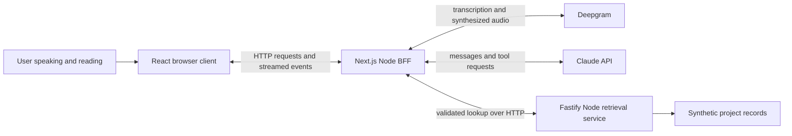

# Conversational voice BFF reference architecture

Date: October 12, 2026.

Status: specification for review and transfer to a new repository. Implementation belongs in that repository, with a new build agent. This document contains no employer records, private interview material or credentials.

## Purpose and agreed intent

Build a small reference architecture to demonstrate React, Next.js, backend-for-frontend design and frontier-model integration. The user speaks naturally, the application sends the question through a BFF to an AI API and specialized data service, and the answer appears as formatted text and generated speech. The transcript is optional; inspecting or approving it is never a normal step.

The application should make **client ↔ BFF ↔ AI API and data services** easy to trace. A later tutorial will explain the working implementation, rather than inventing an architecture the code does not use.

Confirmed direction:

- Next.js and React for the browser application.
- Server-side Deepgram speech recognition and speech synthesis.
- Real Claude or OpenAI API use is acceptable, including modest paid usage during testing.
- A separate Node service demonstrates specialized data retrieval and BFF aggregation.
- Automatic spoken turns and interruptible output; transcript inspection only on request.
- One day is available for implementation, so the baseline must remain small.

Design defaults for that deadline: Claude is the first AI provider, Fastify serves one synthetic lookup capability, and Next.js Route Handlers implement the BFF. OpenAI is a later interchangeable adapter. These defaults can be revised during specification review without changing the architectural boundaries.

## The smallest useful architecture



Next.js already provides the Node backend used by the BFF. There is no additional Fastify gateway duplicating it. The separate Fastify service has a specific domain responsibility: retrieving project records. The browser talks only to its same-origin Next.js BFF; it never receives provider keys or calls the retrieval service directly.

This is two local application processes in one npm workspace: the Next.js application and the retrieval service. Deepgram and Claude are remote dependencies. Run the Next.js application in its Node runtime, not Edge. Keep all dependencies and runtime versions pinned in the implementation repository; Node 24 LTS is the baseline, subject to the selected Next.js release's supported versions. [Next.js BFF guidance](https://nextjs.org/docs/app/guides/backend-for-frontend), [Route Handlers](https://nextjs.org/docs/app/api-reference/file-conventions/route), [Node releases](https://nodejs.org/en/about/previous-releases).

Alternatives considered:

| Option | Tradeoff | Decision |
|---|---|---|
| A. Next.js BFF plus a small retrieval service | Demonstrates aggregation while retaining one browser-facing backend | Selected baseline |
| B. Next.js alone with local fixture lookup | Fewer processes, but hides the independent service boundary | Useful simplification only if explicitly selected later |
| C. Separate live voice gateway with persistent WebSockets | Enables continuous server-side transcription, but adds connection/session lifecycle work | Follow-up after the baseline works |

## One day scope

The baseline includes a working voice loop, one real AI provider, one real speech provider, one local data service, typed fallback, visible answers and optional diagnostics. It also includes provider-hosted public web search when supported by the configured Claude model/account. General questions remain allowed; the synthetic project tool is a concrete aggregation demonstration, not a restriction on subject matter.

The baseline excludes a second AI adapter, accounts, persistent chat history, uploads of research documents, a vector database, production deployment, Kubernetes/Helm resources, telephone calling and durable background research. These are extension points, not dependencies of the first demonstration.

Do not spend the day building a generalized agent framework. Use the provider SDK, a small explicit tool dispatcher, and focused application modules. If time is constrained, preserve the complete working voice-to-BFF-to-model-to-data-to-answer loop before adding UI decoration or extensive tutorial prose. Any unimplemented requirement must be reported explicitly.

## Natural conversation without a voice gateway

The first version uses **automatic browser turn segmentation** and ordinary HTTP requests. Microphone capture continues while conversation mode is active. A browser voice activity detector identifies a completed utterance, packages it as a short WAV recording, and submits it automatically to the BFF. Deepgram transcribes that completed utterance on the server; the BFF then streams the AI response.

This provides hands-free turns without a Submit button or transcript review. It is not continuous streaming transcription. The added batch-transcription latency must be measured honestly; if it prevents an acceptable conversation, replacing this boundary with live STT is the next architectural experiment.

A browser VAD adapter may use `@ricky0123/vad-web`, whose API supplies speech-start and speech-end callbacks and normalized audio. Pin a release, serve its required model/worklet/WASM assets from the application, and verify the configured asset paths. Keep this dependency behind a small adapter rather than spreading its API throughout React components. [VAD project](https://github.com/ricky0123/vad), [VAD API](https://docs.vad.ricky0123.com/user-guide/api/).

The initial Start conversation click requests microphone permission and resumes browser audio contexts. Use a dedicated playback AudioContext separate from capture/VAD, so a reversible playback pause never disables listening. Capture, VAD and playback run in Client Components; the static page shell can use Server Components. Cleanup must release microphone tracks, audio nodes, requests and VAD resources on stop/unmount. React development Strict Mode must not create duplicate sessions or provider calls. [Next.js component boundaries](https://nextjs.org/docs/app/getting-started/server-and-client-components), [React effects](https://react.dev/learn/synchronizing-with-effects).

### Automatic turn behavior

1. User clicks Start conversation once and grants microphone access.
2. User speaks; VAD captures the utterance with pre-roll so the first word is not clipped.
3. After a configurable silence interval, the client automatically submits the completed utterance.
4. The BFF transcribes it, invokes Claude and dispatches any requested lookups.
5. Text appears as it arrives. Stable answer sentences are queued for speech generation automatically.
6. The client plays generated speech in order while continuing to listen.
7. Raw speech detection pauses old playback reversibly; confirmed speech commits interruption and the next completed utterance starts a new turn. A misfire restores playback. The transcript remains hidden unless opened.

Use an initial end-of-turn silence setting around 700–900 ms, then tune it from observed behavior. This is a starting parameter, not a universal conversational threshold. Reject VAD misfires/very short noise using the two-phase interruption policy below; preserve ordinary pauses within a sentence where possible. Microphone mute stops capture; Stop conversation stops capture, requests and playback. Output mute cancels current and queued speech while preserving text answers.

Acoustic echo cancellation and noise suppression should be requested where supported. Verify both headset and speaker behavior. If speaker echo still causes false positives, tune the VAD speech threshold and confirmation duration while Speaking and document the tested settings. Do not disable listening for the whole response. Persistent speaker self-triggering must be reported as an unverified/failed speaker acceptance case and a known limitation, with headset use as an explicit workaround; it cannot be claimed as solved.

## Browser experience

One page is sufficient:

- Start/Stop conversation, microphone mute, output mute and a clear Listening/Working/Speaking indicator.
- Conversation text rendered safely with basic Markdown formatting and source links.
- Structured project card when the data tool returns a record.
- Collapsed transcript/details panel showing the recognized input when requested.
- Collapsed request trace: transcription, AI request, tool call, data result, speech and completion/error.
- Typed question field as fallback and an aid to isolating backend problems.

The typed path invokes the same BFF turn capability and speaks the response automatically when output is enabled. No raw HTML from model output is executed. Render Markdown links and source references only after parsing and allowing absolute `https:` or `http:` URLs; unsupported schemes and invalid URLs remain plain text. External links open with `rel="noopener noreferrer"`. No raw provider events or model reasoning are displayed; normalize only answer text, source metadata, progress, usage and errors.

## BFF responsibilities

The BFF owns secrets, transcription, model configuration, tool dispatch, response normalization and speech synthesis. Browser code owns capture, utterance detection, visible interaction and playback. The retrieval service owns lookup data and its HTTP contract.

Keep business/orchestration logic in server modules, independent of Next.js `Request` and `Response` objects. Route Handlers validate transport input and adapt those modules to HTTP. This makes a later Fastify/Express BFF comparison possible without rewriting the core workflow.

```text
apps/
  web/
    app/                         Next.js page and API Route Handlers
    components/                  React conversation, answer and details UI
    client/voice/                capture, VAD, playback and turn controller
    server/turns/                transcription and AI/tool orchestration
    server/providers/            Claude and Deepgram adapters
    server/tools/                validated dispatcher and retrieval client
    shared/                      application request and event contracts
  retrieval/
    src/http/                    Fastify endpoints and validation
    src/projects/                fixture-backed lookup service
    fixtures/                    synthetic records
docs/
  architecture.md
  tutorial.md
```

Use TypeScript for the application contracts and normal type checking. Avoid adding a separate framework solely for agents, a second BFF or a custom Next.js server in the baseline.

## AI and lookup behavior

### Claude adapter

Use the official Anthropic SDK and streaming Messages API. The configured model ID comes from server environment configuration; choose an available model that supports streaming and custom tools. Hosted search is a separately configured capability. Record the tested model and SDK version in the README.

Expose one custom tool, `lookup_projects`, with an optional project name. The model can request it; the BFF validates the arguments, calls the retrieval service, and returns the result in the provider's required tool-result format before continuing generation. Preserve tool-use IDs and content blocks within that turn. Limit the loop to three model rounds and four custom-tool executions per turn; reaching the limit produces a clear partial/error status, not an infinite loop. [Claude tools](https://platform.claude.com/docs/en/agents-and-tools/tool-use/define-tools), [streaming](https://platform.claude.com/docs/en/build-with-claude/streaming).

For synthetic-project facts, instruct the model to use the tool rather than guess. General conversation and explanation do not require that tool. Public/current-information questions may use hosted search when enabled through `CLAUDE_WEB_SEARCH` with `CLAUDE_WEB_SEARCH_TOOL_VERSION`; use direct hosted search and a small per-turn search budget. Avoid adding code execution solely to enable a newer search variant. Carry citations into the UI; if search is unavailable, show that reason and never suggest an answer used live sources. The baseline tool-version default is `web_search_20250305`; changing it requires validation of direct-caller behavior with the selected model. [Claude web search](https://platform.claude.com/docs/en/agents-and-tools/tool-use/web-search-tool).

Search availability has explicit states: disabled by configuration, unavailable with a reason, configured but not account-verified, or verified by a successful live request. When enabled, check the selected model's advertised search support through the Models API at startup or first use; failed/unknown support disables only search. Configuration and model support do not prove organization enablement. Capabilities may advertise search as provisionally enabled after the model check, but must label account validation as pending until a live request succeeds. If the provider specifically rejects the search tool/version or organization enablement, mark search unavailable for this process, omit it from subsequent requests and expose the reason. That affected turn fails visibly with `SEARCH_UNAVAILABLE`; do not automatically replay it, assume it was free, or turn an ambiguous failure into a tool-support diagnosis. The user may ask again. Project lookup and ordinary conversation remain usable without search; restart after configuration/account repair to revalidate it.

The adapter distinguishes completed answers, custom tool requests, resumable provider pauses and token-limit truncation. Resume only within the configured round/deadline budget; never translate every provider stop reason into a successful `turn.completed`.

An API key does not provide all capabilities of the Claude or ChatGPT consumer applications. The actual accessible tools are those the BFF configures and the API/account supports. The baseline offers broad public-web lookup without an arbitrary domain allowlist, plus the local project tool. It does not connect private mail, employer files, the host filesystem or application accounts.

### Retrieval service

Fastify runs on loopback port 3001 by default. It exposes:

- `GET /health`: liveness only.
- `GET /v1/projects`: all three records.
- `GET /v1/projects?name=Atlas`: case-insensitive exact name lookup; no match returns an empty records list.

The response contains `schemaVersion`, `source` and `records`. Source is `synthetic-project-catalog`, not a real enterprise system. Each record has `id`, `name`, `status`, `ownerTeam`, `openItems` and `summary`.

| ID | Name | Status | Owner team | Open items |
|---|---|---|---|---:|
| atlas | Atlas | active | North | 3 |
| beacon | Beacon | paused | West | 1 |
| cedar | Cedar | complete | South | 0 |

Implement exact deterministic retrieval with Fastify schemas and an in-memory fixture file. No database or data writes are needed. The BFF calls a configured retrieval origin, not a URL chosen by the model. It must not silently substitute fixtures in the BFF when this service is unavailable; that would conceal the communication boundary being taught.

### Answer and source contract

The final answer includes complete display text, available citations, actual tool results, usage when supplied by the provider, and a status such as complete, interrupted, failed or truncated. Project cards are generated from validated tool results, not arbitrary model-produced JSON.

Prompt for concise, natural answers that put the main finding first, normally a few sentences. Longer explanations may remain on screen. Speech is derived from the same answer text with URLs, citation markers and formatting converted for reading aloud. Do not run a second LLM merely to paraphrase each answer for speech.

An OpenAI adapter is a follow-up that preserves this contract and uses the Responses API with its own streaming and tool formats. It is not a day-one completion requirement. [OpenAI streaming](https://developers.openai.com/api/docs/guides/streaming-responses), [OpenAI web search](https://developers.openai.com/api/docs/guides/tools-web-search).

## Browser to BFF API contract

### POST /api/turn

Both `POST /api/turn` and `POST /api/speech` enforce local request admission before reading the body, allocating a provider request or doing paid work. Configure explicit permitted BFF origins, initially `http://localhost:3000` and `http://127.0.0.1:3000`, with their corresponding Host values. Bind only to loopback; a different port or additional loopback hostname requires explicit configuration. Compare the parsed Origin against that configured list, require its host and port to match the request Host, and validate Host against the configured host list. Reject malformed, mismatched, `null` and missing Origin values. Never infer a trusted origin from an unchecked Host or forwarded header. Browser requests must originate from the configured BFF page; documented local CLI and HTTP test clients must send a permitted Origin and matching Host explicitly. Offline module tests may invoke server modules directly. This is browser-origin admission, not authentication of local processes; CORS response headers alone do not establish it.

Rejected admission returns HTTP 403 with stable code `ORIGIN_NOT_ALLOWED`, `retryable: false` and `turnId: null` in the common JSON error format because no body has been read. It makes no model, transcription, retrieval or speech call. Apply this check consistently to both paid endpoints, including well-formed multipart requests that a browser can send without a CORS preflight. [CORS simple requests](https://developer.mozilla.org/en-US/docs/Web/HTTP/Guides/CORS#simple_requests).

Accept multipart form data containing:

- `turnId`: a client-generated UUID for correlation and stale-output protection.
- `history`: JSON containing up to eight prior user/assistant text messages as whole pairs, capped at 16,000 characters total under the policy below.
- Exactly one of `audio` or `text`. Audio is a WAV file containing mono signed 16-bit PCM at 16 kHz. Typed input is capped at 2,000 characters.

The browser VAD's normalized samples must be encoded into a valid WAV, with a correct header and duration. Maximum utterance is 30 seconds; maximum request body is 2 MiB. Enforce the body cap while reading, not merely by trusting Content-Length. The client must stop/discard or deliberately finalize an overlong utterance and show a clear message rather than buffering indefinitely.

For audio input, Deepgram performs server-side prerecorded transcription. Empty/no-speech transcription does not invoke Claude. The optional transcript panel may show recognized text after the result arrives, without blocking the automatic pipeline. [Deepgram transcription](https://developers.deepgram.com/docs/pre-recorded-audio), [audio formats](https://developers.deepgram.com/docs/supported-audio-formats).

The response is a fetch-readable SSE stream, consumed from the POST response. Do not use native EventSource for this POST. Suggested normalized events:

| Event | Payload purpose |
|---|---|
| `turn.accepted` | Turn ID and current mode |
| `transcript.final` | Recognized question for optional display |
| `stage` | Transcribing, researching, retrieving or answering |
| `tool.started` | Tool name and safe summary |
| `tool.completed` | Validated project data or available source metadata |
| `answer.delta` | Append-only answer text |
| `sources` | Actual source references/citations |
| `turn.completed` | Final text, status and available usage |
| `turn.failed` | Stable error code and concise message |

All events include `schemaVersion`, `turnId` and a sequence number. Parse incremental UTF-8 and SSE framing across arbitrary network chunk boundaries. A network read is not necessarily one complete event. Set appropriate no-cache headers and test that local Node hosting delivers events incrementally. [Next.js Route Handlers](https://nextjs.org/docs/app/api-reference/file-conventions/route).

The BFF is responsible for the system prompt and tool definitions. Client history is conversation data; it cannot redefine tools or provide authoritative lookup results. No session database is required: history is kept in browser memory, and the native tool exchange is retained only during the active server request. Refresh starts a new conversation.

History inclusion is atomic by turn. Add the recognized user text (or typed input) and final assistant display text only after a still-current turn completes with status `complete`. Completed text remains history even if its speech is later interrupted, muted or fails. Interrupted, failed, truncated and no-speech turns contribute neither message, even if some user text is known; a turn canceled before `transcript.final` likewise contributes nothing. Do not invent assistant placeholders or append partial model deltas to history. Preserve such turns in the visible timeline with their actual status. Retain at most four complete user/assistant pairs (eight messages), dropping whole oldest pairs until the 16,000-character total is satisfied. If a single completed pair exceeds that cap, omit the whole pair and show a context-omitted notice; never split or silently truncate a pair. The BFF validates the alternating pair structure and bounds as untrusted input. A follow-up therefore uses the most recent completed text turn; an interrupted unfinished answer does not replace that context.

### POST /api/speech

Accept JSON `{ turnId, segmentId, text }`. Nonempty text must fit both a hard 120-character cap and an estimated six-second segment duration. Compute the effective character cap as the smaller of 120 and `floor(6 * SPEECH_CHARS_PER_SECOND)`; the initial conservative estimate is 14 characters/second, giving 84 characters. Expose the effective cap through capabilities and enforce it in the BFF before synthesis. Split stable sentences at safe word boundaries to fit; if an individual token cannot fit, omit that token from speech with an explicit status rather than sending an oversized segment. This estimate is a tunable engineering assumption, not a provider guarantee: validate it for the selected voice and reduce it if actual segments routinely overrun.

The BFF calls Deepgram and streams raw mono signed 16-bit little-endian PCM at 24 kHz, without a WAV header. Return explicit audio-format metadata in response headers; all error responses use the common JSON error format before audio starts.

The browser queues stable sentences from `answer.delta`, strips speech-inappropriate formatting, splits them to the effective segment cap and calls this endpoint sequentially. Only one speech request is active per browser conversation. Start the first eligible segment as soon as stable answer text is available, not after the complete answer or transcript approval; flush the final text fragment on completion. Preserve meaningful numbers; decimals, abbreviations and URLs are not unconditional sentence boundaries. Long answers wait as unsent text, not generated audio. Bound the pending text queue to 2,400 characters; exceeding it clears unsent text and disables remaining speech for that answer with a visible status while already generated audio may finish and text continues.

For the baseline, use Deepgram's REST audio output streaming with explicit `linear16`, `sample_rate=24000` and `container=none`. The model/voice is server-configured. Confirm the selected SDK yields incremental bytes; never interpret a JSON provider error as PCM. [Deepgram synthesis](https://developers.deepgram.com/docs/text-to-speech), [media settings](https://developers.deepgram.com/docs/tts-media-output-settings), [encoding](https://developers.deepgram.com/docs/tts-encoding).

The client handles arbitrary chunk boundaries, including a split 16-bit sample. Convert PCM to Web Audio buffers with the correct sample rate, schedule contiguous playback, and retain every source handle. Count all generated but unplayed audio exactly once: the remainder currently playing, future scheduled sources and unscheduled PCM. Use playback-clock progress and sample duration; scheduling does not remove duration from this outstanding total. [Scheduled audio start](https://developer.mozilla.org/en-US/docs/Web/API/AudioBufferSourceNode/start).

Use request-level backpressure: the audio high-water bound is ten seconds, the low-water mark is two seconds, and one admitted segment has estimated duration at most six seconds, leaving two seconds of safety margin. Start no new speech request until the outstanding total is at or below two seconds, playback is running and no tentative interruption is active. Drain the active small response promptly; do not hold its network body open for playback or throttle it across the 20-second request deadline. Normal fast production waits in the pending text queue and resumes automatically as playback drains; it must not silence an ordinary multi-sentence answer.

Retain an emergency bound over actual PCM before accepting/scheduling additional audio. If one active response would exceed ten seconds despite segment admission, treat it as an oversize-response error. An unexpectedly suspended playback clock pauses new speech requests; if it persists beyond three wall-clock seconds while audio is outstanding and the answer has not been intentionally canceled, treat it as a playback-stalled error. Either emergency stops all scheduled sources for that answer, clears PCM and pending speech text, aborts active synthesis and disables further speech for that answer with a visible reason while text generation continues. A short reversible VAD misfire pause normally restores playback before this watchdog; Stop, output mute and confirmed barge-in deliberately cancel speech instead. A frozen clock never releases audio budget.

### GET /api/capabilities

Validate Host against the same configured allowlist before returning metadata; reject an invalid Host with the common HTTP 403 error. This unpaid GET does not require Origin. Return provider/model labels, live/mock mode, speech availability, search state/reason/account-validation status and effective speech segment/backlog limits. Expose no credentials. Missing configuration disables only the affected capability. Configuration alone never claims tested live search or a live adapter when it is mocked.

Before a stream starts, errors use `{ error: { code, message, turnId, retryable } }`; `turnId` is null when rejection occurs before the body can be read. Use HTTP 400 for malformed requests, 403 for origin/host admission, 413 for the body cap, 429 for concurrency admission, 502 for upstream failure and 504 for deadline expiry. After SSE starts, send `turn.failed` using those same error fields; after PCM starts, terminate the failed stream and let the client retain the answer with a speech-error status. Empty/no-speech audio has its own nonfatal status and never triggers a model request.

## Turn ownership and interruption

The React turn controller owns a monotonically increasing generation, correlated with the UUID sent to the BFF. Exactly one answer generation is current. Use two-phase barge-in while both Working and Speaking:

1. On raw VAD speech-start, tentatively suspend the dedicated playback context within the local 200 ms detection-to-silence target. Retain source handles/offsets, queued text and the current generation. Pause new speech-request admission, but do not abort the model/lookup/turn request or active small synthesis request. Capture/VAD continues in its separate context.
2. On confirmed speech, commit generation invalidation, stop scheduled audio, clear speech queues and abort the old turn and synthesis requests. Use the pinned VAD release's `onSpeechRealStart` with a configured minimum positive-speech duration (initially 400 ms), or an equivalent positive-frame duration check if that callback is unavailable. Confirmation must occur during speech, not after the end-of-turn silence wait.
3. On a misfire before confirmation, resume retained playback and speech admission and keep the pending Working turn current. An obsolete or already-confirmed candidate cannot restore a canceled generation. The next confirmed utterance becomes a new turn only after VAD detects its end.

The VAD callback distinction and playback suspension must be verified against the pinned release and browser. [VAD API](https://docs.vad.ricky0123.com/user-guide/api/), [AudioContext suspension](https://developer.mozilla.org/en-US/docs/Web/API/AudioContext/suspend). Typed submission commits interruption directly. A misfire does not cause a paid-request replay or a new request.

Gate every fetch callback, model delta, speech byte and playback completion against the current generation. Cancellation is not enough by itself: late callbacks can still occur. The BFF propagates request cancellation to model, transcription, lookup and speech operations where the provider/transport supports it. Cancellation may not reverse work or usage already incurred.

A completed visual answer can remain visible with an interrupted-speech marker and remains history under the completed-text policy. Never mark all its speech as heard merely because synthesis finished. Partial/failed answers remain visibly incomplete and are excluded together with their user message from completed history.

On a disconnected BFF stream, show interruption/error and allow another question; do not automatically replay the entire paid request. Closing the page or stopping conversation tears down local resources. The default UI states are Ready, Listening, Working, Speaking, Busy and Error, with microphone/output mute independent. A concurrency rejection shows Busy and allows a deliberate new question; it does not automatically replay the rejected turn.

## Configuration and operating limits

One npm workspace provides root development, build, typecheck and test commands. Root development starts both local applications; Next.js uses port 3000 and retrieval uses 3001. Credentials live only in ignored server environment files. Public browser environment variables contain no provider secrets.

Required provider settings are `ANTHROPIC_API_KEY`, `CLAUDE_MODEL`, `DEEPGRAM_API_KEY`, `DEEPGRAM_STT_MODEL`, `DEEPGRAM_TTS_MODEL` and `RETRIEVAL_BASE_URL`. Explicit capability/admission settings are `CLAUDE_WEB_SEARCH` (`enabled` or `disabled`), `CLAUDE_WEB_SEARCH_TOOL_VERSION`, `BFF_ALLOWED_ORIGINS`, `BFF_ALLOWED_HOSTS` and `SPEECH_CHARS_PER_SECOND`. Validate them on startup; invalid admission configuration fails closed before serving paid endpoints. Provide these documented defaults in the sanitized environment example:

```dotenv
CLAUDE_WEB_SEARCH=enabled
CLAUDE_WEB_SEARCH_TOOL_VERSION=web_search_20250305
BFF_ALLOWED_ORIGINS=http://localhost:3000,http://127.0.0.1:3000
BFF_ALLOWED_HOSTS=localhost:3000,127.0.0.1:3000
SPEECH_CHARS_PER_SECOND=14
RETRIEVAL_BASE_URL=http://127.0.0.1:3001
```

The example also lists placeholders for every required provider key/model without credentials. Parse the allowlists as explicit comma-separated values; no wildcards or inferred forwarded origins. Configuration governs whether search is requested; live account/model compatibility still requires the availability checks above. A real live run needs configured API accounts/keys; consumer-app subscriptions are not API configuration.

Use loopback hosting for the reference app. Public deployment/authentication is outside this build. Apply a 60-second turn deadline, a 5-second retrieval deadline and a 20-second speech-request deadline; all are configurable. Model output is capped at 1,024 tokens per round and three rounds per turn. Hosted search has one two-use BFF-turn budget carried across every Messages request, custom-tool continuation and provider pause. Count actual search uses from validated provider events/usage and give the next request only the remainder. At zero or unverifiable consumption, permit no additional hosted search. Anthropic's `max_uses` is per request. [Claude web search](https://platform.claude.com/docs/en/agents-and-tools/tool-use/web-search-tool).

Preserve prior provider blocks exactly, including hosted-search use/results. Verify live that a continuation with those blocks is accepted when its exhausted search definition is omitted, including a provider-pause continuation. If the selected API/tool combination rejects that form, do not re-enable search or assume a zero-use cap is supported; stop the turn with an explicit partial/truncated status and document the compatibility limitation. No implicit replay of an already accepted provider call is allowed. These limits are engineering defaults and may truncate a complex answer; report that condition.

Limit the application to two active turn requests and two active speech requests per local process. Reject excess admission before paid work with HTTP 429 and a Busy status. Propagate client abort immediately, but keep a concurrency slot until its admitted upstream work settles or is confirmed canceled; do not release slots early and admit unbounded paid work. A rapid barge-in may therefore receive Busy while cancellation finishes. The user can ask again; no automatic 429 retry is part of this baseline. Do not automatically retry paid model/speech calls in a way that can duplicate an answer. Capture actual provider usage when available; do not display invented dollar estimates.

Live mode uses real providers. Test mode uses deterministic provider adapters and synthetic audio; it must be labeled Mock/Simulation and must not claim microphone transcription or generated voice as verified. Automated CI runs offline by default. The owner accepts modest normal API usage for limited live validation; no unlimited soak test is part of this scope.

## Verification and acceptance

Use meaningful tests at the boundaries:

1. A typed question causes Claude tool requests to invoke the retrieval HTTP client, preserve tool IDs and continue to a normalized answer; invalid tool arguments never call the service.
2. Retrieval returns the exact fixture records, handles missing names and rejects malformed requests.
3. Split SSE/UTF-8 events and split PCM samples decode correctly.
4. An obsolete turn cannot update the current card, append current text or play audio after confirmed interruption.
5. VAD completion submits automatically; no transcript-confirmation action is required.
6. First stable answer text starts eligible speech generation before the model completes.
7. Transcription failure, provider rate limit, unavailable retrieval and failed synthesis produce distinct visible states; text remains usable when speech fails.
8. Strict Mode/unmount/Stop conversation do not leak microphone tracks or duplicate provider calls.
9. Both paid endpoints reject well-formed requests from another local origin, null/missing Origin and disallowed/mismatched Host with HTTP 403 before body processing; spies prove zero upstream calls. Configured browser origins and explicitly headed local HTTP test requests remain admitted. The capabilities GET also rejects disallowed Host before metadata is returned.
10. With a fast PCM producer and normal playback, a multi-sentence answer within the text-queue cap is fully spoken while actual outstanding audio stays at or below ten seconds. New synthesis waits for the low-water mark. Separate oversize-response and playback-suspended-beyond-watchdog cases exercise complete emergency teardown while text continues.
11. Multi-round and provider-pause continuations share the two-use search budget. Exhausted/unverifiable consumption never allows another search; exercise the partial/truncated compatibility fallback offline, and verify the omitted-tool/prior-block continuation separately against the selected live API.
12. Raw speech/misfire during Speaking restores retained audio without aborting requests, and during Working preserves a slow lookup. Confirmed positive-duration speech commits invalidation; late results cannot replace the new turn or enter completed history. The reversible detected-start playback pause meets the measured local target.
13. Search disabled, unknown model support and explicit hosted-tool rejection leave subsequent ordinary conversation/project lookup usable. Tool rejection is visible, changes capabilities with a reason and never causes automatic replay; model-only availability is labeled unverified until live account success.
14. Completed text is retained despite later speech interruption/failure; interrupted, failed, truncated and pre-transcript turns add neither history message. Trimming removes whole oldest pairs; oversized single pairs are omitted with a notice.
15. Rapid successive interruptions respect actual upstream concurrency, expose Busy on admission rejection and issue no automatic retries. Markdown/source links with invalid or non-HTTP schemes render as text.

Manual live acceptance in desktop Chrome or Edge:

- Start once, ask “What is the status of Atlas?”, and receive the fixture-backed answer as text, a project card and generated voice without touching the transcript.
- Ask a follow-up such as “Who owns it?” using the most recent completed-text context.
- Interrupt an answer with confirmed speech and ask about Beacon; old speech pauses promptly, commits cancellation and cannot overwrite the new turn. A short noise misfire instead restores the old response.
- Speak a normal multi-sentence answer completely without audio-overflow cutoff; verify actual segment durations and backlog under the configured voice/estimate.
- Open the transcript only when desired; type a correction or alternative question as fallback.
- Ask a current public-information question; verify an actual search event/citations and account-validation status when search is enabled. If unavailable, record the reason and demonstrate project lookup with search off.
- Verify headset and speaker behavior, including self-triggering mitigation; report unresolved speaker echo as a limitation and failed/unverified speaker acceptance.
- Stop conversation and confirm microphone capture and active requests end.

Measure speech-end-to-visible-answer, speech-end-to-first-audio and interruption-to-silence with a documented same-clock/browser method. Separate VAD delay, transcription, tool/model delay, speech generation and playback buffering. Record observations and sample sizes; do not claim a production percentile from a few trials. Target at most 200 ms from the raw VAD speech-start callback to reversible local playback silence, then record speech confirmation-to-cancellation separately. Also measure acoustic speech onset-to-silence when possible; do not present a callback-only measurement as full physical interruption latency. A first-audio goal around three seconds for a simple lookup is a target, not a provider guarantee; public research may take longer and must show Working progress.

Do not call the voice application complete from mocked tests alone. Record the actual live provider/model/browser combination exercised. If keys or account capabilities prevent live testing, identify exactly which acceptance cases remain unverified.

## Tutorial and one day delivery priorities

The implementation README should include setup, commands, actual provider/model versions, supported browser, sample questions and known limitations. A compact tutorial should link to real code for:

1. React state, Client Components, capture and automatic turns.
2. Next.js Route Handlers as the BFF and the request/event contract.
3. Claude streaming and the custom tool loop.
4. BFF aggregation over the Fastify retrieval API.
5. Deepgram transcription, synthesis and browser playback.
6. Cancellation, limits, latency measurements and failure behavior.

Build the typed aggregation path first so provider/tool behavior can be isolated; then complete automatic voice, playback and interruption. Use the remaining time for boundary tests, live validation and the compact tutorial. This is an order of demonstration priorities, not a detailed implementation plan or a promise of completion in a fixed number of hours.

Extension discussions may compare OpenAI's adapter, Fastify/Express/Oak BFFs, continuous STT, WebSockets/WebRTC, persistent research runs and Kubernetes/AWS scaling. Explain why each extension adds a new boundary; keep it out of the baseline code until the working reference justifies it.

## Transfer to the implementation repository

Copy this standalone specification into the new repository as `docs/specification.md`. No job-search files are prerequisites. The owner will create the repository and start its build agent; this specification does not create either one.

Suggested initial build-agent prompt:

> Read docs/specification.md and any repository instructions. Develop a short implementation plan for this one-day reference application, preserving the agreed natural voice interaction and client/BFF/AI/data-service boundaries. Identify any concrete contradictions before scaffolding. Implement in this repository after the plan is reviewed under the applicable workflow. Use real Claude and Deepgram adapters plus offline test adapters, and a minimal Fastify retrieval service. Prioritize the complete working path over extra infrastructure. Report actual test and live-validation evidence, costs/usage when available, and remaining limitations. Do not import private job-search or employer data.
