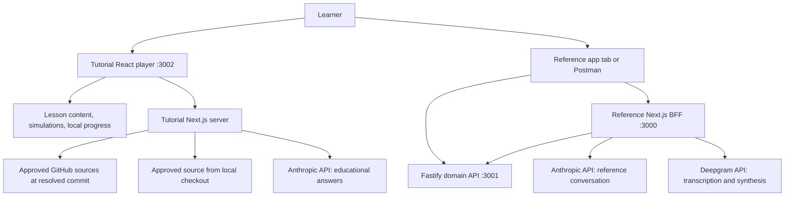

# AIVC interactive tutorial design

Date: October 13, 2026.

Design story: [#15 — Design and refine the AIVC interactive tutorial](https://github.com/kburson/AIVC/issues/15).

Status: written specification awaiting owner review. The owner approved the design direction and requested this artifact and its tracking story. That approval does not constitute approval of this written specification, an implementation plan, or application implementation.

## Intent and audience

Create an engaging local learning application inside the AIVC monorepo. Teach how React, Next.js, Node.js/Fastify, the Anthropic API, and the Deepgram API work individually, why the reference architecture uses them, and how their boundaries cooperate during a conversational interaction. Combine a guided course with a contextual AI tutor grounded in the current lesson and actual repository code/documents.

Three cross-referenced paths serve product/technical leaders, developers, and architects. They share modules, examples, source evidence, and progress. Product learners explore user value, delivery, cost, and risk; developers inspect behavior, code, contracts, and tooling; architects compare responsibilities, alternatives, and operational consequences. The developer path assumes JavaScript/TypeScript fluency. Explain framework-specific concepts and unfamiliar web/audio mechanisms directly, with optional glossary refreshers rather than a beginner programming course.

A successful learner can explain each layer's responsibility, trace an interaction to actual source, inspect the four API surfaces, make a bounded local change, investigate a failure, and justify when an alternative would better meet different requirements. Entertainment supports those outcomes through prediction, exploration, narration, and visible consequences.

## Agreed requirements and boundaries

- Use the AIVC repository as a monorepo. Others clone it, install its pinned toolchain, and supply their own API keys for enabled live features.
- Provide guided text, diagrams, code snippets, animations with voice-over, captions, and exercises.
- Provide a contextual tutor that answers using lesson context, real GitHub/checked-out code and documents, and curated official technology references.
- Start with deterministic simulations; offer optional hands-on labs with local reference services and learner-owned provider accounts.
- Include Postman collections for the Fastify domain API, Next.js BFF, Anthropic API, and Deepgram API.
- Teach fundamentals and project-specific deep dives, languages/toolchain in context, architectural patterns, workflows, integration mechanics, and decision matrices.
- Preserve the reference application's client/BFF/domain/provider responsibilities and its admission, cancellation, and budget contracts.
- Make a complete first lesson before producing the entire course. Later modules deepen the same example.

This design expands the educational application beyond the compact code-linked tutorial in [story #11](https://github.com/kburson/AIVC/issues/11). It references the application delivered by [epic #2](https://github.com/kburson/AIVC/issues/2); it does not replace that epic's scope, evidence, or acceptance. Authoring this specification does not authorize building or changing either application. Future tutorial implementation must have its own reviewed plan and governed stories.

## Repository evidence and current availability

The governing reference design is [the voice BFF specification](2026-10-12-voice-bff-reference-design.md). The implementation plan is [the epic #2 plan](../plans/2026-10-12-2-voice-bff-reference.md), with the [Node 26 execution amendment](../plans/2026-10-13-2-node26-parallel-execution-amendment.md) superseding its older runtime/scheduling assumptions.

Discovery inspected GitHub trunk at `7b926d4ad053120204858278dc38224ba4955bf2` and the initial workspace/retrieval implementation in [PR #12](https://github.com/kburson/AIVC/pull/12), then at `38b9552cac0acc89cd72590aca5f735aff6fe0c7`. That snapshot contained a reference web shell, Fastify retrieval source, synthetic fixtures, and tests. The full voice loop was not evidenced by that inspection. Revalidate current source before implementation and publication; this specification does not claim the reference application is complete.

Every example identifies its evidence status: implemented at a named revision, documented/planned, or simulated. Mock output and successful offline tests do not establish a successful live provider/browser run. Instructional simulations may precede completed source, but their visible labels and tutor answers must preserve that distinction.

## Monorepo architecture

Proposed directories, to be created during later implementation:

```text
apps/
  web/                         Existing reference React/Next.js application and BFF
  retrieval/                   Existing Fastify synthetic domain API
  tutorial/                    Course player and tutorial-only server endpoints
packages/
  tutorial-content/            Lesson manifests, authored text, source mappings
  tutorial-contracts/          Content, tutor, progress, and simulation types/schemas
  tutorial-simulations/        Deterministic teaching scenarios and event traces
docs/
  tutorial/                    Setup, curriculum, lab instructions, narration scripts
  superpowers/specs/           This specification and its successors
tools/
  postman/                     Four collections and sanitized environments
tutorial-assets/               Authored audio, captions, and documented sample audio
```

Reuse the repository's npm workspaces, TypeScript conventions, exact dependency pins, and Node/npm reproduction checks. The current execution amendment specifies Node >=26, reproducible Node 26.8.1 and npm 12.0.2; resolve actual accepted toolchain authority when implementation begins. This tutorial does not independently upgrade the reference toolchain.

Next.js is the proposed tutorial shell because it supports the accepted React learning interface and local server boundary for secrets, GitHub retrieval, and tutor calls. This is a tutorial-specific choice, not a historical claim about the reference application. Keep its educational orchestration independent from the reference BFF. Shared tutorial packages contain contracts, content, and deterministic simulations; extracting reference runtime/provider modules is not a prerequisite.

Default local origins are reference web/BFF `http://localhost:3000`, domain API `http://127.0.0.1:3001`, and tutorial `http://localhost:3002`. Ports are configurable and checked for conflicts. Bind the applications to loopback. The tutorial should start without starting the reference services; a separate root command starts reference services for labs. Command names in the implementation plan must be reconciled with existing scripts rather than overwriting them.



The reference client calls its BFF; the BFF orchestrates Claude, Deepgram, and the domain API as separate dependencies. The Fastify domain service owns synthetic project lookup. It is not a gateway through which all provider calls must pass. Node.js is the runtime, Fastify and Next.js provide server framework capabilities, React provides the UI model, and TypeScript expresses contracts.

## Learning experience and module contract

A module exposes Overview, How it works, Code, Decisions, and Try it. Learners can change path or depth without restarting a module. Links explain their relationship: prerequisite, implementation evidence, alternative, failure consequence, or next exercise. A developer can jump from a Route Handler to origin admission; a leader can move from paid-request limits to cost/risk; an architect can compare the BFF boundary with a Next.js-only design.

Use stable module and concept IDs. Persist local progress by course edition and module ID in browser storage. Separate viewed, exercise attempted, self-confirmed completion, and live lab verification; viewing an animation is not proof of technical mastery. Changing paths preserves progress. New course editions identify changed modules and let learners revisit them. Offer explicit export/import and reset of progress using a versioned JSON contract. Keep API keys, tutor transcripts, and sensitive lab payloads out of progress exports.

A typical lesson follows: watch the interaction, inspect a boundary, predict a result, run a simulation, ask the tutor, examine the decision matrix, and optionally perform a lab. Short chapters make a substantial course navigable; the first edition is project-focused rather than an exhaustive replacement for vendor documentation.

Each lesson manifest defines its ID/edition, outcomes, audience/depth tags, prerequisites, cross-references, authored sections, diagram elements, snippets, narration/captions, simulation scenario, lab prerequisites, Postman request IDs, decision matrix, evidence status, and source references. Schema validation and broken-reference checks are publication prerequisites.

## Curriculum

| Module | Core concepts and depth | Simulation / optional lab |
|---|---|---|
| 1. Architecture in motion | Follow a typed or spoken question; separate UI, orchestration, domain ownership, and external capabilities | Assemble the Atlas request path; inspect its live local HTTP boundaries |
| 2. React | JSX/components, props/state, rendering and reconciliation, hooks/effects, refs, cleanup, asynchronous ownership; browser capture/playback in context | Cause a stale response and inspect generation handling; make a small UI/state change |
| 3. Next.js | App Router, layouts, server/client components, hydration, Route Handlers, Node runtime, server-only configuration, BFF normalization and streaming | Trace transport validation into server modules; inspect capabilities and a typed turn |
| 4. Node.js and Fastify | Runtime/event loop and async I/O, routing, request lifecycle, plugins/encapsulation, schemas, serialization, domain service separation, HTTP tests | Validate a lookup; explore missing/invalid inputs; extend a synthetic record in a lab branch |
| 5. Anthropic API | API credentials/model configuration, Messages/context, streaming events, tool schemas/IDs/results, continuation, stop reasons, usage and budgets | Act as the tool dispatcher; inspect raw HTTP, then the SDK and AIVC adapter |
| 6. Deepgram API | Prerecorded transcription versus live STT, synthesis, WAV versus raw PCM, sample rate/channels, SDK streaming, playback/backpressure | Transcribe a provided sample; synthesize short text; connect byte output to browser playback |
| 7. Reliability | Deadlines, errors, cancellation propagation, tentative/confirmed interruption, stale callbacks, history, concurrency, latency observations | Interrupt the timeline; inject unavailable-domain, slow-provider, and failed-speech outcomes |
| 8. Delivery and alternatives | TypeScript contracts/runtime validation, npm workspaces, environment config, test boundaries, builds/CI, provenance, evolving architecture | Reproduce an offline check and compare a changed boundary with its existing contract |

Postman orientation and HTTP/SSE/audio refreshers are cross-referenced supporting units. Familiar JavaScript syntax is not re-taught as a prerequisite. Each module includes product consequences, implementation evidence, architectural rationale, and a link to the appropriate official documentation.

## Architectural decision matrices

Each matrix records the requirement, candidate choices, criteria, selected choice, benefits, liabilities, evidence, and conditions that would change the decision. Separate historical documented reasons, constraints inferred from implementation, and new tutorial analysis. Avoid invented benchmark results or numerical scores presented as measured evidence. If weighted scoring is later added, expose the owner-selected weights and assumptions.

| Boundary / choice | Criteria that support the AIVC choice | Alternatives and conditions favoring them |
|---|---|---|
| React client | Interactive state, composable UI, browser resource lifecycle, reference learning goal, integration with Next.js | Vue/Svelte or simpler browser code where team skills, UI scope, or delivery constraints differ |
| Next.js BFF | Same-origin browser API, server-owned secrets, React integration, thin transport handlers, normalized provider/domain responses | Standalone Fastify/Express BFF for independently deployed clients; Next.js-only domain logic when a separate domain boundary adds insufficient value |
| Node.js runtime + TypeScript | Shared language/contracts, asynchronous network work, SDK availability, reproducible build/typecheck | Other runtimes/languages for existing domain expertise, CPU-heavy workloads, operational standards, or established services |
| Fastify domain API | Explicit HTTP/domain ownership, schema validation/serialization, plugin boundaries, independent tests | Express for ecosystem/team conventions; in-process lookup for a smaller demo; an existing domain service for real enterprise data |
| Anthropic adapter | Accepted first provider; streaming Messages and custom tools demonstrate explicit orchestration | Another provider adapter when capabilities, cost, quality, portability, or account availability justify it |
| Deepgram adapter | Accepted dedicated speech provider; transcription/synthesis boundaries and media contracts are concrete teaching examples | Other hosted/on-device speech engines when language, privacy, offline, latency, cost, or deployment requirements differ |
| Completed-utterance HTTP + SSE | Small baseline, inspectable contracts, incremental answer text, bounded lifecycle | Continuous STT/WebSockets/WebRTC when measured conversational latency justifies persistent connection/session complexity |
| GitHub and local revision sources | Actual project evidence, reproducibility, source-linked explanations, clone-based learning | A broader indexed corpus when corpus size and measured retrieval quality justify additional infrastructure |

A separate comparison explains conceptual layer necessity versus technology choice: the reference could preserve domain/orchestration boundaries using other frameworks. The tutorial demonstrates the selected implementation while teaching when its additional process or framework is unnecessary.

## Contextual tutor

The first implementation uses the learner's Anthropic API key and text answers. Optional spoken tutor interaction is an extension using Deepgram; it is not required to consume authored course narration. Tutor endpoints belong to the tutorial server, proposed as `GET /api/tutorial/status` and `POST /api/tutorial/tutor`. Final event schemas and limits belong in the implementation plan, with normalized text, validated citations, completion/failure status, and provider usage when available.

The request contains question, course edition, module/concept ID, selected snippet or diagram element ID, audience/depth preference, source mode, and bounded conversation context. Server lookup resolves these IDs against the curated manifest; the browser cannot supply authoritative file contents or arbitrary fetch URLs.

Retrieval prioritizes current lesson evidence, selected source, prerequisite/related concepts, and curated official-reference excerpts. Start with explicit source mappings and bounded lexical lookup across approved text; a vector database or generalized agent framework is not a baseline requirement. Fetch and parse sources into chunks with path, revision, line/section range, content hash, and origin. Apply file-size, total-context, turn/deadline, concurrency, output-token, and tool-call limits; the plan must choose and test concrete values rather than inherit reference-app budgets without analysis.

The tutor explains what the evidence supports, cites repository paths and revisions, and distinguishes design intent, implemented behavior, simulation, and inference. It can offer a short answer with links to deeper modules. Missing evidence leads to an explicit gap and relevant source links. An answer about framework behavior can cite official documentation; a claim about AIVC behavior needs AIVC evidence. Source material is untrusted data, including repository comments/documents; it cannot change tutor policy, obtain secrets, execute commands, or broaden approved retrieval scope.

Tutor tools are read-only bounded retrieval. The tutor does not execute labs, mutate repositories, send messages, run shell commands, or trigger paid lab requests. Active lab execution is learner-controlled. Render safe Markdown and validated source links, not raw HTML or provider reasoning. Keep tutor conversation in browser memory by default, with explicit clear controls and no automatic transcript export.

Missing tutor credentials, offline GitHub, provider errors/rate limits, context exhaustion, and invalid citations produce distinct actionable status. Preserve the course and authored simulations when tutor access fails. Cancellation prevents obsolete answers from updating the active question. Do not automatically replay paid calls after an ambiguous failure or disconnect.

## Source provenance and revision handling

Support two source modes:

1. Checked-out revision: curated tracked files resolved from the local repository's HEAD. Resolve the physical repository root on the server, enforce containment, and read approved tracked paths. Keep the revision and hashes visible.
2. GitHub revision: approved paths from configured `kburson/AIVC` or an explicitly configured fork. Resolve a selected branch/tag to a full commit SHA before fetching; pin that question's retrieval to the resolved SHA. Use commit-specific blob links and validated line anchors.

Course editions pin their reference revision. A learner may explicitly compare with another revision; the interface shows which content differs. Never silently mix snippets from multiple revisions in one ordinary lesson or answer. A comparison answer labels each revision separately. Source not yet present is unavailable/planned, not replaced by a fabricated implementation.

Local lab modifications can be discussed through an explicit working-copy mode that labels modified paths and hashes as uncommitted local evidence; it cannot supply a GitHub link that claims those bytes exist in a commit. Dirty source does not rewrite the course edition. Baseline operation with committed HEAD remains reproducible.

Use a curated manifest rather than indiscriminate repository ingestion. Include application code/contracts, architecture documents, accepted plans, setup/tutorial material, selected tests, and relevant synthetic fixtures. Exclude environment files, credentials, machine-local state, scratch data, logs, unrelated private material, and sealed review dumps by default. Collateral such as binary PDFs/media remains linked with metadata unless a tested extraction adapter is explicitly added; unsupported files cannot be represented as fully read.

Cache approved sources locally by repository + SHA + path + hash; show last retrieval and offline/cache status. Retain the installed course snapshot for offline lessons. GitHub rate-limit/authentication failures keep that snapshot usable. Public-source access may work without a token; document optional token configuration for API limits/private forks with minimal needed read access. Tokens stay server-local and absent from bundles, traces, exports, and manifests.

## Narration, diagrams, and animations

Use authored narration synchronized with captions and diagram timeline events. Each clip has text transcript, scene/cue IDs, duration metadata, and the course revision it describes. Store scripts and approved assets with clear authorship/license metadata. Reuse one authored scene across audience paths where its facts are the same; provide optional deeper explanations rather than duplicate courses.

The normal course serves recorded clips without a provider request on each playback. Optional authoring-time synthesis uses the author's own credentials in a later controlled asset workflow; learners do not need Deepgram merely to listen to bundled narration. Sample audio for transcription labs must be authored or licensed for repository redistribution.

Provide play/pause, replay, speed, mute, captions, transcript, keyboard navigation, text alternatives, and reduced-motion behavior. No autoplay speech on page load. Step mode lets learners advance request/tool/audio events manually. Highlight a diagram boundary and corresponding code together; include accessible labels and a readable textual sequence. Use code-native diagrams and animations for inspectable request/state behavior. Captions and text remain useful with sound or motion disabled.

Entertaining scenarios include assembling a valid request, predicting whether a domain lookup is needed, playing the tool dispatcher, observing delayed/stale output, and diagnosing a failed boundary. Simulation speed is an instructional control, not a benchmark. Show simulated timing/output visibly as simulated.

## Simulations and hands-on labs

Simulations run deterministically without GitHub, API keys, microphone permission, or reference services. Scenario fixtures define initial state, learner actions, events, expected decisions, and explanations. Use the same named architectural concepts/contracts as the real project, but keep deterministic fixtures visibly distinct from live traces. Learners can reset/replay and compare prediction with the outcome.

Optional labs name prerequisites, exact source revision, services/ports, commands, inputs, expected observations, verification, provider usage conditions, cleanup, and links back to decisions. Start with local synthetic retrieval, then direct provider requests, typed BFF aggregation, and browser voice/interruption. Keep code-edit exercises small and have learners use their own branch; do not change the shared reference fixture/schema as an automatic tutorial action.

The tutorial origin :3002 is different from the reference BFF origin :3000. Existing paid BFF endpoints require permitted Origin and matching Host before upstream work. Run browser labs in the reference application's own tab. Postman/CLI exercises send the configured reference Origin and matching destination Host. Do not widen the BFF allowlist or disable admission for tutorial convenience. An embedded cross-origin live runner/proxy is a separate future design, not a baseline dependency.

Live actions are explicitly initiated by the learner and show which provider/account settings are used and that usage may be billed. Simulations never quietly make live calls. Display actual usage when supplied; any future monetary calculation needs current pricing and labeled assumptions. Readiness distinguishes services/configured keys from verified live functionality. Record live lab observations locally with revision, scenario, timestamp, environment and pass/failure details, excluding secrets and raw personal audio by default.

## Postman collections

Deliver four importable collection JSON files, a sanitized shared local environment template, a provider environment template, instructions, safe sample payloads/audio, and request-to-module/source mappings. Exported environment values for all keys/tokens are empty. Learners set their own local values. Include equivalent curl requests so Postman is optional.

| Collection | Initial requests | Learning objective |
|---|---|---|
| Fastify domain | `GET /health`, `GET /v1/projects`, named Atlas lookup, no-match and malformed query cases | Domain contract, deterministic data, validation, statuses and serialized response |
| Next.js BFF | `GET /api/capabilities`, multipart `POST /api/turn` with typed input and with sample WAV, `POST /api/speech`, invalid admission/input cases | Thin transport versus orchestration, normalized SSE, speech bytes, visible failures |
| Anthropic | Basic `POST /v1/messages`, streaming request, custom tool declaration, deliberate tool-result continuation | Raw HTTP versus SDK, state supplied per turn, tool IDs/content blocks, usage and stop reasons |
| Deepgram | Prerecorded `POST /v1/listen` with sample WAV; `POST /v1/speak` with short text and contrasting supported output settings | Auth, media input/output, transcription structure, encoding/sample rate and binary inspection |

Provider examples use configurable model/voice IDs from actual tested accounts and the documented API versions/settings. Anthropic request headers and Deepgram authentication follow official documentation at publication time. Avoid hardcoding an assumed universally available model. Anthropic does not directly invoke the local Fastify service: the learner performs the tool call and sends the correctly correlated result, mirroring BFF ownership.

Each request includes purpose, prerequisites, headers/body, expected schema/status, captured synthetic example, troubleshooting, lesson ID, source reference, and whether it incurs provider usage. Local tests assert meaningful schemas/statuses; negative paid-boundary cases prove rejection before provider work using offline instrumentation where needed. Live provider request groups are excluded from default unattended collection runs.

Inspect SSE/binary behavior in the tested Postman version and document its actual capabilities. Pair collections with browser/CLI demonstrations for stream timing and PCM playback; response inspection alone does not prove microphone, speaker, interruption, or continuous audio behavior. The planned BFF returns raw 24 kHz PCM without a WAV header, so a playback exercise must supply format-aware decoding or an explicitly documented conversion rather than treat it as an ordinary WAV file.

## Setup and sharing

The setup guide must prominently state: other learners clone AIVC and provide their own API keys; keys are never supplied by the repository. Provider API usage may incur charges, and consumer-app subscriptions do not supply the configured API credentials.

Document toolchain selection, dependency installation, environment-template copying, local key entry, source-mode/revision selection, tutorial start, optional reference-service start, Postman import, and troubleshooting. Include a feature matrix:

| Capability | Required configuration |
|---|---|
| Bundled lessons, narration, simulations and progress | Installed repository/toolchain; no provider credentials |
| GitHub refresh/revision comparison | Network access; token when access/limits require it |
| Contextual tutor | Anthropic API key and configured available model; usable lesson/source evidence |
| Fastify local labs | Reference domain service running |
| Live typed reference turn | Reference BFF/domain services and reference Anthropic configuration |
| Direct/live speech and voice labs | Deepgram API key/model settings; browser microphone permission for capture labs |

Give tutorial-specific configuration an explicit namespace, including tutorial model/key selection and source repository/ref/token/cache settings. The implementation plan defines exact names and validation. Learners may deliberately reuse their reference API account, but tutorial configuration must not silently depend on unrelated reference secrets. Keep all secrets in ignored server-local environment files. Document the expected external transmission of questions, retrieved code excerpts to the tutor provider, and audio/text to enabled speech APIs. Learners choose whether to enable private-fork retrieval and live features.

A readiness page reports course/source edition, toolchain check, local services, configuration presence, and verified/unverified live capability without showing credentials. Missing keys disable affected live features and present setup instructions; they leave the authored course usable. Do not claim a configured key or a healthy local endpoint proves live model/speech success.

## First complete lesson and delivery sequence

The first lesson is Ask about Atlas. Begin with typed input so the architecture can be learned before audio mechanics. Its complete vertical slice includes authored overview and narration, synchronized request diagram, actual or explicitly planned source references, an Atlas simulation, a contextual tutor exchange with citations, a BFF/domain decision matrix, a Fastify Postman request and optional typed BFF/provider lab. Deepgram examples can be introduced independently with sample media while the voice reference code remains incomplete.

Subsequent stages deepen React/Next.js/Fastify and provider mechanics, add the speech journey, then cancellation/failure exercises and delivery/alternative discussions. Framework examples remain tied to real AIVC modules; broader topics link to official learning resources. This sequence is instructional/design guidance, not a reviewed implementation task breakdown, effort estimate, dependency schedule, or permission to implement.

## Acceptance and verification

Future implementation must demonstrate:

1. One cloned repository starts the tutorial independently under the pinned toolchain; documented lab commands start the reference services separately.
2. Without credentials/network, bundled lessons, captions, narration, diagrams, simulations, cross-references and local progress work; live features show accurate readiness.
3. All three audience paths reach the same stable modules, change depth without losing progress, and provide meaningful concept/source/decision links.
4. The Atlas lesson completes its guided/simulation/tutor/lab sequence with explicit prerequisites and evidence status.
5. All eight modules have outcomes, actual/planned evidence labels, technology explanations, decision matrices, simulations or appropriate exercises, and optional labs.
6. Tutor answers cite validated evidence at the displayed revision, distinguish intent/implementation/inference, and clearly report missing evidence.
7. Tests cover unknown module IDs, path traversal/symlink escapes, arbitrary URL/repository attempts, malicious instructions in source, invalid citations, mixed revisions, dirty working-copy labels, canceled answers, missing keys and provider failures.
8. GitHub/cache failures preserve the installed course; branch resolution pins a request's SHA; unsupported collateral is labeled linked-only.
9. Four Postman collections and sanitized environments import and execute in the documented version, map to lessons/source, preserve required BFF admission, and contain no credential values.
10. Offline request-contract checks and explicit live smoke tests are separate. Stream/media assertions use appropriate instrumentation/browser/CLI checks rather than inferring playback from HTTP success.
11. Narration has synchronized captions/transcripts and revision metadata; keyboard, reduced-motion, sound-off and text-only paths remain usable.
12. Keys and sensitive inputs are absent from browser bundles, citations, logs, progress exports, cached manifests and committed artifacts. Only approved content is sent to provider calls.
13. Meaningful checks validate content schemas, cross-reference integrity, snippet ranges/hashes, caption/cue consistency, deterministic scenarios, tutor/source boundaries and actual optional lab outcomes.

For this design-authoring story, verify the document exists, inspect its references/coverage, run a whitespace diff check, and perform an inline self-review for omissions, contradictions and ambiguity. These are document checks, not application verification. No application implementation, provider call, microphone trial, or new product test is performed by writing this specification.

## Risks and explicit limitations

- The reference application is evolving. Revision-bound editions and planned/implemented labels prevent teaching nonexistent behavior as working code.
- Three learner paths can multiply content maintenance. Shared concepts/scenes with depth-specific sections limit duplication.
- Tutorial retrieval can confuse changed local code with published evidence. Commit/hash labels and explicit working-copy mode preserve attribution.
- Voice assets and labs add media/browser variability. Recorded narration supports the core course; live speech verification records tested conditions and limitations.
- API account/model availability and Postman streaming behavior vary. Publish the actual tested combination, with manual lab prerequisites and honest unverified states.
- Tutor answers can overstate conclusions. Bounded retrieval, validated citations, source-status labels and evaluation cases constrain that failure.
- Public hosting, user accounts, cloud progress synchronization, automatic code execution, a generalized agent platform, an embedding/vector infrastructure, and automatic repository updates are future scope decisions.

## Review and workflow

This story tracks specification authoring, owner review, and subsequent design refinements. AITM timing starts only after issue binding; prior discovery is not backfilled as measured issue work. Pause tracked work while awaiting owner review and resume against #15 for requested corrections. Keep unknown active-time measurements explicitly unknown rather than replacing them with invented precision.

After the owner approves this written specification, use the writing-plans skill to prepare the implementation plan and its tracked work decomposition. Written-spec approval is distinct from plan approval and execution-method selection. Keep this artifact's status current and link its exact committed revision from #15.

## Primary learning references

Use vendor documentation for framework/API mechanics and repository evidence for AIVC-specific claims. Resolve and record source/version provenance during content publication.

- [React: Thinking in React](https://react.dev/learn/thinking-in-react) and [managing state](https://react.dev/learn/managing-state).
- [Next.js: server/client components](https://nextjs.org/docs/app/getting-started/server-and-client-components), [Route Handlers](https://nextjs.org/docs/app/getting-started/route-handlers), and [BFF guidance](https://nextjs.org/docs/app/guides/backend-for-frontend).
- [Fastify: validation and serialization](https://fastify.dev/docs/latest/Reference/Validation-and-Serialization/).
- [Anthropic: Messages API](https://platform.claude.com/docs/en/api/messages/create), [streaming](https://platform.claude.com/docs/en/build-with-claude/streaming), and [tool use](https://platform.claude.com/docs/en/agents-and-tools/tool-use/define-tools).
- [Deepgram: prerecorded transcription](https://developers.deepgram.com/docs/pre-recorded-audio), [speech synthesis](https://developers.deepgram.com/reference/text-to-speech/speak-request), and [media output settings](https://developers.deepgram.com/docs/tts-media-output-settings).
- [Postman: environment variables](https://learning.postman.com/docs/use/send-requests/variables/environment-variables).
