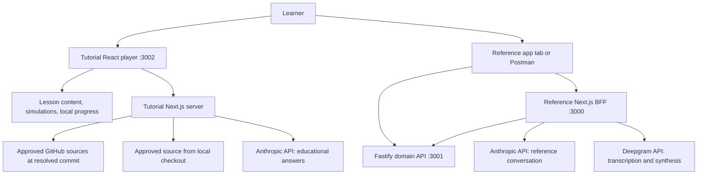

# AIVC interactive tutorial design

Date: October 13, 2026.

Design story: [#15 — Design and refine the AIVC interactive tutorial](https://github.com/kburson/AIVC/issues/15).

Status: written specification awaiting owner review. The owner approved the design direction and requested this artifact and its tracking story. That approval does not constitute approval of this written specification, an implementation plan, or application implementation.

## Intent and audience

Create an engaging local learning application inside the AIVC monorepo. Teach how React, Next.js, Node.js/Fastify, the Anthropic API, and the Deepgram API work individually, why the reference architecture uses them, and how their boundaries cooperate during a conversational interaction. Combine a guided course with a contextual AI tutor grounded in the current lesson and actual repository code/documents.

Three cross-referenced paths serve product/technical leaders, developers, and architects. They share modules, examples, source evidence, and progress. Product learners explore user value, delivery, cost, and risk; developers inspect behavior, code, contracts, and tooling; architects compare responsibilities, alternatives, and operational consequences. The developer path assumes JavaScript/TypeScript fluency. Explain framework-specific concepts and unfamiliar web/audio mechanisms directly, with optional glossary refreshers rather than a beginner programming course.

A successful learner can explain each layer's responsibility, trace an interaction to actual source, inspect the four API surfaces, make a bounded local change, investigate a failure, and justify when an alternative would better meet different requirements. Entertainment supports those outcomes through prediction, exploration, narration, and visible consequences.

## Agreed requirements and boundaries

- Use the AIVC repository as a monorepo. Others clone it, install its pinned toolchain, and supply their own API keys for enabled live features.
- Provide guided text, diagrams, code snippets, animations with voice-over, captions, and exercises.
- Provide a contextual tutor that answers using lesson context, real GitHub/checked-out code and documents, and curated official technology references.
- Start with deterministic simulations; offer optional hands-on labs with local reference services and learner-owned provider accounts.
- Include Postman collections for the Fastify domain API, Next.js BFF, Anthropic API, and Deepgram API.
- Teach fundamentals and project-specific deep dives, languages/toolchain in context, architectural patterns, workflows, integration mechanics, and decision matrices.
- Preserve the reference application's client/BFF/domain/provider responsibilities and its admission, cancellation, and budget contracts.
- Make a complete first lesson before producing the entire course. Later modules deepen the same example.

This design expands the educational application beyond the compact code-linked tutorial in [story #11](https://github.com/kburson/AIVC/issues/11). It references the application delivered by [epic #2](https://github.com/kburson/AIVC/issues/2); it does not replace that epic's scope, evidence, or acceptance. Authoring this specification does not authorize building or changing either application. Future tutorial implementation must have its own reviewed plan and governed stories.

## Repository evidence and current availability

The governing reference design is [the voice BFF specification](2026-10-12-voice-bff-reference-design.md). The implementation plan is [the epic #2 plan](../plans/2026-10-12-2-voice-bff-reference.md), with the [Node 26 execution amendment](../plans/2026-10-13-2-node26-parallel-execution-amendment.md) superseding its older runtime/scheduling assumptions.

Discovery inspected GitHub trunk at `7b926d4ad053120204858278dc38224ba4955bf2` and the initial workspace/retrieval implementation in [PR #12](https://github.com/kburson/AIVC/pull/12), then at `38b9552cac0acc89cd72590aca5f735aff6fe0c7`. That snapshot contained a reference web shell, Fastify retrieval source, synthetic fixtures, and tests. The full voice loop was not evidenced by that inspection. Revalidate current source before implementation and publication; this specification does not claim the reference application is complete.

Every example identifies its evidence status: implemented at a named revision, documented/planned, or simulated. Mock output and successful offline tests do not establish a successful live provider/browser run. Instructional simulations may precede completed source, but their visible labels and tutor answers must preserve that distinction.

## Monorepo architecture

Proposed directories, to be created during later implementation:

```text
apps/
  web/                         Existing reference React/Next.js application and BFF
  retrieval/                   Existing Fastify synthetic domain API
  tutorial/                    Course player and tutorial-only server endpoints
packages/
  tutorial-content/            Lesson manifests, authored text, source mappings
  tutorial-contracts/          Content, tutor, progress, and simulation types/schemas
  tutorial-simulations/        Deterministic teaching scenarios and event traces
docs/
  tutorial/                    Setup, curriculum, lab instructions, narration scripts
  superpowers/specs/           This specification and its successors
tools/
  postman/                     Four collections and sanitized environments
tutorial-assets/               Authored audio, captions, and documented sample audio
```

Reuse the repository's npm workspaces, TypeScript conventions, exact dependency pins, and Node/npm reproduction checks. The current execution amendment specifies Node >=26, reproducible Node 26.8.1 and npm 12.0.2; resolve actual accepted toolchain authority when implementation begins. This tutorial does not independently upgrade the reference toolchain.

Next.js is the proposed tutorial shell because it supports the accepted React learning interface and local server boundary for secrets, GitHub retrieval, and tutor calls. This is a tutorial-specific choice, not a historical claim about the reference application. Keep its educational orchestration independent from the reference BFF. Shared tutorial packages contain contracts, content, and deterministic simulations; extracting reference runtime/provider modules is not a prerequisite.

Default local origins are reference web/BFF `http://localhost:3000`, domain API `http://127.0.0.1:3001`, and tutorial `http://localhost:3002`. Ports are configurable and checked for conflicts. Bind the applications to loopback. The tutorial should start without starting the reference services; a separate root command starts reference services for labs. Command names in the implementation plan must be reconciled with existing scripts rather than overwriting them.



The reference client calls its BFF; the BFF orchestrates Claude, Deepgram, and the domain API as separate dependencies. The Fastify domain service owns synthetic project lookup. It is not a gateway through which all provider calls must pass. Node.js is the runtime, Fastify and Next.js provide server framework capabilities, React provides the UI model, and TypeScript expresses contracts.

## Learning experience and module contract

A module exposes Overview, How it works, Code, Decisions, and Try it. Learners can change path or depth without restarting a module. Links explain their relationship: prerequisite, implementation evidence, alternative, failure consequence, or next exercise. A developer can jump from a Route Handler to origin admission; a leader can move from paid-request limits to cost/risk; an architect can compare the BFF boundary with a Next.js-only design.

Use stable module and concept IDs. Persist local progress by course edition and module ID in browser storage. Separate viewed, exercise attempted, self-confirmed completion, and live lab verification; viewing an animation is not proof of technical mastery. Changing paths preserves progress. New course editions identify changed modules and let learners revisit them. Offer explicit export/import and reset of progress using a versioned JSON contract. Keep API keys, tutor transcripts, and sensitive lab payloads out of progress exports.

A typical lesson follows: watch the interaction, inspect a boundary, predict a result, run a simulation, ask the tutor, examine the decision matrix, and optionally perform a lab. Short chapters make a substantial course navigable; the first edition is project-focused rather than an exhaustive replacement for vendor documentation.

Each lesson manifest defines its ID/edition, outcomes, audience/depth tags, prerequisites, cross-references, authored sections, diagram elements, snippets, narration/captions, simulation scenario, lab prerequisites, Postman request IDs, decision matrix, evidence status, and source references. Schema validation and broken-reference checks are publication prerequisites.

## Curriculum

| Module | Core concepts and depth | Simulation / optional lab |
|---|---|---|
| 1. Architecture in motion | Follow a typed or spoken question; separate UI, orchestration, domain ownership, and external capabilities | Assemble the Atlas request path; inspect its live local HTTP boundaries |
| 2. React | JSX/components, props/state, rendering and reconciliation, hooks/effects, refs, cleanup, asynchronous ownership; browser capture/playback in context | Cause a stale response and inspect generation handling; make a small UI/state change |
| 3. Next.js | App Router, layouts, server/client components, hydration, Route Handlers, Node runtime, server-only configuration, BFF normalization and streaming | Trace transport validation into server modules; inspect capabilities and a typed turn |
| 4. Node.js and Fastify | Runtime/event loop and async I/O, routing, request lifecycle, plugins/encapsulation, schemas, serialization, domain service separation, HTTP tests | Validate a lookup; explore missing/invalid inputs; extend a synthetic record in a lab branch |
| 5. Anthropic API | API credentials/model configuration, Messages/context, streaming events, tool schemas/IDs/results, continuation, stop reasons, usage and budgets | Act as the tool dispatcher; inspect raw HTTP, then the SDK and AIVC adapter |
| 6. Deepgram API | Prerecorded transcription versus live STT, synthesis, WAV versus raw PCM, sample rate/channels, SDK streaming, playback/backpressure | Transcribe a provided sample; synthesize short text; connect byte output to browser playback |
| 7. Reliability | Deadlines, errors, cancellation propagation, tentative/confirmed interruption, stale callbacks, history, concurrency, latency observations | Interrupt the timeline; inject unavailable-domain, slow-provider, and failed-speech outcomes |
| 8. Delivery and alternatives | TypeScript contracts/runtime validation, npm workspaces, environment config, test boundaries, builds/CI, provenance, evolving architecture | Reproduce an offline check and compare a changed boundary with its existing contract |

Postman orientation and HTTP/SSE/audio refreshers are cross-referenced supporting units. Familiar JavaScript syntax is not re-taught as a prerequisite. Each module includes product consequences, implementation evidence, architectural rationale, and a link to the appropriate official documentation.

## Architectural decision matrices

Each matrix records the requirement, candidate choices, criteria, selected choice, benefits, liabilities, evidence, and conditions that would change the decision. Separate historical documented reasons, constraints inferred from implementation, and new tutorial analysis. Avoid invented benchmark results or numerical scores presented as measured evidence. If weighted scoring is later added, expose the owner-selected weights and assumptions.

| Boundary / choice | Criteria that support the AIVC choice | Alternatives and conditions favoring them |
|---|---|---|
| React client | Interactive state, composable UI, browser resource lifecycle, reference learning goal, integration with Next.js | Vue/Svelte or simpler browser code where team skills, UI scope, or delivery constraints differ |
| Next.js BFF | Same-origin browser API, server-owned secrets, React integration, thin transport handlers, normalized provider/domain responses | Standalone Fastify/Express BFF for independently deployed clients; Next.js-only domain logic when a separate domain boundary adds insufficient value |
| Node.js runtime + TypeScript | Shared language/contracts, asynchronous network work, SDK availability, reproducible build/typecheck | Other runtimes/languages for existing domain expertise, CPU-heavy workloads, operational standards, or established services |
| Fastify domain API | Explicit HTTP/domain ownership, schema validation/serialization, plugin boundaries, independent tests | Express for ecosystem/team conventions; in-process lookup for a smaller demo; an existing domain service for real enterprise data |
| Anthropic adapter | Accepted first provider; streaming Messages and custom tools demonstrate explicit orchestration | Another provider adapter when capabilities, cost, quality, portability, or account availability justify it |
| Deepgram adapter | Accepted dedicated speech provider; transcription/synthesis boundaries and media contracts are concrete teaching examples | Other hosted/on-device speech engines when language, privacy, offline, latency, cost, or deployment requirements differ |
| Completed-utterance HTTP + SSE | Small baseline, inspectable contracts, incremental answer text, bounded lifecycle | Continuous STT/WebSockets/WebRTC when measured conversational latency justifies persistent connection/session complexity |
| GitHub and local revision sources | Actual project evidence, reproducibility, source-linked explanations, clone-based learning | A broader indexed corpus when corpus size and measured retrieval quality justify additional infrastructure |

A separate comparison explains conceptual layer necessity versus technology choice: the reference could preserve domain/orchestration boundaries using other frameworks. The tutorial demonstrates the selected implementation while teaching when its additional process or framework is unnecessary.

## Contextual tutor

The first implementation uses the learner's Anthropic API key and text answers. Optional spoken tutor interaction is an extension using Deepgram; it is not required to consume authored course narration. Proposed tutorial endpoints are `GET /api/tutorial/status` and `POST /api/tutorial/tutor`. The plan defines normalized event schemas and concrete limits for body/file size, total context, deadlines, concurrency, output tokens and tool calls, with text, validated citations, completion/failure status and actual provider usage. Analyze tutorial requirements rather than copying reference-app budgets without justification.

A tutor request identifies the question, course edition, module/concept, selected snippet/diagram element, audience/depth, explicitly selected source experience and bounded conversation context. The server resolves those IDs against curated manifests and the source-selection contract below. The browser cannot supply authoritative file contents or arbitrary fetch URLs. Prior answers are conversation data, not source authority. Retrieve current-lesson evidence first, then selected source, related concepts and curated official-reference excerpts. Begin with explicit source mappings and bounded lexical lookup; vector infrastructure and a generalized agent framework are not prerequisites.

Every evidence chunk records path, revision, line/section range, hash and origin. AIVC behavior claims require AIVC evidence; framework explanations may cite official references. Answers distinguish documented intent, implemented behavior, simulation and inference, offer cross-references, and report missing evidence directly. Treat source comments/documents as untrusted data that cannot change policy, obtain secrets, execute commands or broaden approved retrieval. Render safe Markdown and validated links rather than raw HTML or provider reasoning.

Tutor tools perform bounded read-only retrieval. They cannot execute labs, mutate repositories, send messages, run shell commands, trigger paid lab requests or clear runtime data. Keep conversation in browser memory by default with explicit clear controls and no automatic export. Missing keys, source/network gaps, provider errors/rate limits, exhausted context and invalid citations produce distinct actionable statuses while leaving lessons/simulations usable. Cancel obsolete answers and block late callbacks. Never automatically replay paid calls after an ambiguous failure or disconnect.

### Tutorial server admission

The tutorial has its own caller boundary. Define `TUTORIAL_ALLOWED_HOSTS` and `TUTORIAL_ALLOWED_ORIGINS`, initially `localhost:3002,127.0.0.1:3002` and `http://localhost:3002,http://127.0.0.1:3002`. Validate explicit loopback host/port entries at startup. A custom port requires matching explicit configuration; no wildcards, inferred origins, unchecked forwarded headers or silent port changes. Invalid admission configuration fails closed. These settings do not expand the reference BFF allowlist.

Every tutorial server endpoint validates the request Host against its configured list before returning metadata or processing work. The tutor POST additionally requires a well-formed non-null Origin in the tutorial list whose host/port matches the validated request Host. Apply the same stronger Origin/Host admission to every tutorial endpoint that mutates runtime data or retrieves/returns local, private or selected repository source, even if unpaid. Reject missing, malformed, null, disallowed or mismatched values before reading a body, opening files, consulting source caches, contacting GitHub or invoking providers.

The tutor accepts `Content-Type: application/json` only. Caller rejection takes precedence over media/body validation and returns HTTP 403 with stable code `TUTORIAL_ORIGIN_NOT_ALLOWED`, null request identifier and `retryable: false`; the plan defines the final error envelope. After successful admission, unsupported media types return HTTP 415 before body processing or retrieval. Input validation, measured body caps, concurrency and deadlines follow admission. Document explicit Origin/Host requirements for local CLI requests.

The unpaid status GET requires Host only, performs no source/provider request, and returns sanitized readiness flags and public course-edition identifiers. It returns no private repository names/paths, source snippets, filesystem locations, questions or credentials. Public bundled lesson assets contain publication-approved course material only. No source-returning GET endpoint exists in the baseline; a future one must obey the stronger source-access rule. An unpaid endpoint cannot bypass that boundary.

This protects browser-origin admission, not local processes that can deliberately supply headers. CORS response-reading restrictions alone do not establish it. Test JSON and cross-origin safelisted form/multipart/text requests, demonstrating rejection before body/source/cache/GitHub/provider work. Valid origins and explicitly configured ports remain usable.

## Source provenance and revision handling

Ordinary learning and tutoring use the course edition's pinned source snapshot, even when local HEAD or a remote branch advances. An edition records a full commit SHA, curated file hashes/ranges, official-reference provenance and publication-approved bundled excerpts. Its installed snapshot is usable without runtime refresh. Official-reference excerpts are likewise edition-bound by stored content/hash and publication metadata; mutable URLs alone do not establish the cited bytes.

Local Git and GitHub are retrieval backends, separate from the selected learning experience. Local committed mode reads approved tracked paths from the selected commit's Git objects, not working-tree bytes labeled with HEAD. Resolve the physical repository root and enforce containment/approved paths. GitHub mode reads configured `kburson/AIVC` or an explicitly configured fork; resolve selected refs once to a full SHA and use commit-specific blob links with validated line anchors.

| Source experience | Authority and displayed behavior |
|---|---|
| Course edition — default | Use its bundled pinned snapshot. An explicit refresh verifies/retrieves only that same SHA. Local/remote advancement does not replace it. |
| Explore another committed revision | Learner explicitly selects local HEAD or a GitHub ref; resolve/freeze its SHA. Show an exploration banner, edition SHA and selected SHA. Answers describe the selected revision; unchanged edition examples remain labeled as edition material. |
| Compare revisions | Explicitly compare the edition with another resolved revision. Label each source and describe differences. |
| Working-copy exploration | Explicit opt-in to curated local modifications. Show captured path/content hashes and base commit as uncommitted evidence; use local links rather than claiming GitHub contains these bytes. |

With edition A and HEAD B, default lessons/tutoring still use A. Selecting B explicitly enters exploration or comparison. Freeze identity for each request: ref/HEAD changes cannot alter committed bytes midway. Working-copy mode captures/hashes approved bytes once with physical containment/symlink checks; subsequent edits create a new context generation. Dirty mapped files stay excluded from committed evidence.

Changing edition, repository, selected SHA, comparison pair or working-copy generation cancels the active answer, resets tutor conversation and invalidates stale callbacks. Context identity includes those selections/hashes. Earlier answers may remain in a separately labeled history view but are not automatically sent into the new context. Missing source at a chosen revision is unavailable/planned, never invented.

If a selected commit is unavailable locally, the learner may explicitly retrieve that exact SHA from configured GitHub when access permits. Otherwise display unavailable source. Preserve authored edition lessons/simulations; questions needing missing evidence report the gap without silently selecting a different revision. An explicit return to Course edition resets context and restores bundled authority. Comparison requires both labeled sources or reports the unavailable side.

Use a curated corpus: relevant application contracts/code, architecture documents, accepted plans, setup/tutorial material, selected tests and synthetic fixtures. Exclude environment files, credentials, scratch/runtime state, logs, unrelated private material and sealed review dumps. Binary PDFs/media remain linked with metadata unless a tested extraction adapter is added; unsupported collateral cannot be claimed as fully read.

Store refreshed approved sources by repository + SHA + path + hash under ignored `.tmp/tutorial/source-cache/`; optional local lab observations belong in ignored `.tmp/tutorial/lab-observations/`. Private-fork/working-copy evidence must never enter committed course assets, bundles, default progress exports or diagnostic logs. Runtime caches/observations are separate from publication manifests and portable progress. Setup/readiness describes retention and exposes explicit clear/delete controls that preserve bundled course assets and keys. Those runtime mutations require tutorial admission and cannot be initiated by the tutor.

Logs contain sanitized operational metadata (request IDs, status, duration, counts), not questions, answer text, source bodies, audio, tokens or private repository/path names. Conversation clearing removes browser-memory conversation; runtime-data clearing removes selected source caches/observations. Local data remains until explicitly cleared; no automatic cloud synchronization. Clearing cannot retract earlier authorized provider transmissions.

Show cache/retrieval status and active revision. Public GitHub access may work without a token; document optional minimal read access for limits/private forks. Tokens remain server-local and absent from bundles, traces, exports and manifests. Authentication/rate-limit failures preserve the edition snapshot without implying successful refresh/comparison.

## Narration, diagrams, and animations

Use authored narration synchronized with captions and diagram events. Each clip has transcript, scene/cue IDs, duration metadata and course revision; scripts/assets record authorship/license. Reuse factually shared scenes across paths with optional deeper explanations. Normal playback serves recorded local clips without provider calls. Optional authoring-time synthesis uses the author's credentials in a controlled later asset workflow; learner Deepgram keys are unnecessary for bundled narration. Sample lab audio is authored or licensed for redistribution.

Provide play/pause, replay, speed, mute, captions, transcript, keyboard navigation, text alternatives and reduced motion; no page-load autoplay speech. Step mode advances events manually. Highlight diagram boundaries and matching code with accessible labels and a readable textual sequence. Use code-native diagrams/animations; captions/text remain useful with sound or motion disabled.

Initial desktop browser targets are Chrome and Edge with actual tested versions recorded per release. Verify keyboard-only navigation in both and a documented manual macOS VoiceOver/Chrome pass; additional combinations have their own evidence. Check focus order/visibility/restoration, accessible names, non-color diagram meaning, textual source/sequence alternatives, caption/transcript access and synchronized cues after speed/seek changes. Record failures instead of inferring assistive-technology success from automated checks.

Entertaining scenarios assemble requests, predict tool use, let the learner act as dispatcher, expose stale output and diagnose failures. Simulated timing/output stays visibly labeled; playback speed is an instructional control, not a benchmark.

## Simulations and hands-on labs

Simulations are deterministic without GitHub, keys, microphone permission or reference services. Fixtures specify state, actions, events, expected decisions and explanations. Reuse real architectural concepts/contracts, while visibly distinguishing fixtures from live traces. Support reset/replay and prediction comparison.

Optional labs identify prerequisites, source revision, services/ports, commands, inputs, observations, verification, provider usage, cleanup and related decisions. Start with synthetic retrieval, then direct providers, typed BFF aggregation and browser voice/interruption. Code edits are bounded and use the learner's branch; the tutorial does not automatically modify shared reference fixtures/contracts.

The tutorial origin :3002 differs from reference BFF :3000. Run browser labs in the reference application's own tab. Postman/CLI supply the configured reference Origin and matching destination Host. Preserve pre-upstream admission; do not widen its allowlist or disable checks for convenience. An embedded cross-origin runner/proxy requires a separate future design.

Learners explicitly initiate live actions with visible provider/account settings and billing implications. Simulations never quietly make live calls. Show actual provider usage; future cost calculations require current pricing and labeled assumptions. Readiness distinguishes configuration from verified functionality. Local lab observations record revision, scenario, timestamp, environment and pass/failure without secrets/raw personal audio by default, following the runtime-data policy above.

## Postman collections

Deliver four importable JSON collections, sanitized shared local/provider environment templates, instructions, safe sample payloads/audio and request-to-module/source mappings. Export key/token values empty; learners set their own local values. Provide equivalent curl requests.

| Collection | Initial requests | Learning objective |
|---|---|---|
| Fastify domain | `GET /health`, `GET /v1/projects`, Atlas lookup, no-match and malformed queries | Domain contract, deterministic data, validation, statuses and serialization |
| Next.js BFF | `GET /api/capabilities`, multipart typed/WAV `POST /api/turn`, `POST /api/speech`, admission/input failures | Transport versus orchestration, normalized SSE, binary speech and visible failures |
| Anthropic | Basic/streaming `POST /v1/messages`, custom tool declaration and deliberate tool-result continuation | HTTP versus SDK, supplied context, tool IDs/blocks, usage and stop reasons |
| Deepgram | Prerecorded `POST /v1/listen`, `POST /v1/speak` with supported contrasting media settings | Auth, media formats, transcription structure, sample rate and binary inspection |

Use configurable tested model/voice IDs and documented API versions/settings. Validate provider headers/auth at publication; never assume universal model availability. Anthropic requests a tool; the learner performs the local lookup and sends its correlated result, mirroring BFF ownership.

Each request has purpose, prerequisites, headers/body, expected schema/status, synthetic example, troubleshooting, lesson/source IDs and provider-usage label. Meaningful local schema/status tests cover errors; offline instrumentation proves rejected paid-boundary requests cause zero upstream calls. Exclude live provider groups from default unattended collection runs.

Publish against the edition's authoritative BFF contract. The current turn requires `turnId`, JSON-encoded `history` and exactly one of `text`/`audio`; text is at most 2,000 characters. WAV is mono signed PCM16 at 16 kHz, at most 30 seconds, within the measured 2 MiB body cap. History is at most four complete pairs/eight messages and 16,000 characters. Speech requires `{ turnId, segmentId, text }` within advertised `min(120, floor(6 * SPEECH_CHARS_PER_SECOND))`, initially 84 characters at 14 characters/second. New editions derive examples from their pinned contract/capabilities rather than copied assumptions. Validate sample headers and file selection after import into a second clone; export no author-machine absolute paths. Direct Deepgram examples may show broader formats, explicitly distinguished from narrower BFF acceptance.

Inspect SSE/binary behavior in the documented Postman version. Pair with browser/CLI checks for stream timing and PCM playback; HTTP inspection does not prove microphone, playback or interruption. The BFF returns raw mono PCM16 at 24 kHz without a WAV header, requiring format-aware decoding or documented conversion for playback.

## Setup and sharing

Prominently state that learners clone AIVC and supply their own keys; the repository supplies none. Provider usage may be billed; consumer subscriptions are not configured API credentials. Document pinned toolchain/dependencies, sanitized environment copying, local key entry, source experience/revision, tutorial and optional service start, Postman import, runtime-data clearing and troubleshooting.

| Capability | Prerequisites |
|---|---|
| Bundled lessons/narration/simulations/progress | Installed repository/toolchain; no provider keys |
| GitHub refresh/comparison | Network; token when access/limits require it |
| Contextual tutor | Anthropic key, available configured model, usable lesson/source evidence |
| Fastify local labs | Reference domain service running |
| Live typed reference turn | Reference BFF/domain services and Anthropic configuration |
| Direct/live speech and voice labs | Deepgram key/model settings; microphone permission for browser capture |

Namespace tutorial configuration, including admission variables above and model/key/source repository/ref/token/cache settings. The plan chooses remaining exact names/validation. Account reuse is deliberate; no hidden dependence on reference secrets. Keys stay in ignored server-local files. Explain external transmission of questions/retrieved excerpts to the tutor and audio/text to enabled speech providers. Private-fork retrieval and live features are learner-selected.

Readiness exposes sanitized flags/public edition identifiers as specified above; detailed private source context requires admitted source access. Missing keys show setup guidance while lessons remain usable. Configuration and local health do not prove a live provider pass.

Cold offline acceptance begins after documented toolchain/dependency installation, which may require networking. Empty runtime source caches, remove prior tutorial build output, disable external networking, build the tutorial cleanly and start its local server. Use a fresh browser profile without warmed site/media caches to verify bundled text, fonts, diagrams, narration, captions, source snapshots, simulations and progress. Required build/runtime assets are local; no remote font/media/GitHub fetch is needed. This does not promise a browser-only/PWA restart without the server. Live/tutor features report their unavailable prerequisites accurately.

## First complete lesson and delivery sequence

Start with Ask about Atlas and typed input before audio mechanics: authored overview/narration/captions, synchronized diagram, actual/planned source references, prediction/simulation, BFF/domain matrix, Fastify Postman example, and optional contextual-tutor/typed-BFF labs. Deepgram sample-media lessons can precede completed voice reference code, with accurate evidence labels.

| Checkpoint | Completion scope |
|---|---|
| CP1 — Atlas guided/simulation | Cold-offline no-key lesson, assets, edition source labels, prediction/simulation, decision matrix, cross-references and accurate readiness. This is neither connected-provider verification nor the complete course. |
| CP2 — Atlas connected | CP1, offline tutor/source/admission checks, genuine source-cited tutor exchange and observed Fastify/typed-BFF/Anthropic labs with recorded revisions/accounts/models. Missing keys/source leave live cases unverified. |
| CP3 — Complete first edition | All eight modules/three paths, four validated collections, multimedia/accessibility/source/progress checks, and actual recorded live demonstrations for the curriculum's tutor/provider/voice labs, including Deepgram and browser voice/interruption. Unavailable required live cases prevent this completion claim. Optional spoken-tutor extensions remain outside the baseline. |

Learners may complete authored material without opting into labs. Publisher verification is separate: advertised live labs need actual recorded evidence, and missing/failed cases remain nonpassing; simulation cannot replace them. The plan maps each checkpoint to its checks and supplies governed stories, estimates and dependencies. Subsequent stages deepen frameworks/providers, speech, reliability and delivery alternatives; this sequence is instructional guidance, not an approved implementation plan or permission to build.

## Acceptance and verification

Future implementation must demonstrate, attributed to checkpoint and evidence mode:

1. One clone starts the tutorial independently with the pinned toolchain; lab commands start reference services separately.
2. Cold offline acceptance includes clean initial build after installation, empty runtime caches, disabled external networking and a fresh browser. Bundled text/assets/narration/captions/diagrams/source snapshots/simulations/progress work; live readiness is accurate.
3. Three paths share stable modules, preserve progress while changing depth and provide meaningful concept/source/decision links.
4. CP1/CP2/CP3 have separate evidence; no-key Atlas does not pass connected/live or eight-module completion.
5. Eight modules cover outcomes, technology mechanics, evidence labels, decision matrices, exercises and optional labs.
6. Tutor citations validate against displayed source; answers distinguish intent/implementation/inference and report gaps.
7. Tests cover unknown IDs, traversal/symlink escapes, arbitrary URL/repository attempts, malicious source instructions, invalid citations, cancellation, missing keys and provider failures.
8. Edition A with HEAD B uses A by default. Explicit exploration/comparison freezes displayed identity; ref changes cannot mix committed bytes and dirty files are excluded. Source/context changes cancel/reset and block late callbacks. Unavailable commits show gaps without implicit fallback.
9. Four collections/environments import in the recorded version, map to lessons/source, preserve admission, contain no credential values/author paths and apply pinned BFF fields/media/history/speech caps separately from direct providers.
10. Offline contract checks and live smoke tests stay separate. Instrument/browser/CLI checks establish stream/media behavior, not HTTP success alone.
11. Record Chrome/Edge versions, keyboard/focus/non-color/text alternatives, actual VoiceOver/Chrome observations, reduced-motion/sound-off behavior and synchronized cues/captions after speed/seek changes.
12. Keys/sensitive inputs are absent from bundles/citations/diagnostic logs/progress exports/publication manifests/commits. Approved private/working-copy caches and observations stay in ignored storage with working clear controls; conversation and runtime clearing are distinct. Only approved evidence is transmitted to providers.
13. Meaningful checks validate content schemas, links, source ranges/hashes, caption/cues, deterministic scenarios, tutor/source boundaries and actual lab observations.
14. Other local/external, missing/null/malformed or mismatched Origin/Host requests return HTTP 403 and `TUTORIAL_ORIGIN_NOT_ALLOWED` before body/file/cache/GitHub/provider access. Exercise JSON plus safelisted form/multipart/text. Valid origins/custom ports work; after admission unsupported media receives HTTP 415 with zero retrieval/provider calls.
15. Status GET validates Host, performs no source/provider work and returns sanitized public readiness only. Runtime mutation/future source routes use stronger admission; invalid allowlists fail closed and reference BFF settings remain intact.
16. GitHub/cache failure preserves the edition, unavailable comparison sides are explicit, unsupported collateral is linked-only, committed evidence comes from selected Git objects and working-copy evidence uses captured hashes/local links.

For this design story, check document existence/references/coverage and whitespace, and self-review omissions/contradictions/ambiguity. These are document checks, not application, provider, browser or microphone verification. Writing/revising the specification does not implement the product or establish live functionality.

## Risks and explicit limitations

- Evolving reference code requires revision-bound editions and truthful planned/implemented labels.
- Shared concepts/scenes limit content duplication across learner paths.
- Edition-default authority, frozen snapshots and explicit comparison/working-copy labels preserve source attribution.
- Recorded narration supports offline learning; live speech/device variability requires actual recorded conditions and limitations.
- API accounts/models and Postman streaming behavior vary; publish tested combinations and unverified states honestly.
- Tutor conclusions need bounded retrieval, validated citations and evaluation cases.
- Origin admission does not authenticate local processes. Runtime data remains until cleared; authorized transmissions cannot be retracted by local clearing.
- Public hosting/accounts, cloud progress sync, automatic code execution/repository updates, general agent infrastructure and vector indexing require future scope decisions.

## Review and workflow

Story #15 tracks design authoring, SAR review/revision, owner review and refinements. AITM timing begins at issue binding; prior discovery is not backfilled. Pause when awaiting the owner; resume for corrections. Preserve unknown active-time measurements as unknown.

The owner clarified that SAR is a review–revise loop until nothing remains to revise. Preserve reports and author dispositions at their artifact digests; continue the same requested Astra session, revise supported findings and re-review. Address optional improvements as well as blockers through changes or evidence-backed dispositions checked by the next pass. A first revisions-needed report is not terminal SAR completion. No-further-revisions SAR evidence remains distinct from owner approval, two-party SPR/XPR acceptance or application validation.

After owner approval of this written spec, invoke writing-plans for implementation planning/decomposition. Spec approval, plan approval and execution selection are distinct. Keep status and issue links current.

## Primary learning references

Vendor documentation supports mechanics; repository evidence supports AIVC-specific claims. Record version/content provenance during course publication.

- [React: Thinking in React](https://react.dev/learn/thinking-in-react) and [managing state](https://react.dev/learn/managing-state).
- [Next.js components](https://nextjs.org/docs/app/getting-started/server-and-client-components), [Route Handlers](https://nextjs.org/docs/app/getting-started/route-handlers), [BFF guidance](https://nextjs.org/docs/app/guides/backend-for-frontend).
- [Fastify validation/serialization](https://fastify.dev/docs/latest/Reference/Validation-and-Serialization/).
- [Anthropic Messages](https://platform.claude.com/docs/en/api/messages/create), [streaming](https://platform.claude.com/docs/en/build-with-claude/streaming), [tool use](https://platform.claude.com/docs/en/agents-and-tools/tool-use/define-tools).
- [Deepgram transcription](https://developers.deepgram.com/docs/pre-recorded-audio), [synthesis](https://developers.deepgram.com/reference/text-to-speech/speak-request), [media settings](https://developers.deepgram.com/docs/tts-media-output-settings).
- [Postman environments](https://learning.postman.com/docs/use/send-requests/variables/environment-variables).
- [MDN CORS/simple requests](https://developer.mozilla.org/en-US/docs/Web/HTTP/Guides/CORS#simple_requests).
