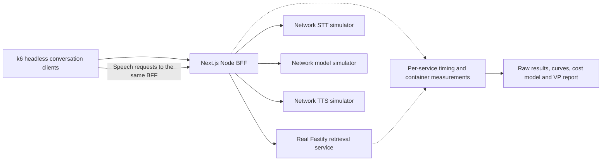

# Voice BFF backend performance and cost research

Date: October 14, 2026 (America/Chicago).

Tracking: [#39 — Specify backend performance and cost research for the voice BFF](https://github.com/kburson/AIVC/issues/39).

Status: draft specification for owner review. The owner requested this specification; the written artifact has not yet been approved. This document defines the research and report, not its implementation plan. No benchmark, paid API sample, capacity result, or deployment is established by authoring it.

## 1. Intent and decisions this research must support

Measure the performance curve of the local reference services, identify the first binding resource at each configuration, and explain the financial and operational consequences of optimizing code, assigning more resources, running more processes, and adding instances. Begin without a target peak-call count: discover the observed operating envelope rather than validate an assumed capacity.

The VP-level report must answer:

1. How many correct synthetic turns and concurrent conversation sessions can each tested service configuration sustain within declared latency and error limits?
2. Where does latency begin increasing sharply, and is the cause the event loop, GC, CPU throttling, memory, network, admission, another local service, or the test infrastructure?
3. Does assigning more CPU to one Node process improve this workload? What additional capacity comes from independent processes or instances using additional cores?
4. How do external STT, model inference, TTS, and tool waits affect in-flight work, local capacity, bandwidth, and user-perceived response delay?
5. What are the cost curves, provider allocation thresholds, and economically useful scaling choices? Which further optimizations are unlikely to repay their engineering cost?

The measurement definitions, completion oracles, pacing rules, and evidence classifications in section 16 govern all experiments and report labels below. The main investment is repeatable local experimentation. External APIs receive only a small bounded calibration sample across reasonable use cases. Network simulators replace paid services for capacity, stress, scaling, and soak runs. Results distinguish measured local behavior, exploratory live samples, simulated behavior, and financial projections.

## 2. Governing architecture and source evidence

The [reference specification](2026-10-12-voice-bff-reference-design.md) assigns the browser-facing BFF and provider orchestration to Next.js Node Route Handlers; Fastify owns the synthetic retrieval API. Provider calls do not all pass through Fastify. The [epic #2 plan](../plans/2026-10-12-2-voice-bff-reference.md) and its [Node 26 amendment](../plans/2026-10-13-2-node26-parallel-execution-amendment.md) describe the implementation boundary and superseding toolchain selection.

Authoring inspected the current checkout at `9e400ab` on `trunk`: governing documents are tracked, but the checkout does not contain a complete tracked application implementation. GitHub issue states and separate worktrees are not a substitute for inspecting the revision eventually tested. Before research implementation, resolve the accepted integrated application revision and verify the actual route, provider, cancellation, and speech contracts. Record any missing prerequisite as unavailable; do not fill it with a lookalike and call that the reference service.

Preserve the original application specification and sealed peer-review collateral. This research is a separately scoped extension. Its implementation plan must reconcile changes with the accepted application and issue ownership, rather than silently changing epic #2 acceptance or claiming historical live evidence applies to modified code.

## 3. Selected approach and scope

Three approaches were considered:

| Approach | Strength | Limitation | Decision |
| --- | --- | --- | --- |
| A. Protocol-level tests through the real BFF, local-service isolation, and calibrated network simulators | Measures the actual backend boundary with controlled cost and repeatability | Requires streaming-capable clients and simulator validation | Selected |
| B. Browser-led performance tests | Includes capture, rendering, and physical playback behavior | Browser work obscures portable backend measurements | Separate future UX validation |
| C. Sustained load against real speech/model APIs | Measures one provider deployment at one time | Expensive; quotas and provider variability hide local limits | Restricted to small calibration samples |

Primary path:



In scope:

- Backend API behavior, the actual BFF-to-retrieval boundary, provider adapters, stream consumption, cancellation, and request admission.
- Timing instrumentation on every locally owned API service, including success, rejection, and error paths.
- Controlled CPU/memory experiments, process and instance comparisons, k6 scenarios, calibration artifacts, reproducible analysis, and the management report.
- Simulated headless conversations that submit audio or text, consume incremental answers, request speech when eligible, and enforce the existing queue/segment/cancellation policy.

Out of scope for the first report:

- Browser rendering, React/VAD CPU, microphone devices, acoustic echo cancellation, and physical speaker playback.
- Implementing Twilio call routing, production telephony, a new Fastify orchestration gateway, persistent accounts, or a database not present in the reference architecture.
- Broad framework comparisons, self-hosted speech/model inference, autonomous per-call multi-agent fanout, or a new Kubernetes cluster.
- Paid provider load/soak tests, deliberate paid rate-limit exhaustion, or hosted search by default.

The owner's phrase "Redis UI" is interpreted as the React/browser UI. No Redis dependency is assumed. If the selected implementation actually requires Redis or another data store, retain that backend dependency in the measured topology and record it; bypassing the UI does not authorize bypassing a required backend dependency.

Frontends can change backend demand through pacing, payloads, cancellation, history, and speech requests. Freeze those behaviors in headless workload manifests. Backend-only results are portable for that declared request pattern, not proof that every frontend creates identical demand.

Telephony remains a labeled forecast. A future Twilio-compatible WebSocket profile may measure an implemented gateway, but HTTP turn/SSE results must not be relabeled as measured telephone-call capacity.

## 4. Experiment topology and attribution

Use two mandatory measurement paths:

- **BFF path:** k6 enters the actual Next.js APIs and exercises real orchestration, the real Fastify API when selected by a tool, and provider simulators over the network. This is the primary architecture result.
- **Fastify isolation:** k6 calls the real retrieval routes directly with the same schemas, fixture mix, and response sizes. This identifies retrieval service limits and checks whether retrieval is constraining the BFF. Its RPS cannot be presented as voice-session capacity.

Within the BFF path, run separate resource sweeps with the BFF as the constrained service and with Fastify as the constrained service. Hold all peer-service resources constant at independently demonstrated nonbinding allocations. Record each service's cgroup, process count, and resource use. A run where a peer becomes limiting is an architecture result, not an isolated limit for the intended target.

Do not place both application services inside one ambiguously budgeted container for the primary sweep. A shared-container experiment is supplementary and explicitly reports the combined budget. Do not send BFF-path traffic directly to Fastify to obtain a better result.

Use production builds and pinned toolchains/images. Do not benchmark Next.js development compilation, HMR, debug builds, or an unreported profiler as steady production overhead. Record cold start separately from warmed operation. Pin Node and dependencies to the selected accepted revision; do not independently upgrade the runtime for this research.

Load generators, provider simulators, and telemetry collectors have separate budgets from the constrained target. Prefer separate hosts for publication runs. On a shared host, reserve sufficient physical CPU/RAM/network capacity and record contention. Host swapping, VM oversubscription, simulator delays, or generator saturation invalidate a claimed isolated service limit.

## 5. Resource and process matrix

Use CPU units and GiB consistently. Enforce limits with actual container/cgroup settings; merely setting environment variables is insufficient.

### Primary resource matrix

| CPU quota | Memory limits to test |
| --- | --- |
| 1 CPU | 2, 4, 8, 12 GiB |
| 2 CPU | 2, 4, 8, 12 GiB |
| 3 CPU | 2, 4, 8, 12 GiB |
| 4 CPU | 2, 4, 8, 12 GiB |

The paired executive comparison is 1 CPU/2 GiB, 2 CPU/4 GiB, 3 CPU/8 GiB, and 4 CPU/12 GiB. The full 16-cell matrix separates CPU effects from memory effects. Unsupported or physically infeasible cells are reported unavailable, never inferred as measured.

All primary cells run one application process per target container. Record actual threads, including GC/libuv activity. More CPU assigned to one process does not imply parallel JavaScript execution on its main event loop.

Record CPU quota, period, cpuset policy, requests/limits where applicable, throttled time, architecture, CPU model, SMT, host resources, container engine/VM, kernel, swap policy, Node heap settings, and observed heap limit. Keep heap policy fixed for the primary comparison; report changes caused by Node's detected container limit. A manually tuned heap is a separate intervention, not an unreported change.

### Additional process and horizontal comparisons

After single-process sweeps, compare:

- One process versus two workers with the same aggregate 2-CPU/12-GiB allocation.
- One process versus four workers with the same aggregate 4-CPU/12-GiB allocation.
- Two and four single-process instances, each with the same selected per-instance allocation and enough aggregate host resources to honor it.

Workers must preserve per-session ownership, cancellation, and contracts. Include connection distribution and duplicated memory/pool overhead. The implementation plan selects a supported worker mechanism; adding workers must not fabricate unsupported Next.js clustering behavior. If no supported worker configuration exists, report that comparison unavailable and use the instance comparison.

Use one declared balancer configuration for instance comparisons and monitor each instance. Report allocation efficiency and new-connection skew. Do not claim seamless migration of an established stream or resilience of calls on a failed instance.

## 6. External API calibration and spending

Live calibration is a distinct command/mode. Mock-only execution is the default. This specification proposes a total calibration ceiling of USD 10 across all paid APIs, with at most 30 billable requests per provider initially and five repetitions per selected use-case cell. Continuations, warmups, cancellations, and retries count against both limits. Unused budget is not a requirement to spend it.

Before each paid request, reserve a conservative upper-bound cost using pinned model IDs, maximum billable tokens/audio/characters, billing minima, applicable tools, and a dated rate card. Count cache writes/reads and reasoning tokens according to the selected API. No concurrent calibration workers can each spend the same remaining balance. Reconcile actual usage when available; retain reservations for ambiguous outcomes. Stop at either limit. Disable automatic paid retries and hosted search. If an upper bound or rate cannot be established, omit that paid cell and record why rather than silently proceeding.

The limit is an application-controlled estimated spend bound, not a guarantee of the provider's final invoice. Record pricing uncertainty and exclude unsupported provider behavior from any stronger claim. Never automatically increase the ceiling, enable an extra paid feature, or rerun an expensive sample to improve its percentile.

Reasonable calibration cases:

| Provider | Initial cells | Measurements |
| --- | --- | --- |
| Model | Short answer; one project lookup with real tool continuation; longer bounded context | Connect/setup when visible, first answer token, tool decision/result, completion, tokens and status |
| STT | Synthetic 2-, 5-, and 15-second utterances; prerecorded reference path | Submitted duration/bytes, request/response time, transcript correctness for fixtures, billable usage |
| TTS | 40-, 120-, and 300-character approved text | First audio, completion, returned duration/bytes, generation rate and characters billed |

Separate cold-connection and reused-connection observations within the request cap. Initially use concurrency one, then a small sample at concurrency three if the remaining budget permits. Every model request, including continuation, counts as a request. Record the exact actual sample counts by cell; do not pretend every Cartesian combination was exercised.

Use the actual reference speech segment limits for end-to-end cases. Longer TTS calibration text is a direct provider characterization cell, not a relaxation of the application API. Likewise, streaming STT/TTS characterization is an optional separately labeled sample if the implementation supports it and the existing budget permits; prerecorded or REST latency does not calibrate an untested WebSocket protocol.

Collect examples of ordinary success, a lookup, and bounded longer context. Simulate failures and rate limits locally instead of purchasing enough real traffic to force them. Use only synthetic/public fixtures; retain no credentials or private caller audio.

Small samples establish exploratory observations, not production p99s, guarantees, or precise fitted tail distributions. Report sample sizes, minimum/median/range, and individual samples. Keep earlier conversational latency/capacity estimates labeled assumptions until replaced by evidence.

## 7. Provider simulators

Implement out-of-process network services at the provider-adapter boundary. Reuse actual adapters with configured simulator endpoints when possible. Where an adapter cannot be redirected, use a narrow explicit test adapter that still performs real network I/O and document the bypassed SDK behavior. In-process immediate stubs are useful correctness controls, not the published capacity topology.

Simulators reproduce the selected protocol and representative payload sizes, including model tool blocks/continuations, SSE framing, split UTF-8, HTTP errors, audio formats, response streaming, cancellation, and connection lifecycle. They must not generate real speech or invoke a real model to simulate work. Use bounded synthetic byte generation and scripted transcripts/text. Simulated correctness proves contracts, not speech quality or model intelligence.

Profiles are versioned, seeded, and include:

- **Minimum-wait control:** correct network protocol and realistic payloads with minimal intentional wait, to reveal local overhead.
- **Calibrated replay:** empirical sample tuples preserving observed first-output/completion, output size, chunks, and use-case relationships. Do not independently combine incompatible timings or imply a small sample is a complete provider distribution.
- **Sensitivity:** declared hypothetical fast/normal/slow/tail delays, output sizes, burst patterns, and quotas that extend beyond the observations. Label assumptions explicitly.
- **Fault and quota:** slow reads/writes, disconnects, malformed output, 429/5xx, stalled streams, cancellation settlement, and bounded provider concurrency/token limits.

Preserve response generation rate separately from playback consumption. TTS may produce audio much faster than real time; simulate that burst so the application must enforce its actual backpressure and memory policy. Streaming audio fixtures, if used, are paced and sized for the selected protocol rather than sent as a single file upload.

Record configured and actual simulator dispatch/output times. Simulator scheduling delay is a validity check: otherwise a saturated simulator can masquerade as a slow provider or a saturated BFF. Prove generators and simulators can exceed the highest accepted target load by at least 1.5 times in an independent control, or mark the capacity result censored at the tested load.

Mock-only runs start without paid credentials and restrict outbound connectivity to declared local test dependencies. SDK defaults, telemetry, and failover must not reach paid endpoints. Prove attempted paid endpoint access fails closed. Run artifacts state `mode: mock` and `externalSpend: 0` only when isolation evidence supports it.

## 8. Timing and observability contract

### Server-Timing on locally owned APIs

Every local API service emits `Server-Timing` for completed measurements known when response headers are committed. This includes ordinary, health/capability, admission rejection, validation failure, and upstream error responses under application control. Do not attempt to add a header after the first body bytes. Instrument at an early lifecycle boundary so normal error handling also has a timing context.

Use monotonic clocks and milliseconds. Metric names are bounded and namespaced, for example:

```http
Server-Timing: bff.admit;dur=0.8, bff.preheaders;dur=1.4
X-Request-Id: <correlation-id>
```

A nonstreamed retrieval response can include `retrieval.handler` and `retrieval.preheaders`. A BFF may relay completed child timings under a distinct namespace if they are already available. Do not make every third-party API emit headers we do not control; measure those calls in the local adapter.

`preheaders` ends immediately before header commitment; it is neither full stream duration nor client TTFB. The elapsed time before the handler is entered can include runtime/socket queueing that this header cannot explain. Client measurements, event-loop metrics, and correlated server records expose that gap.

Limit timing headers to 2 KiB and fixed metric names. No prompts, transcripts, secrets, URLs, provider account IDs, or raw untrusted descriptions enter headers. Unique trace/session/turn/request IDs belong in correlation records, not metric labels. Record any infrastructure-generated responses that bypass application instrumentation.

### Streaming completion and nested spans

For SSE, streamed PCM, and any later WebSocket path, headers cannot contain future model/TTS/stream completion times. Preserve early flushing. Emit correlated server-side completion/abort records and stage spans. Existing SSE consumers remain compatible; an optional research diagnostics event is versioned and must not be required to finish the stream or drain PCM. Do not append JSON timing bytes to audio.

Final records contain route elapsed time, first answer delta/first audio write when applicable, stream end or abort, admission outcome, provider spans, lookup spans, cancellation settlement, status, and bytes. HTTP trailers are optional evidence only after verifying the exact runtime, proxy, and load client expose them; the baseline does not depend on trailers.

Each span has run/trace/request/parent IDs, service/process identity, operation, start offset and duration on that process's monotonic clock, outcome, and relevant bounded byte/usage counters. Propagate trace context over internal calls without weakening existing Origin/Host admission. Do not subtract unsynchronized absolute timestamps across processes.

Distinguish inclusive parent durations, child waits, overlapping calls, queue time, and CPU consumption. Do not sum parent and child durations or subtract independent p95s to obtain a local p95. Any wall-time residual based on the union of local child-wait intervals is labeled residual residence time, not CPU time. Use paired traces and client observations for critical-path analysis.

### Process, container, network, and collector data

Capture per process and per instance:

- Event-loop delay histogram with declared sampling resolution and reset window; event-loop utilization; CPU time; GC count/pause observations.
- RSS, heap used/limit, external and ArrayBuffer memory; active turns/speech, leases awaiting cancellation, pending text/audio, open connections and file descriptors where available.
- Container CPU usage/throttling, memory limit/working set/OOM, network receive/send bytes, host contention, and balancer distribution.
- Generator utilization, intended/actual arrivals, dropped iterations, connection failures, simulator scheduling delay, and telemetry loss/backlog.

Use bounded asynchronous collection and fixed metric labels. High-rate raw traces must stream to an external collector rather than grow unbounded in application memory. Record collector backpressure/loss and never silently discard overloaded observations. Run a matched instrumentation-on/off subset to quantify overhead; observability is part of the published default configuration, not free measurement.

## 9. Backend-only k6 workloads and streaming clients

All requests use the real documented contracts, permitted Origin/Host, body/history limits, synthetic data, and actual cancellation semantics. No browser UI or browser VUs are required. Redirects, admission failures, and skipped provider work are not successful turns.

| ID | Workload | Purpose |
| --- | --- | --- |
| F1 | Fastify health and project lookup with controlled names/payloads | Isolated route, validation, and serialization curve; health is not domain-work capacity |
| B1 | Typed BFF answer without a tool | BFF/model-adapter and streaming overhead |
| B2 | Typed BFF answer with one real retrieval tool round trip | Full local aggregation path |
| B3 | Audio upload, prerecorded STT, answer/tool, and eligible speech through the BFF | Reference voice-backend workload |
| B4 | Larger valid history, longest admitted utterance, and bounded long output | Allocation, byte-rate, and queue sensitivity |
| B5 | Disconnect, cancellation, rapid replacement, slow consumer, and quota/error profiles | Cleanup, backpressure, and overload behavior |
| M1 | Declared mixed conversation population | Primary capacity and cost curve |

Initial M1 turn mix: 40% B1, 30% B2, and 30% B3. Initial conversation pacing follows the fixed schedule and residence policy in section 16.4 at four intended user turns/minute; report actual achieved pacing. B3 includes all required speech requests, not just `/api/turn`. Sweep pacing at two and eight turns/minute at the paired executive configurations. Run B4/B5 as explicit interventions rather than silently changing the baseline mix. Preserve separate typed, voice, and mixed results; one scenario's capacity cannot label another.

Each virtual conversation has independent history and generation state, only one current answer, and one active speech request at a time. A headless speech scheduler uses actual stable-text segmentation, effective caps, pending text/audio limits, virtual playback progress, and interruption rules. Count speech requests, audio duration, and suppressed/canceled segments. Virtual playback is calculated byte-duration consumption, not proof of audible telephone/browser playback.

Use both:

- Closed session populations for concurrent-conversation curves and realistic caller pacing.
- Open arrival-rate scenarios for new conversations/turns, so slow responses do not conceal offered demand. Report offered, admitted, started, completed, failed, rejected, dropped, and unfinished work separately. Do not pile overlapping turns onto one conversation to meet an offered rate.

A standard buffered HTTP response does not provide time to the first semantic SSE event or incremental audio consumption. Pin a k6 client/extension that supports the actual POST/multipart SSE contract, incremental events, cancellation, and header access. The candidate SSE extension is `phymbert/xk6-sse`; verify it against the pinned k6 release before selecting it in the implementation plan. An extension must not force a switch to a GET-only endpoint or a fake WebSocket transport.

Before any capacity result, a compatibility fixture must prove first-event observation before EOF, correct split-event parsing, prompt abort, and speech scheduling without blocking continued answer consumption. Standard k6 HTTP may measure complete finite audio download and server first-write timing, but it must not be labeled client first-audio timing. If client audio-first-byte behavior is unsupported, record that metric unavailable or use a separately validated streaming observer; do not fabricate it from TTFB headers. Failure of this protocol prerequisite blocks the affected scenario.

## 10. Load progression, validity, and capacity definition

Freeze scenario/profile versions, seeds, resource configuration, instrumentation, and decision thresholds before comparing cells. Run a low-load smoke and correctness check first. Separate cold starts from steady-state warmups.

For each of the 16 resource cells, run F1 isolation and M1 with the intended service constrained. Cover typed/voice/fault and pacing deep dives at the four paired executive configurations. The plan may schedule experiments efficiently, but must not replace a required cell with extrapolation.

Default discovery procedure:

1. Warm for 60 seconds at low load; exclude this interval from steady results but retain it as evidence.
2. Use session plateaus of 1, 2, 4, 8, and so forth, with at least 120 seconds of steady observation after stabilization. Stop after sustained failure or a validity/safety stop, retaining the failed point.
3. Refine the last passing/first failing bracket with intermediate loads. If no failure was reached, publish a lower bound, not an exact capacity.
4. Repeat low-load baseline, last-pass, boundary, and first-fail points three times with declared independent seeds and clean run state. Randomize configuration order where practical.
5. Select a candidate operating point at 75% of the highest repeatably passing session count, round down, and verify it for a 30-minute mock-only soak. If the highest passing count is one, retain one only as a no-headroom candidate and explicitly report that the margin cannot be achieved; do not publish a zero-session operating point. The 25% margin is a stated operating policy, not an inferred confidence interval. Increase the margin if the workload or failures justify it.
6. Verify cleanup after repeated batches and after overload. Retained heap/external memory and live resources should stabilize; RSS need not immediately return to its original value because allocators can retain pages.

Initial empirical screening thresholds, subject to the sample-count and repeated-run evidence rules in section 16.3, to be frozen in the first run manifest:

- At least 99.9% correct completed turns among all offered turns expected to complete; report load-generator drops, admission rejects, timeouts, stream failures, and unfinished turns in the denominator. Planned cancellation has its own expected-outcome denominator and cannot hide ordinary failures.
- For a given workload/profile, p95 first answer delta no more than its low-load baseline p95 plus 100 ms; p95 speech-request-local first server audio write no more than its baseline plus 150 ms; p95 turn completion no more than its baseline plus 250 ms.
- These baseline comparisons are acceptance budgets, not subtraction-based estimates of local percentile duration. Report absolute latencies alongside them, and show an exploratory three-second client-submit-to-first-received-PCM budget only where the section 16.1 same-client observer is validated. A slow profile that already misses it remains visibly outside that backend budget.
- Event-loop delay p99 at most 20 ms for the published low-lag operating point, with the sampling resolution disclosed. Also publish the empirical latency curve beyond that policy limit.
- No unbounded audio/text/telemetry queue, OOM, stale-generation output, duplicate paid work, or resource leak. Container memory remains below 85% of its limit at the proposed operating point.

Do not call a short sparse run a statistically reliable p99. Report count, histogram precision, per-run values, and uncertainty. Near-boundary points require at least 1,000 applicable completed timing observations across the repetitions for exploratory p99 reporting; fewer samples leave that percentile unavailable. Correlated turns and small repeat counts limit inference even above that minimum. Never average per-run p95/p99 values into a pooled percentile.

Stop a run on OOM, host swapping, telemetry loss that prevents attribution, generator/simulator saturation, or persistent unsafe queue growth. Record the stop cause and incomplete observations. Tests may continue through the first controlled overload point only while the environment remains bounded and recoverable.

Classify the first binding limit from multiple measurements. Event-loop saturation is a hypothesis, not a required outcome. A configured two-turn semaphore, exhausted socket pool, CPU quota, or slow Fastify peer can limit throughput before the main loop saturates. Preserve a default-admission control, then use explicit mock-only research admission settings to find the hardware curve. Do not relax live spending, payload, deadline, or cancellation safeguards to obtain a higher result.

## 11. Analysis and scaling forecasts

Produce curves by workload, profile, target service, resources, and process count:

- Offered load, active conversations, admitted work, correct goodput, rejection/error rate, and latency p50/p95/p99 where supported.
- Time to first answer, first server audio write, completion, and paired per-stage timing; clearly distinguish backend milestones from physical audible response.
- Event-loop delay/utilization, CPU/throttling/GC, RSS/heap/external memory, queue age/duration, connections, and receive/send bandwidth versus load.
- Capacity versus CPU and versus RAM, plus resource-normalized goodput. Show the paired executive configurations and fixed-variable comparisons.
- Single-process versus workers versus instances; scaling efficiency `C(n) / (n * C(1))` under identical per-instance workloads, with aggregate resources and balancer overhead disclosed.
- Fastify isolation versus BFF-path results, identifying whether retrieval, orchestration, or another component binds first.

Use per-run raw observations to create uncertainty/range bands. Do not join independent service percentiles as if they were one end-to-end distribution. Replay paired calibration tuples and sensitivity profiles to show how provider delay changes occupancy and backlog under the same declared arrivals. Do not claim that more Node replicas make one remote inference or synthesis operation faster.

No universal "Node.js maximum" is asserted. Conclusions apply to the tested revision, request pattern, hardware, runtime, admission policy, and topology. Any extrapolation beyond measured instances, resources, or provider sample concurrency is explicitly projected and includes assumptions.

## 12. Cost model and financial feasibility

Keep cost inputs versioned with currency, provider/model/region, unit, effective date, primary source URL, promotional/contract status, and billing assumptions. Refresh them at analysis time; earlier chat prices are not a durable rate card. Unknown contract uplift or quota-upgrade price stays unknown rather than zero.

Track telephone minutes, stream minutes, submitted STT audio minutes, synthesized characters, actual input/output/cache/tool usage, compute-hours, memory allocation, ingress/LB/NAT/egress, observability/storage, and required idle/HA capacity separately. Twilio fees are projections until an actual telephony path is sampled. Mock-generated usage counters are projections, not provider invoices.

Compute cost per successful synthetic turn, per modeled conversation/call-minute, per instance-hour, and per supported concurrent session at declared utilization. Successful business resolution requires later outcome data and is not inferred from a scripted success. Include low/medium/high occupancy and daily duty cycle, warm spare capacity, and minimum platform footprint. A highly utilized instance's marginal cost must not conceal the fixed cost of a mostly idle deployment.

Project practical capacity as the minimum of measured local capacity, network limits, data-service capacity, and provider limits translated into workload units. For `t` turns/caller-minute and `q` model requests/turn, `N` callers create `N*t*q` model RPM; token and active-request limits supply additional bounds. Distinguish persistent connection slots from paid audio/text units. Use actual lifetime/overlap measurements rather than assuming every provider is continuously generating at full rate.

Financial feasibility is conditional until the owner supplies a revenue or budget constraint. Present cost-versus-capacity curves and break-even tables across adjustable budget/utilization assumptions; do not invent a profitable concurrency target. Include discrete spend steps when adding instances/nodes or changing a provider contract.

For each candidate optimization or scaling action, compare measured capacity/latency benefit, saved monthly operating cost, implementation and operating effort, quality implications, and payback interval. Distinguish concurrent independent agent sessions from multiple paid agents on one turn. Local code optimization can improve capacity without materially improving external wait time; fewer model rounds, shorter suitable output, and better retrieval can change both latency and variable API spend.

## 13. Reproducible artifacts and VP report

Proposed artifact locations, created by later implementation:

```text
tools/performance/                 k6 scenarios, simulator and analysis sources
research/performance/fixtures/      Synthetic input and deterministic profiles
research/performance/calibration/   Sanitized bounded provider observations
research/performance/runs/<run-id>/ Immutable run manifest, summaries and raw references
research/performance/analysis/      Derived CSV/JSON tables and exported figures
docs/research/performance/          Report Markdown, standalone HTML and methodology
```

Use stable names and schema versions, not a dependency on a hosted dashboard. The report must be readable without external accounts. Export figures as SVG or PNG plus underlying CSV. Provide a concise executive report and a linked technical appendix. Keep large raw artifacts outside ordinary Git when necessary, with immutable hashes, accessible storage references, retention rules, and reproduction instructions; do not commit credentials, node_modules, or private audio.

Every run manifest records at least: run ID/time, source commit and dirty/input digest, toolchain and dependency lock/image digests, machine/container facts, target/peer allocations and process counts, admission settings, topology/protocol/TLS, scenario/profile/fixture hashes, seed, offered-load schedule, thresholds, warmup/steady intervals, simulator and generator validation, instrumentation, stop reason, and artifact hashes. Calibration manifests additionally contain exact provider/model/region, request settings, sample counts, usage/reservations, rate-card source, observed failures, and redaction policy.

The VP report begins with the measured operating envelope, first binding constraints, cost composition, and recommended spending/engineering sequence. It must contain:

1. A configuration table with candidate operating point, observed boundary bracket, workload, latency, correct goodput, bandwidth, and evidence status.
2. Clear latency/goodput/resource curves with threshold crossings and uncertainty; failed points remain visible.
3. What more CPU, more RAM, workers, and additional instances actually produced, including disappointing or non-scaling results.
4. External latency observations, sample limitations, quota thresholds, and the sensitivity of capacity and cost to provider behavior.
5. Cost and utilization scenarios, fixed versus variable costs, and recommendations with explicit economic assumptions.
6. Limitations: synthetic workloads, missing production data, unsupported cells/protocols, local host versus cloud differences, and untested physical telephony/browser behavior.
7. A technical appendix linking methods, exact artifacts, timing definitions, reproducibility commands, and rerun criteria.

A report template or plot populated with invented numbers is not a completed research report. Provide a schema/template while results are absent and label all illustrative examples. The later implementation plan defines commands and evidence verifiers against the integrated repository; this document does not invent passing commands or executed tests.

## 14. Acceptance and handoff

The research is complete only when:

- The selected baseline revision and backend contracts are verified; instrumentation and streaming-client prerequisites pass without changing the request path.
- Paid calibration respects the recorded total/request ceilings, captures reasonable actual cases, and identifies unavailable samples honestly.
- Mock-only capacity runs prove no paid access, simulator fidelity/throughput, generator headroom, and correlated timing through all local API levels.
- All feasible resource cells and required comparisons have retained evidence; unavailable/invalid/censored cells remain explicit.
- Capacity boundaries, repeated points, recovery, the operating-point soak, and instrumentation overhead are evidenced.
- Raw observations regenerate the reported curves and costs; summaries reconcile offered/completed/failed work and preserve stopped runs.
- The VP report supports the stated research decisions with linked evidence and separates measurements from projections and assumptions.

The immediate deliverable is this written specification for review. Implementation planning, backlog decomposition, runtime changes, deployment, and paid calibration follow the separately accepted plan and normal repository workflow. Do not overwrite the accepted reference contracts or add a telephony gateway merely to satisfy a benchmark scenario.

## 15. Primary technical references

These sources support mechanisms, not capacity claims for this application. Recheck pinned-version behavior during implementation.

- [W3C Server Timing](https://www.w3.org/TR/server-timing/): header grammar, durations, and exposure.
- [Fastify lifecycle](https://fastify.dev/docs/latest/Reference/Lifecycle/) and [Reply](https://fastify.dev/docs/latest/Reference/Reply/): header/send/completion boundaries and optional trailers.
- [Next.js Route Handlers](https://nextjs.org/docs/app/api-reference/file-conventions/route): server transport boundary and streaming.
- [Node performance APIs](https://nodejs.org/api/perf_hooks.html): event-loop delay/utilization and performance observations.
- [Docker resource constraints](https://docs.docker.com/engine/containers/resource_constraints/): enforced CPU/memory resource policy.
- [k6 open and closed models](https://grafana.com/docs/k6/latest/using-k6/scenarios/concepts/open-vs-closed/), [protocols](https://grafana.com/docs/k6/latest/using-k6/protocols/), and [HTTP Response](https://grafana.com/docs/k6/latest/javascript-api/k6-http/response/): offered-load models and client capabilities.
- [xk6-sse author repository](https://github.com/phymbert/xk6-sse): candidate incremental SSE client; compatibility with the actual POST contract is an explicit prerequisite.
- [Deepgram limits](https://developers.deepgram.com/reference/api-rate-limits), [Deepgram pricing](https://deepgram.com/pricing), [Claude limits](https://platform.claude.com/docs/en/api/rate-limits), [Claude pricing](https://platform.claude.com/docs/en/about-claude/pricing), and [Twilio US pricing](https://www.twilio.com/en-us/voice/pricing/us): inputs to refresh for calibration and projections.

## 16. Measurement, outcome, and evidence definitions

These definitions resolve the cross-request and statistical details of sections 8–13. A report cannot substitute a cheaper or earlier milestone for the named metric, count a text-only result as voice success, or turn an inconclusive observation into a passing capacity point.

### 16.1 Metric dictionary and clock ownership

| Metric | Origin → end | Clock owner and eligible population |
| --- | --- | --- |
| Client first answer | Immediately before submitting `/api/turn` → first valid nonempty semantic answer delta received | One headless client monotonic clock; one observation per text-bearing turn, excluding admission/status events |
| Speech-request first server audio | Entry to one `/api/speech` request → first valid PCM write for that request | One server process monotonic clock; per segment, not per conversation turn |
| Client turn first audio | Immediately before submitting `/api/turn` → first valid PCM received for the first eligible speech segment of that turn | One validated headless client monotonic clock spanning both HTTP requests; one observation per ordinary voice-bearing turn |
| Client text completion | Turn submission → valid terminal answer completion received | Same client clock; text oracle must pass |
| Client voice delivery completion | Turn submission → receipt/draining of every required eligible segment and final pending-speech settlement | Same client clock; voice oracle must pass |
| Virtual playback completion | Turn submission → virtual consumption of all required audio at its declared sample rate | Same client clock/model; includes virtual queue drain, not physical audible playback |
| Request residence | Request entry → normal end or observed abort/settlement | Same server process; aborted/failed outcomes remain distinguishable |

Every record correlates conversation ID, `turnId`, generation, request ID, and `segmentId` where applicable. The client schedules speech from the actual stable text and records both intended and actual speech-request initiation. Use the first eligible segment once for turn-level first audio; later segments contribute request-local metrics and continuity checks, not additional first-audio samples.

The BFF can serve turn and speech requests on different processes. Matching IDs do not make their monotonic clocks comparable. The same-client cross-request observer is mandatory for client turn first-audio claims; otherwise that metric is unavailable and request-local server measurements remain useful under their own names. Distinguish a first PCM byte from a complete valid sample; require valid format and sufficient bytes for a sample before recording first audio. Warmup, canceled generations, provider failures, and fixtures intentionally producing no speech have separately declared populations rather than being silently removed from ordinary outcome accounting.

Client submission includes upload/STT/model/segmentation/client scheduling as exercised by the harness, but excludes earlier capture/VAD and physical playback. The exploratory three-second backend budget is not proof of the original speech-end-to-audible goal. Server first-write and endpoint latency cannot demonstrate either client-receipt or acoustic timing. No sample is created when its required observer or endpoint is missing.

The 150 ms baseline regression budget in section 10 applies only to speech-request first server audio. The 250 ms completion budget applies to client text completion for typed turns and client voice delivery completion for ordinary voice turns. Virtual playback duration is reported separately because answer length deliberately changes it. Client turn first audio is also reported as its own absolute curve and backend-budget comparison when supported.

### 16.2 Workload-specific outcome oracle and settlement

For B1/B2, successful completion requires the scripted expected final text, correct actual tool results and identifiers where required, a valid terminal sequence, and no stale/duplicate output. For ordinary B3 and voice-bearing M1 turns, voice success additionally requires every fixture-required eligible speech segment in order, valid audio format and byte-duration, successful complete draining, bounded queues, and no unintended suppression, overflow, truncation, synthesis failure, or obsolete-generation audio. Select fixture expectations before each run and account for the real segmenter and configured limits.

Record `textOutcome`, `voiceOutcome`, and `cancellationOutcome` independently. A valid completed text answer followed by failed speech is text success and voice failure; it cannot increase ordinary voice goodput or reduce cost per successful voice turn. At least one ordinary B3 fixture produces multiple segments with speech continuing after SSE completion, so that omission is detectable. Deterministic audio checks establish transport correctness, not naturalness, intelligibility, or successful business resolution.

A voice turn's delivery observation window stays open after answer SSE completion until required segments and pending speech settle or a 120-second absolute turn-observation deadline is reached. Requests still obey their shorter reference deadlines. Use concise ordinary fixtures that fit this window; long/over-cap fixtures are separately labeled policy tests. The headless scheduler also tracks virtual playback to apply backpressure and pacing even after network delivery completes.

Stopping offered arrivals does not discard admitted work. Drain for up to 120 seconds, classify remaining operations unfinished/failed against the ordinary denominator, initiate cancellation, and retain a further settlement record for up to 30 seconds. If upstream work remains unconfirmed, retain its unresolved lease/resource status and mark cleanup failure. Do not free a lease early or mark missing audio successful to finish a run. Include all resulting bytes, operations, reservations, and failures in accounting.

Intentional B5 interruption and intentionally policy-limited cases have explicit expected outcomes and their own denominators. Prove old-generation cancellation and absence of stale output. Ordinary baseline turns are not reclassified as intentional cancellations after failure. Mixed goodput and costs use each workload's matching oracle and also publish per-workload counts; they cannot hide voice failures behind typed successes.

### 16.3 Empirical screening, confirmation, and inconclusive outcomes

The 99.9% figure in section 10 is an observed success-fraction screening policy. Neither three short repeats nor a 30-minute soak proves an underlying 99.9% service reliability. Call the proposed operating point an **empirically observed candidate** and state that production reliability is unproven. Preserve those labels in executive tables and financial projections. Any later reliability claim needs a separate confidence/precision design that addresses within-session dependence and changing workloads.

For each baseline and candidate stratum, publish offered/admitted/completed/failed counts, applicable timing count, duration, independent session count, repeat count, per-run histogram/range, and uncertainty method. A p95 regression decision requires at least 200 applicable timing observations in both the comparable low-load baseline and each candidate repeat. This minimum is an exploratory decision policy, not a confidence guarantee. Baselines may use several independent sessions only while resource measurements confirm they remain below the local contention region. Do not silently change pacing, payload, profile, or mixture to manufacture samples.

Discovery plateaus are screens. Extend mock-only baseline or confirmation observation up to 60 minutes per run if needed for the named metric counts. If counts, a comparable baseline, or uncertainty evidence remain insufficient within that bound, label the threshold inconclusive. Sparse points may still show descriptive data and observed hard failures; they cannot be accepted as fully confirmed capacity points. No extra live calibration is required or authorized to improve these statistics.

A repeated point passes empirical confirmation only when all three repeats separately meet every applicable outcome, timing, resource, and validity rule. One failed repeat makes the point fail; an inconclusive repeat makes confirmation inconclusive. A pooled average or percentile cannot conceal a failed or sparse repeat. The 30-minute soak is an additional recovery/stability observation and cannot by itself repair inadequate confirmation evidence.

Use the highest repeatably confirmed passing point for the 75% policy candidate. If none can be confirmed, report the observed bracket and unconfirmed candidate rather than a validated operating count. If that count is one, publish the no-headroom caveat specified in section 10. The p99 minimum in section 10 remains exploratory and does not imply statistical confidence or override these p95/count rules.

### 16.4 Session schedules, pacing, and open arrivals

One ordinary conversation resides for 180 seconds plus bounded drain. Give each session an independent deterministic seed. Its first intended turn is session start plus a uniform phase in [0,15) seconds. Later intended submissions occur at that phase plus `15*k` seconds and independent uniform jitter in [-1.5,1.5] seconds, while the intended time remains inside the 180-second residence. Each submission uses a completed synthetic utterance or typed fixture; prior recording time is not silently added to HTTP submit latency. At two/eight turns per minute, use 30/7.5-second intervals with jitter of plus/minus 10% and a phase over one interval.

A scheduled ordinary turn cannot overlap unsettled prior answer, required speech delivery, or virtual playback in that session. If the session is still busy at its intended start, count that offer as a `busy-schedule-miss`, exclude it from admitted goodput, include it among failed offers for the offered-work screening policy, and do not queue, catch up, or cancel the old turn. Normal baseline waits therefore cannot silently lower offered demand. Intentional barge-in is only the separately labeled B5 policy. Keep request service latency for admitted turns distinct from the failed-offer rate.

Closed-population plateaus maintain the declared number of resident sessions, replacing each expired session after its bounded drain; retain both intended resident slots and actual resident/in-flight/settling populations. A slot temporarily in drain is visible, and its missed scheduled work is not hidden. Report idle residents, in-flight turns, pending speech, measured starts/minute, successful completions/minute, and session residence separately. A cold-start replacement period is not automatically counted as steady state.

For the mandatory open scenario, one k6 arrival iteration represents one **new 180-second conversation** with its own session ID and the above schedule. Conversation start arrivals are independently scheduled; record late or dropped starts, offered conversations/second, actual lifetime, and population. An optional open-turn saturation test uses a new independent one-turn session per iteration, has no overlapping turns, and is labeled unpaced backend saturation rather than realistic caller population.

Translate callers into RPM, bandwidth, and cost using actual achieved turn rates and residence, showing offered demand and failed offers alongside them. Report paced-session capacity and unpaced request throughput as different curves. The no-target discovery is allowed to show a conversational pacing limit before CPU saturation; F1/B1 and open-turn controls then isolate remaining backend headroom rather than changing the baseline definition.

### 16.5 Mandatory coverage and hosting-price mapping

| Experiment family | Minimum-wait network control | Calibrated replay | Sensitivity/fault/pacing |
| --- | --- | --- | --- |
| F1 isolation, every feasible resource cell | Required; no external wait is injected into real retrieval | Not applicable to direct retrieval | Fault subset at the four paired executive configurations |
| M1 BFF path, every feasible resource cell and both constrained-service sweeps | Required | One declared supported replay profile required; if calibration is unavailable, use a clearly hypothetical profile and mark empirical replay unavailable | Four paired executive configurations |
| Worker and two/four-instance comparisons | Required | Same supported replay profile as single-instance comparison | Boundary, skew, and recovery subset |
| B1/B2/B3 deep dives | Four paired executive configurations | Same profile at those configurations | Declared selected slow/tail cells |
| B4/B5 interventions | Appropriate controlled profile | Not required | Four paired executive configurations; never pooled into ordinary M1 |

A missing supported calibration remains explicit; a hypothetical replay cannot be counted as measured external behavior. This matrix defines minimum coverage, not permission to purchase more samples or invent support for an unimplemented protocol.

For every costed deployment, map the experimental entitlement to a dated purchasable hosting SKU, region, architecture, shared/dedicated/burst CPU policy, billing granularity, usable resource overhead, packing assumptions, and required spare resources. A 3-CPU experiment is not automatically priced at three quarters of a 4-CPU server. If the actual platform cannot buy that allocation, show its containing purchasable unit and unused capacity. If machine performance differs, label both the capacity transfer and allocation-price mapping as projections. Preserve unpriced cells and unknown provider contract changes as unknown.
