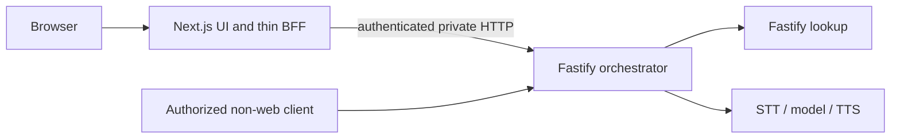

# Three-service voice backend migration

Date: October 16, 2026 (America/Chicago). Tracking: [#40](https://github.com/kburson/AIVC/issues/40).

Status: migration-specific draft for independent review. No acceptance, implementation approval, test execution, deployment or paid-provider result is asserted.

## 1. Intent and governing evidence

The service operator needs to deploy and scale the portable voice backend independently of its web client and lookup service. Success is an integrated three-service application with verified compatibility, not a research simulator.

- [Governing research specification](2026-10-14-39-voice-bff-performance-research-design.md), original revision `be1da47a81cbbf8b2bc56eda194bca2c0e9e1c42`, SHA-256 `bd1803bf8b3b1f6c70489c33a125ec4fd4dd9c8962b50023ae23a26945059919`; especially sections 18–19.
- [Governing research plan](../plans/2026-10-15-39-voice-bff-performance-research.md), original revision `f273bf88d0d3a7125c78e54479541794adf7c40e`, SHA-256 `23bae15f1cde2d54d8c78994170739a46f05bb3405f259e5815204323d7f289b`; sections 1, 12–13 and Task 0.
- #40's live acceptance criteria. #39's accepted predecessor reviews and later unreviewed amendments remain distinct; this review assesses the migration requirements directly.
- Formatted #39 views preserve originals in `docs/quality-evidence/2026-10-16-39-originals.json`. Original hashes identify those original bytes, not current formatting views.

This stage prepares and reviews documents only. No application implementation, provider calls, production deployment, cluster creation, telephony gateway, campaign or spending begins here. Research #41/#42 wait for an accepted integrated application revision and actual evidence, not plan acceptance alone.

## 2. Verified baseline and gaps

Inspected source: `ff0cb5a31baca8a50cc83c8a862e73c84d19edc8`, fetched `origin/trunk` at authoring.

| Existing source                                                | Observed behavior                                                             | Migration consequence                                           |
| -------------------------------------------------------------- | ----------------------------------------------------------------------------- | --------------------------------------------------------------- |
| `apps/web/server/runtime.ts`, `providers/`, `tools/`, `turns/` | Next.js owns STT/model/lookup/TTS, leases and deadlines                       | Move ownership into Fastify orchestrator                        |
| `apps/web/server/http/{body,sse-response,speech-response}.ts`  | Bounded bodies, SSE/PCM, abort and deferred lease release                     | Preserve semantics; add real socket backpressure/shutdown proof |
| `apps/web/shared/{contracts,validation,history,sse}.ts`        | Browser-safe contracts; caller-supplied history                               | Extract neutral shared workspace                                |
| `apps/web/client/{turn-controller,voice/speech-queue}.ts`      | Client generation fencing and per-request abort; self-contained speech inputs | Later requests can use any replica                              |
| `apps/retrieval/src/http/app.ts`, `fixtures/projects.json`     | Independent Fastify `/v1/projects` and `/health`                              | Retain lookup API; version immutable data                       |
| `scripts/dev.mjs`                                              | Two-process launcher                                                          | Add orchestrator and three-service lifecycle                    |

The current turn parser accepts multipart text or WAV, not JSON turn bodies. Preserve the actual browser contract; the governing JSON-or-multipart description uses its established multipart representation here. Adding JSON turn input requires an explicit extension. Speech remains JSON. No cancellation-by-ID endpoint or server generation registry exists. Turn/segment IDs correlate requests; they are neither authorization nor idempotency keys.

Existing SSE enqueues eagerly: unchanged relocation would not prove bounded backpressure. Historical tests/live evidence describe the old revision and do not validate the new topology.

## 3. Approaches and decision

1. **Selected: extract neutral contracts and the existing real provider lifecycle into a standalone Fastify orchestrator; retain web paths as forwarding adapters.** Lowest semantic drift, compatible browser, reusable backend. Streaming and lifecycle boundaries receive socket-level tests.
2. **Shared coordination store.** Supports stronger generation/idempotency/cancellation commands but adds a stateful dependency, cost and failure modes. Existing request-scoped semantics do not require it; do not add a store here.
3. **Rewrite or retain orchestration in Next.js behind a facade.** Rewrite increases parity risk; facade fails portable ownership. Neither is selected.

No-store design does not promise global deduplication, server-enforced latest-generation ordering, cross-request cancellation or transparent failover. If a real acceptance requirement needs such guarantees, stop and amend this design to declare shared coordination and costs; do not use affinity/local maps as a substitute.

## 4. Service and module ownership

| Unit                         | Responsibility                                                                                             | Dependencies                                                   |
| ---------------------------- | ---------------------------------------------------------------------------------------------------------- | -------------------------------------------------------------- |
| `packages/contracts`         | Existing types, validators, SSE grammar, history retention                                                 | No Node runtime, Next.js, provider SDK, config or secret reads |
| `apps/orchestrator`          | Credentials/config, validation, STT/model/tools/lookup/TTS, capabilities, admission/deadlines/cancel/usage | Contracts, pinned Fastify/SDKs, HTTP lookup                    |
| `apps/web/server/forwarding` | Web admission, fixed upstream mapping, server-held caller token, streaming bridge                          | No provider SDK/runtime/lease ownership                        |
| `apps/retrieval`             | Synthetic catalog and HTTP lookup                                                                          | Existing Fastify/AJV, immutable fixtures                       |

Move browser/test imports to `@aivc/contracts`. Shared workspace exports compiled ESM/declarations and builds before consumers; server imports use explicit `.js` specifiers. Move server ownership instead of keeping two executable implementations. Remove provider SDK direct dependencies and provider import graph from web. Pin Node 26.8.1/npm 12.0.2 and existing application dependencies; no runtime upgrade.

## 5. HTTP and authentication contract

| Endpoint                    | Web admission                     | Core admission                                                     | Response                                                  |
| --------------------------- | --------------------------------- | ------------------------------------------------------------------ | --------------------------------------------------------- |
| `POST /api/turn`            | Host + Origin; streamed multipart | Bearer auth before body/provider lease, 2 MiB multipart validation | Existing version-1 SSE grammar, terminal and usage fields |
| `POST /api/speech`          | Host + Origin; streamed JSON      | Bearer auth before body/provider lease, 8 KiB/segment validation   | PCM s16le, 24 kHz, mono and existing audio headers        |
| `GET /api/capabilities`     | Host; delegated capabilities      | Bearer auth; no provider work                                      | Existing shape; web response retains web build metadata   |
| `GET /health`, `GET /ready` | Minimal operational endpoints     | Minimal operational endpoints                                      | No secrets or paid probes                                 |

Core uses a configured exact bearer credential with bounded input and constant-time comparison. Missing/wrong credentials return 401 before paid-capable body consumption, lease acquisition, adapters or provider work. Validate core Host independently; never trust forwarded Host/Origin/identity/deadline headers as authority. Private direct clients authenticate and follow identical validation/admission. Origin is not caller identity. No public browser CORS access to core.

Web overwrites inbound Authorization with its server-held token. Fixed upstream origin and endpoint allowlist; no user-selected URL, redirect following, automatic retry or open proxy. Strip cookies, proxy-auth, hop-by-hop and untrusted internal headers. Preserve multipart boundary, status, safe content/format headers and exact stream bytes. No whole upload/SSE/PCM buffering or rewriting. IDs correlate; they never authenticate.

Compose keeps core/lookup on an isolated application network without public host bindings. Production ingress TLS and secret delivery require separate deployment authorization; declare any private plaintext hop. No credentials, prompts, transcripts or raw request headers in evidence, images or browser bundles.

Keep pre-header validation/provider error envelopes and retryability. After headers, forward terminal SSE errors once; transport loss closes incomplete, never fabricates completion. PCM failures terminate, never append diagnostics. Sanitized 502 for unreachable upstream before headers; 504 for forwarding deadline before headers; after headers abort/close.

## 6. Deadlines, backpressure and settlement

Core deadlines start before body ingestion and govern provider/tool work. BFF deadline starts before upload and covers upload/connect/headers/full stream, bounded to configured turn/speech timeout plus configured transport grace. No per-chunk reset, raw cross-process monotonic timestamp or extension of core budgets.

Both bridges are bounded and pull-based. `write(false)` waits for `drain` with abort awareness; upstream reads stop when downstream is full. Per-hop application queue is at most 64 KiB plus one producer chunk of at most 16 KiB; split larger chunks before enqueue. Configure/measure runtime socket buffers separately. Body accumulation remains capped. A high-water mark without producer demand gating is insufficient. Never drop SSE/PCM bytes to hide pressure.

One request controller combines downstream close, timeout and shutdown. Abort propagates through BFF fetch/socket closure to the owning core request and provider readers/tools. Test response-socket closure after upload and after headers, not merely a synthetic Request signal. BFF termination closes upstream work; no cancellation command is sent to an arbitrary replica.

Preserve `runWithDeadline`'s client-facing `result` versus actual `settled`. Hold two turn/two speech slots per core process until actual provider/reader/cancellation settlement, including late EOF/rejection. Timeout/socket loss does not release paid leases early. Observe all cancellation promises; no unhandled rejections or extra terminal events. Preserve provider-observed usage; unfinished/unknown work is not zero-cost success. No automatic paid retry.

## 7. Stateless and cross-replica semantics

| State                 | Owner/lifetime                            | Rule across replicas                                                                       |
| --------------------- | ----------------------------------------- | ------------------------------------------------------------------------------------------ |
| History               | Caller; bounded whole-pair input          | B receives explicit history; no session fetch from A                                       |
| Generation            | Browser controller/queue                  | Client fences stale output/dispatch; no global core generation promise                     |
| Speech                | Request carries turn ID, segment ID, text | B synthesizes without prior turn state on B                                                |
| Cancellation          | Each open transport                       | Aborts its actual owner; next independent request may use B                                |
| Leases/provider work  | Handling process until settlement         | Two slots of each kind per process; N replicas permit at most 2N of each, not a global cap |
| Duplicate submissions | Caller-request semantics                  | Duplicate IDs can cause separate work; no ambiguous automatic retry                        |
| Catalog/config        | Immutable image/config                    | Same recorded catalog/contract/config digests in eligible replicas                         |

No required writable service volume, local durable history, sticky cookie, owner-replica ID, lock service or database. Framework caches or ephemeral mounts must be bounded, disposable and irrelevant to later-request correctness. Test read-only roots and unprivileged containers; bake build/VAD assets into images. Record any pinned-framework ephemeral mount requirement.

Force turn A → speech B → next turn/history B, replace A, then continue. Assert client interruption cancels every active old turn/speech stream and ignores stale events while the next generation works elsewhere. This is transport cancellation plus client fencing, not remote cancellation or global stale-request rejection. Unsupported cancellation endpoints return 404 with no provider work.

## 8. Production topology and termination

Three separate images/start commands, independent health/readiness, resource limits and replica controls. Baseline one of each; two-core test keeps web/lookup at one each. A stateless retry-disabled test/ingress router proves per-request selection without stickiness; record its separate resource/cost footprint. It is neither an application service nor hidden coordination storage.

SIGTERM first withdraws readiness and refuses new application requests (including keepalive requests) with sanitized 503. Drain established work for configured 15 seconds, abort remainder, then allow configured 5 seconds for settlement. Hard-exit unresolved work is interrupted/settlement-unknown, not settled, released or replayable. Container stop grace is at least 25 seconds. Hard-kill evidence must show incomplete stream outcome and zero surviving-replica replay. Initial durations are configuration, not sizing recommendations.

Health is event-loop responsiveness. Readiness covers valid startup config, required credential presence without values, build/contract/catalog consistency and non-draining state. No paid probes. Bounded cached lookup dependency checks must declare interval/policy and avoid restart storms. Web checks configured core readiness/capabilities with authentication and no provider call. A failed downstream readiness check cannot itself perform paid work.

Catalog version is SHA-256 of delivered fixture bytes in a service operations manifest; lookup response schema is unchanged. Record image/build and contract digests; mismatch refuses accepted topology. No `latest` image, source bind mount or dev server in acceptance.

## 9. Verification and research handoff

Only scripted/mock providers; paid credentials absent and external provider egress denied. Exercise real application modules and production servers; clients never implement missing server behavior.

| Acceptance area            | Required proof                                                                                                                             |
| -------------------------- | ------------------------------------------------------------------------------------------------------------------------------------------ |
| Separate containers        | Image IDs/digests, read-only roots/mounts, limits, health/readiness; core scaling alone                                                    |
| Direct/delegated parity    | Equivalent validated SSE sequence/usage, PCM bytes/headers, errors and no web provider path                                                |
| Auth/pressure/cancellation | Auth-before-body/lease, forged header refusal, slow upload/reader, oversize, socket abort, held leases during deferred cancellation        |
| Replica correctness        | Forced A/B turn/speech/history, cold replacement, client generation fencing without storage/affinity                                       |
| Termination                | Readiness withdrawal, keepalive refusal, drain/abort/settlement/unknown, hard kill, no replay                                              |
| Task 0 handoff             | Accepted integrated source/PR, contract/config/catalog digests, images/topology/resources, state declaration, verifier results/limitations |

Required entry point: `node --test tests/contracts/stateless-services.test.mjs`. It runs real offline integration/production-container checks and fails when required runtime/images are absent; no silent skips. A fast companion suite cannot replace container acceptance. Implementation delivery also requires existing unit/contracts/integration/voice/slow/browser regression suites, typecheck, build, lint and format. These are future requirements, not executed-result claims.

Publish exact accepted artifacts/review records in #40's formatted Plan Metadata. Preserve historical sealed bytes. Maintain a draft PR to `trunk`. Review acceptance alone cannot close #40 or unblock research.

## 10. Decomposition and approval boundary

Preliminary 40 joint hours/XL: separate contracts, core transport/ownership, web delegation, lifecycle/container packaging and cross-replica acceptance into dependent reviewable work. The migration plan must define the task graph and meaningful tests. Hydration/conversion uses governed AITM actions after plan review; do not fabricate children or skip stages.

Acceptance names exact revisions/digests and distinguishes native SAR from sealed SPR/XPR. Stop before product implementation even when both planning artifacts have accepted peer reviews; owner implementation approval remains separate.
