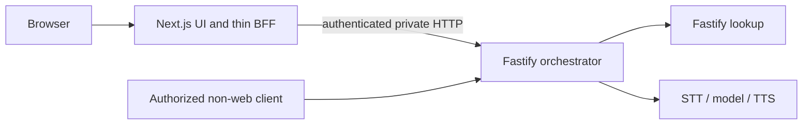

# Three-service voice backend migration

Date: October 16, 2026 (America/Chicago). Tracking: [#40](https://github.com/kburson/AIVC/issues/40).

Status: migration-specific revision for independent review. Historical native SAR applies to its recorded bytes; this revision awaits sealed XPR. No implementation approval, test execution, deployment or paid-provider result is asserted.

## 1. Intent and governing evidence

The service operator needs to deploy and scale the portable voice backend independently of its web client and lookup service. Success is an integrated three-service application with verified compatibility, not a research simulator.

- [Governing research specification](2026-10-14-39-voice-bff-performance-research-design.md), original revision `be1da47a81cbbf8b2bc56eda194bca2c0e9e1c42`, SHA-256 `bd1803bf8b3b1f6c70489c33a125ec4fd4dd9c8962b50023ae23a26945059919`; especially sections 18–19.
- [Governing research plan](../plans/2026-10-15-39-voice-bff-performance-research.md), original revision `f273bf88d0d3a7125c78e54479541794adf7c40e`, SHA-256 `23bae15f1cde2d54d8c78994170739a46f05bb3405f259e5815204323d7f289b`; sections 1, 12–13 and Task 0.
- #40's live acceptance criteria. #39's accepted predecessor reviews and later unreviewed amendments remain distinct; this review assesses the migration requirements directly.
- Formatted #39 views preserve originals in `docs/quality-evidence/2026-10-16-39-originals.json`. Original hashes identify those original bytes, not current formatting views.

This stage prepares and reviews documents only. No application implementation, provider calls, production deployment, cluster creation, telephony gateway, campaign or spending begins here. Research #41/#42 wait for an accepted integrated application revision and actual evidence, not plan acceptance alone.

## 2. Verified baseline and gaps

Inspected source: `ff0cb5a31baca8a50cc83c8a862e73c84d19edc8`, fetched `origin/trunk` at authoring.

| Existing source | Observed behavior | Migration consequence |
| --- | --- | --- |
| `apps/web/server/runtime.ts`, `providers/`, `tools/`, `turns/` | Next.js owns STT/model/lookup/TTS, leases and deadlines | Move ownership into Fastify orchestrator |
| `apps/web/server/http/{body,sse-response,speech-response}.ts` | Bounded bodies, SSE/PCM, abort and deferred lease release | Preserve semantics; add real socket backpressure/shutdown proof |
| `apps/web/shared/{contracts,validation,history,sse}.ts` | Browser-safe contracts; caller-supplied history | Extract neutral shared workspace |
| `apps/web/client/{turn-controller,voice/speech-queue}.ts` | Client generation fencing and per-request abort; self-contained speech inputs | Later requests can use any replica |
| `apps/retrieval/src/http/app.ts`, `fixtures/projects.json` | Independent Fastify `/v1/projects` and `/health` | Retain lookup API; version immutable data |
| `scripts/dev.mjs` | Two-process launcher | Add orchestrator and three-service lifecycle |

The current turn parser accepts multipart text or WAV, not JSON turn bodies. The migration will preserve that browser representation and add bounded JSON text-turn input to fulfill governing section 18's explicit JSON-or-multipart portable contract. Section 5 defines the additional representation; no owner waiver or existing JSON support is claimed. Speech remains JSON. No cancellation-by-ID endpoint or server generation registry exists. Turn/segment IDs correlate requests; they are neither authorization nor idempotency keys.

Existing SSE enqueues eagerly: unchanged relocation would not prove bounded backpressure. The current `next start` binds loopback and does not expose the lifecycle controls required here. Historical tests/live evidence describe the old revision and do not validate the new topology.

## 3. Approaches and decision

1. **Selected: extract neutral contracts and the existing real provider lifecycle into a standalone Fastify orchestrator; retain web paths as forwarding adapters.** Lowest semantic drift, compatible browser, reusable backend. Streaming and lifecycle boundaries receive socket-level tests.
2. **Shared coordination store.** Supports stronger generation/idempotency/cancellation commands but adds a stateful dependency, cost and failure modes. Existing request-scoped semantics do not require it; do not add a store here.
3. **Rewrite or retain orchestration in Next.js behind a facade.** Rewrite increases parity risk; facade fails portable ownership. Neither is selected.

No-store design does not promise global deduplication, server-enforced latest-generation ordering, cross-request cancellation or transparent failover. If a real acceptance requirement needs such guarantees, stop and amend this design to declare shared coordination and costs; do not use affinity/local maps as a substitute.

## 4. Service and module ownership

| Unit | Responsibility | Dependencies |
| --- | --- | --- |
| `packages/contracts` | Existing types, validators, SSE grammar, history retention; bounded JSON text representation | No Node runtime, Next.js, provider SDK, config or secret reads |
| `apps/orchestrator` | Credentials/config, validation, STT/model/tools/lookup/TTS, capabilities, admission/deadlines/cancel/usage | Contracts, pinned Fastify/SDKs, HTTP lookup |
| `apps/web/server/forwarding` | Web admission, fixed upstream mapping, server-held caller token, streaming bridge | No provider SDK/runtime/lease ownership |
| `apps/web/server/start.mjs` | Explicit Node HTTP listener and Next.js production request-handler lifecycle | Pinned Next.js, local listener/drain state; no provider lifecycle |
| `apps/retrieval` | Synthetic catalog and HTTP lookup | Existing Fastify/AJV, immutable fixtures |

Move browser/test imports to `@aivc/contracts`. Shared workspace exports compiled ESM/declarations and builds before consumers; server imports use explicit `.js` specifiers. Move server ownership instead of keeping two executable implementations. Remove provider SDK direct dependencies and provider import graph from web. Pin Node 26.8.1/npm 12.0.2 and existing application dependencies; no runtime upgrade.

Web production uses an explicit custom Node HTTP server around pinned Next.js 16.4.0's `prepare`/`getRequestHandler` API, with the normal production build, rather than `next start` or standalone-output assumptions. The wrapper owns the listener, request/socket registry, readiness and drain interception; App Router handlers retain only forwarding. All container listeners bind explicit private/container addresses (normally `0.0.0.0`), never container loopback alone. Before adopting the wrapper, an implementation compatibility test must prove the pinned build/request handler, stream demand, disconnect and shutdown behavior. If it cannot, stop and revise this design; do not silently weaken bounds or upgrade Next.js.

## 5. HTTP and authentication contract

| Endpoint | Web admission | Core admission | Response |
| --- | --- | --- | --- |
| `POST /api/turn` | Host + Origin; stream unchanged multipart or JSON | Bearer auth before body/provider lease; 2 MiB whole-body cap, representation validation | Existing version-1 SSE grammar, terminal and usage fields |
| `POST /api/speech` | Host + Origin; streamed JSON | Bearer auth before body/provider lease; 8192-byte whole JSON body cap and separate segment-character cap | PCM s16le, 24 kHz, mono and existing audio headers |
| `GET /api/capabilities` | Host; delegated capabilities | Bearer auth; no provider work | Existing shape; web response retains web build metadata |
| `GET /health`, `GET /ready` | Local operational endpoints | Local operational endpoints | No secrets or paid probes |

Multipart preserves exact existing field validation: `turnId`, JSON-encoded `history`, exactly one of text or WAV audio; existing text, history and WAV bounds. JSON text turns use exactly `{turnId, history, text}`: UUID turn ID, history array validated by the same whole-pair/eight-message/16000-character validator, nonblank text of at most 2000 characters. Require valid UTF-8, a JSON object, no unknown/duplicate members and the same 2097152-byte whole-body cap. JSON audio/base64 and ambiguous mixed representations are rejected. Both representations normalize to the same internal text `TurnInput` and SSE lifecycle. No browser format change is required. Task 0 must inventory both accepted turn representations; negative and direct/delegated tests cover JSON validation and multipart text/WAV parity.

Speech preserves `validateSpeech` and the independent configured limit `segmentChars = min(120, floor(6 * SPEECH_CHARS_PER_SECOND))`, including invalid configuration rejection. The 8192-byte cap covers the entire JSON body, not each segment. Direct and delegated tests exercise both boundaries separately.

Core uses a configured exact bearer credential with bounded input and constant-time comparison. Missing/wrong credentials return 401 before paid-capable body consumption, lease acquisition, adapters or provider work. Validate core Host independently; never trust forwarded Host/Origin/identity/deadline headers as authority. Private direct clients authenticate and follow identical validation/admission. Origin is not caller identity. No public browser CORS access to core. Bounded multi-key rolling rotation is deferred; this version requires a coordinated secret change and records its outage limitation, without a zero-downtime rotation claim.

Web overwrites inbound Authorization with its server-held token. Fixed upstream origin and endpoint allowlist; no user-selected URL, redirect following, automatic retry or open proxy. Strip cookies, proxy-auth, hop-by-hop and untrusted internal headers. Preserve multipart boundary, status, safe content/format headers and exact stream bytes. No whole upload/SSE/PCM buffering or rewriting. IDs correlate; they never authenticate.

A canonical non-secret interface-policy manifest records turn/speech timeouts, transport grace, both whole-body limits, text/history/segment bounds and contract version. Core and web derive their interface settings from this same manifest; service-specific origins, credentials and provider config are separate. Record its digest alongside each service's own config digest. Web overwrites any caller-supplied `X-AIVC-Interface-Digest` with its manifest digest. After bearer authentication and before body ingestion, core refuses a present mismatched digest with sanitized retryable 503 and no provider work. Direct clients may supply this consistency header, but it grants no identity or privilege. Web cannot omit it. The private core capabilities response exposes the actual digest as a header without changing its JSON schema; web strips that internal header from browser responses. Accepted topology requires matching manifest digests for web and all eligible cores. Deliberately different timeouts/segment caps must fail topology verification and delegated API admission before paid work, while the static UI remains available.

Compose keeps core/lookup on an isolated application network without public host bindings. Production ingress TLS and secret delivery require separate deployment authorization; declare any private plaintext hop. No credentials, prompts, transcripts or raw request headers in evidence, images or browser bundles.

Keep pre-header validation/provider error envelopes and retryability. After headers, forward terminal SSE errors once; transport loss closes incomplete, never fabricates completion. PCM failures terminate, never append diagnostics. Sanitized 502 for unreachable upstream before headers; 504 for forwarding deadline before headers; 503 for draining/no eligible core or interface mismatch; after headers abort/close.

## 6. Deadlines, backpressure and settlement

Core deadlines start before body ingestion and govern provider/tool work. BFF deadline starts before upload and covers upload/connect/headers/full stream, derived from the paired core timeout plus configured transport grace. No per-chunk reset, raw cross-process monotonic timestamp or extension of core budgets.

Bound pre-body admission as well as paid work. After authentication and policy checks, each core process has two turn-pipeline permits and two speech-pipeline permits, acquired before reading request bodies with no waiting queue. Exhaustion returns sanitized retryable 429 before body consumption/provider acquisition. A permit covers ingestion, validation and any resulting provider/reader settlement. Invalid or aborted inputs release only after their body reader has settled. Valid inputs still acquire the existing separate paid lease only after validation, and hold both until actual settlement. Slow uploads can therefore occupy pipeline capacity; that deliberate availability tradeoff prevents unlimited buffering. Do not eagerly parse bodies in Fastify plugins before this gate.

At most two turn bodies and two speech bodies can accumulate concurrently: 4 MiB plus 16 KiB of wire-body buffers before measured parser/copy/decoder overhead. Parsed input, active provider buffers, stream queues and socket buffers have separate measured bounds in the operations manifest; this is not a total-RSS claim. Size the container from their measured combined peak. Concurrent slow uploads beyond both limits must be refused without additional body buffering or disruption of already admitted work; verify permit retention/release, memory plateau and recovery. No readiness-triggered restart hides overload.

Both bridges must exhibit bounded producer demand. Core's Node response bridge stops upstream pulls on `write(false)` and waits for `drain` with abort awareness. Web's App Router bridge uses a pull-driven Web `ReadableStream` with an explicit high-water mark; it cannot assume direct access to Node `write`/`drain`. The custom server and actual pinned Next.js transport must demonstrate the end-to-end bound using socket-level slow-reader tests. Each application-controlled hop queues at most 64 KiB plus one producer chunk of at most 16 KiB; split larger chunks before enqueue. Configure/measure framework and socket buffers separately. A high-water mark without producer demand gating is insufficient. Never drop SSE/PCM bytes to hide pressure.

One request controller combines downstream close, timeout and shutdown. Abort propagates through BFF fetch/socket closure to the owning core request and provider readers/tools. Test response-socket closure after upload and after headers, not merely a synthetic Request signal. BFF termination closes upstream work; no cancellation command is sent to an arbitrary replica.

Preserve `runWithDeadline`'s client-facing `result` versus actual `settled`. Hold two turn/two speech paid slots per core process until actual provider/reader/cancellation settlement, including late EOF/rejection. Timeout/socket loss does not release paid leases or pipeline permits early. Observe all cancellation promises; no unhandled rejections or extra terminal events. Preserve provider-observed usage; unfinished/unknown work is not zero-cost success. No automatic paid retry. A stalled downstream can retain its lease until the absolute deadline; an earlier provider idle timeout maps to the existing sanitized provider-failure outcome, or incomplete transport if headers prevent an envelope, never completion or automatic retry.

## 7. Stateless and cross-replica semantics

| State | Owner/lifetime | Rule across replicas |
| --- | --- | --- |
| History | Caller; bounded whole-pair input | B receives explicit history; no session fetch from A |
| Generation | Browser controller/queue | Client fences stale output/dispatch; no global core generation promise |
| Speech | Request carries turn ID, segment ID, text | B synthesizes without prior turn state on B |
| Cancellation | Each open transport | Aborts its actual owner; next independent request may use B |
| Leases/provider work | Handling process until settlement | Two slots of each kind per process; N replicas permit at most 2N of each, not a global cap |
| Duplicate submissions | Caller-request semantics | Duplicate IDs can cause separate work; no ambiguous automatic retry |
| Catalog/config | Immutable image/config | Same recorded catalog/contract/interface-policy digests in eligible replicas |

No required writable service volume, local durable history, sticky cookie, application owner-replica ID, lock service or database. Framework caches or ephemeral mounts must be bounded, disposable and irrelevant to later-request correctness. Test read-only roots and unprivileged containers; bake build/VAD assets into images. Record any pinned-framework ephemeral mount requirement.

Force turn A → speech B → next turn/history B, replace A, then continue. Use the offline L7 test router in section 8 for delegated requests and explicit private per-replica addresses for direct controls. Correlate router upstream-address records with separate per-replica scripted-provider/lease journals. These observations are test-only, bounded and sanitized; they introduce no application response field, client routing token or durable service dependency. Fail the test if forced-distinct requests reach the same replica, attribution is missing/ambiguous, or the script is not consumed exactly. Assert client interruption cancels every active old turn/speech stream and ignores stale events while the next generation works elsewhere. This is transport cancellation plus client fencing, not remote cancellation or global stale-request rejection. Unsupported cancellation endpoints return 404 with no provider work.

## 8. Production topology, readiness and termination

Three separate images/start commands, independent health/readiness, resource limits and replica controls. Baseline one of each; two-core test keeps web/lookup at one each. A separately budgeted, stateless L7 test router chooses a scripted ordered upstream per HTTP request (for example A, B, B, replacement-A), not per TCP connection. It selects only for application calls; probes do not advance the script. Downstream and upstream keep-alive are allowed but cannot affect that per-request decision. Disable all retries, redirects and automatic upstream substitution, even when a scripted target fails. A failed selected target yields an explicit failure. The script is immutable test configuration and a transient cursor, discarded per test, not session/affinity storage. Log the actual selected private upstream address and compare it with per-replica journals. Negative controls deliberately send both legs to A and omit attribution; each must make the acceptance assertion fail. Record the router's resource/cost footprint. It is neither an application service nor hidden coordination storage.

For every service, liveness is strictly local event-loop responsiveness. Readiness means valid local startup config, required credential presence without values, loaded build/contract/catalog/interface policy where applicable, and non-draining state. Neither web readiness nor core readiness depends on another service's availability. Lookup failure degrades/fails only the tool request under the existing bounded tool deadline; it cannot trigger core/web restarts or remove unrelated turns/UI from service. Optional dependency diagnostics are cached for five seconds with a one-second timeout, never affect readiness/liveness, and perform no paid work. The test/ingress router excludes draining cores; when none remain, API requests receive sanitized 503 while web remains locally ready and can serve static assets/error UI. Network unreachability gives 502. Config mismatch is an API admission/topology refusal as defined in section 5, not a dependency-driven liveness failure.

SIGTERM behavior is owned by each actual listener: Fastify lifecycle wrappers for core/lookup and the explicit Node/Next server wrapper for web. Before awaiting any close/drain operation, synchronously mark draining, make `/ready` return 503 and intercept all newly arriving application requests, including existing keep-alive sockets, with sanitized 503. Existing requests drain for configured 15 seconds. At expiry, abort remaining owned requests and upstream forwarding, close idle sockets and allow configured five seconds for actual settlement. Then close the listener/sockets and exit; hard-exit unresolved work is interrupted/settlement-unknown, not settled, released or replayable. Lookup has no paid lease, but must bound/close its existing HTTP work. Container stop grace is at least 25 seconds. Hard-kill evidence shows incomplete streams and zero surviving-replica replay. Durations are initial configuration, not sizing recommendations. Work whose remaining deadline exceeds the drain window may be interrupted on every rolling shutdown; record this intended outcome rather than promising seamless completion.

Catalog version is SHA-256 of delivered fixture bytes in a service operations manifest; lookup response schema is unchanged. Record image/build and contract/interface-policy digests; mismatch refuses accepted topology. No `latest` image, source bind mount or dev server in acceptance.

## 9. Verification and research handoff

Only scripted/mock providers and local provider-protocol stubs; paid credentials absent and external provider egress denied. Exercise real application modules and production servers; clients never implement missing server behavior. Also exercise the moved real STT/model/TTS adapter and SDK abort/reader paths against local isolated stub endpoints with valueless fixture credentials. Use existing supported endpoint injection or a narrowly test-owned construction seam, never real provider destinations or a production auth bypass. Stub tests cover late EOF/rejection and cancellation settlement; mocks alone cannot establish SDK parity.

| Acceptance area | Required proof |
| --- | --- |
| Separate containers | Image IDs/digests, read-only roots/mounts, limits, local health/readiness; core scaling alone; pinned Next custom-server compatibility |
| Direct/delegated parity | Equivalent multipart/JSON text normalized SSE sequence/usage, multipart WAV, exact speech body/segment limits, PCM bytes/headers, errors and no web provider path |
| Auth/pressure/cancellation | Auth/policy/pre-body permit before ingestion/lease; forged headers; slow-upload concurrency/memory bounds; slow reader; socket abort and deferred settlement |
| Config/readiness | Deliberate timeout/segment-policy mismatch refused before provider work; core/lookup outages do not remove static UI/local readiness or cause restarts |
| Replica correctness | Deterministic per-request A/B routing with out-of-band attribution and failing negative controls; cold replacement and client fencing without storage/affinity |
| Termination | Each real listener: readiness withdrawal, keep-alive refusal, drain/abort/settlement/unknown, hard kill, no replay |
| Task 0 handoff | Accepted integrated source/PR, both route representations, contract/interface-policy/config/catalog digests, images/topology/resources, state declaration, verifier results/limitations |

Required entry point: `node --test tests/contracts/stateless-services.test.mjs`. It runs real offline integration/production-container checks and fails when required runtime/images are absent; no silent skips. A fast companion suite cannot replace container acceptance. Implementation delivery also requires existing unit/contracts/integration/voice/slow/browser regression suites, typecheck, build, lint and format. These are future requirements, not executed-result claims.

Publish exact accepted artifacts/review records in #40's formatted Plan Metadata. Preserve historical sealed bytes. Maintain a draft PR to `trunk`. Review acceptance alone cannot close #40 or unblock research.

## 10. Decomposition and approval boundary

The companion migration plan currently proposes six dependent work packages and 52 joint hours/XL, superseding this design's earlier preliminary 40-hour estimate. JSON text input, pipeline admission, the Next listener wrapper and config/routing proofs must be included in the plan review and estimate reassessment before hydration. Separate contracts, core transport/ownership, web delegation, lifecycle/container packaging and cross-replica acceptance into dependent reviewable work. Hydration/conversion uses governed AITM actions after plan review; do not fabricate children or skip stages.

Acceptance names exact revisions/digests and distinguishes native SAR from sealed SPR/XPR. Stop before product implementation even when both planning artifacts have accepted peer reviews; owner implementation approval remains separate.
